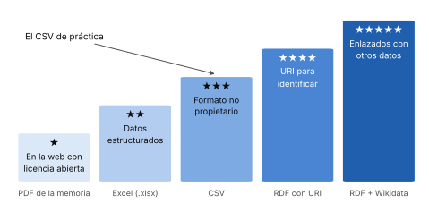
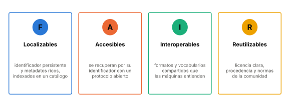

# Tema 0. Introducción a los datos abiertos y la reutilización de la información {#sec-tema0}

*Nivelación*

::: {.callout-note appearance="default"}
## Objetivos
- Comprender el contexto en el que surge el movimiento *open data*.
- Diferenciar los conceptos fundamentales relacionados con los datos abiertos.
- Conocer los principios básicos que favorecen la reutilización de la información.
:::

::: {.callout-note appearance="simple" icon="false"}
## Glosario del tema
[Datos abiertos](92-glosario.qmd#gl-datos-abiertos) · [Open Definition](92-glosario.qmd#gl-open-definition) · [Datos públicos](92-glosario.qmd#gl-datos-publicos) · [Gobierno abierto](92-glosario.qmd#gl-gobierno-abierto) · [Cinco estrellas](92-glosario.qmd#gl-cinco-estrellas) · [FAIR](92-glosario.qmd#gl-fair) · [Formato abierto](92-glosario.qmd#gl-formato-abierto) · [Legible por máquina](92-glosario.qmd#gl-legible-maquina) · [Licencia abierta](92-glosario.qmd#gl-licencia-abierta) · [Web Semántica](92-glosario.qmd#gl-web-semantica)
:::

::: {.callout-tip appearance="simple" icon="false"}
## Descargas
[Script R del capítulo](plantillas/tema0_datos_abiertos.R){.btn .btn-outline-primary .btn-sm download="tema0_datos_abiertos.R"}
[Plantilla de informe (.qmd)](plantillas/informe_practica.qmd){.btn .btn-outline-primary .btn-sm download="informe_practica.qmd"}
[Tema de estilo (.scss)](plantillas/informe.scss){.btn .btn-outline-primary .btn-sm download="informe.scss"}
[CSV de práctica](datos/prestamos_bibliotecas_practica.csv){.btn .btn-outline-primary .btn-sm download="prestamos_bibliotecas_practica.csv"}

El script reúne todo el código del capítulo para trabajar en RStudio o Positron. La plantilla `.qmd` y su tema `.scss` sirven para redactar las prácticas opcionales: guárdalos en la misma carpeta.
:::


## Lectura obligatoria

::: {.lectura}
Janssen, M.; Charalabidis, Y.; Zuiderwijk, A. (2012). [Benefits, adoption barriers and myths of open data and open government](https://doi.org/10.1080/10580530.2012.716740). *Information Systems Management*, 29(4), 258-268. Acceso por suscripción a través de la Biblioteca UC3M.

Complementaria: Wilkinson, M. D. et al. (2016). [The FAIR Guiding Principles for scientific data management and stewardship](https://doi.org/10.1038/sdata.2016.18). *Scientific Data*, 3, 160018 (acceso abierto).
:::

### Lecturas complementarias {.unnumbered}

- Attard, J.; Orlandi, F.; Scerri, S.; Auer, S. (2015). [A systematic review of open government data initiatives](https://doi.org/10.1016/j.giq.2015.07.006). *Government Information Quarterly*, 32(4), 399-418. Revisión de iniciativas de datos abiertos de gobierno y de su ciclo de vida.
- Zuiderwijk, A.; Janssen, M. (2014). [Open data policies, their implementation and impact: A framework for comparison](https://doi.org/10.1016/j.giq.2013.04.003). *Government Information Quarterly*, 31(1), 17-29. Marco para comparar políticas de datos abiertos.

## 1. Sociedad de la información y sociedad del conocimiento

La expresión **sociedad de la información** se generaliza en las décadas de 1970 a 1990 para describir sociedades en las que producir, tratar y transmitir información se convierte en la actividad económica y social central, apoyada en las tecnologías digitales. El énfasis está en la **infraestructura**: redes, ordenadores, volumen de datos que circula.

La **sociedad del conocimiento**, término que la UNESCO popularizó en su informe *Hacia las sociedades del conocimiento* (2005), desplaza el foco hacia la capacidad de las personas y las instituciones para **convertir la información en conocimiento** y usarlo: educación, alfabetización informacional, diversidad cultural, acceso equitativo. Tener datos no basta; hace falta saber encontrarlos, evaluarlos y combinarlos.

Las bibliotecas están en el centro de ese paso: median entre la información disponible y las competencias para usarla. La reutilización de datos abiertos es una prolongación natural de esa misión.

## 2. Internet y la World Wide Web

Conviene no confundirlos:

| | Internet | World Wide Web |
|---|---|---|
| Qué es | La red de redes: infraestructura que conecta ordenadores | Un servicio que funciona sobre Internet: documentos enlazados |
| Origen | ARPANET (1969); protocolos TCP/IP (1983) | Tim Berners-Lee en el CERN (1989-1991) |
| Piezas básicas | TCP/IP, DNS, encaminamiento | URL/URI, HTTP, HTML |
| Otros servicios | Correo, transferencia de ficheros, mensajería… | — |

Las tres piezas de la Web son las mismas que, años después, sostendrán los datos enlazados: **identificadores** (URI), un **protocolo** para pedirlos (HTTP) y un **formato** para representarlos (HTML para documentos; RDF para datos).

## 3. Evolución de la Web: de la Web 1.0 a la Web Semántica

| Etapa | Rasgo principal | Ejemplo en bibliotecas |
|---|---|---|
| **Web 1.0** (años 90) | Páginas estáticas de lectura; pocos publican y muchos leen | Web institucional con horarios en HTML |
| **Web 2.0** (desde 2004 aprox.) | Participación, contenido generado por usuarios, servicios y API | OPAC social con reseñas; catálogo en redes sociales |
| **Web Semántica / Web de datos** | Datos con significado explícito y enlazados entre sí, procesables por máquinas | datos.bne.es; registros enlazados con Wikidata y VIAF |

La Web Semántica, propuesta por Berners-Lee, Hendler y Lassila en 2001, pretende que las máquinas no solo muestren documentos sino que **entiendan** los datos: que «Getafe» sea una entidad identificada, no una cadena de texto. Sus tecnologías (RDF, vocabularios, SPARQL) se ven en el Tema 4. Algunos autores hablan después de una «Web 3.0» o de una web descentralizada; el término no tiene un significado único y no lo usaremos.

## 4. Gobierno abierto y datos abiertos

El **gobierno abierto** (*open government*) es una forma de gobernar basada en tres pilares: **transparencia** (rendir cuentas y publicar información), **participación** (implicar a la ciudadanía en las decisiones) y **colaboración** (trabajar con ciudadanía, empresas y otras administraciones). Se impulsa a partir del memorando de la administración Obama de 2009 y de la **Alianza para el Gobierno Abierto** (*Open Government Partnership*, 2011), de la que España forma parte y en la que aprueba planes de acción periódicos.

Los **datos abiertos** son una herramienta del gobierno abierto, no su sinónimo. La [Open Definition 2.1](https://opendefinition.org/od/2.1/es/) de la Open Knowledge Foundation dice que el conocimiento es abierto si cualquiera puede acceder a él, usarlo, modificarlo y compartirlo libremente, sujeto como mucho a requisitos que preserven su procedencia y su apertura. En la práctica, un conjunto de datos es abierto cuando cumple a la vez:

- **Licencia abierta**: permite uso, redistribución y modificación para cualquier fin, también comercial.
- **Acceso**: se puede descargar entero por Internet, sin coste o a un coste razonable de reproducción.
- **Legible por máquina** y en **formato abierto**.

### Beneficios, barreras y mitos

Janssen et al. contrastan los beneficios que se atribuyen a los datos abiertos (políticos y sociales, económicos, operativos y técnicos) con las barreras reales de adopción y con cinco creencias extendidas que matizan. En síntesis, los mitos son que publicar datos produce beneficios de forma automática, que toda la información debe publicarse sin restricciones, que basta con poner los datos en la red, que cualquier ciudadano puede aprovecharlos y que los datos abiertos traen por sí solos un gobierno abierto.

## 5. El modelo de las cinco estrellas de Tim Berners-Lee

Berners-Lee propuso en 2010 una escala acumulativa para valorar cómo se publican los datos ([5 ★ Open Data](https://5stardata.info/es/)):

| Estrellas | Requisito (acumulativo) | Ejemplo |
|---|---|---|
| ★ | En la web, con licencia abierta, en cualquier formato | PDF escaneado de la memoria anual |
| ★★ | Datos estructurados | Hoja de Excel (.xlsx) |
| ★★★ | Formato no propietario | CSV |
| ★★★★ | URI para identificar las cosas | RDF con URI para cada biblioteca |
| ★★★★★ | Enlazados con otros datos | RDF enlazado a Wikidata o a datos.bne.es |

{#fig-cinco-estrellas fig-alt="Escalera de cinco barras de altura creciente, de azul claro a azul oscuro. Una estrella: en la web con licencia abierta, ejemplo PDF de la memoria. Dos: datos estructurados, Excel. Tres: formato no propietario, CSV, señalado como el CSV de práctica. Cuatro: URI para identificar, RDF con URI. Cinco: enlazados con otros datos, RDF más Wikidata."}

## 6. Principios FAIR

FAIR no es sinónimo de abierto: describe datos **localizables** (*Findable*), **accesibles** (*Accessible*), **interoperables** (*Interoperable*) y **reutilizables** (*Reusable*), aunque el acceso esté restringido. Los cuatro principios se desarrollan en 15 subprincipios (F1-F4, A1-A2, I1-I3, R1), recogidos por [GO FAIR](https://www.go-fair.org/fair-principles/). Uno de ellos (A2) pide que los metadatos sigan accesibles aunque los datos ya no lo estén. Nacieron en el ámbito de la investigación, pero hoy se aplican a cualquier dato.

| Principio | Qué exige, en síntesis |
|---|---|
| Localizable | Identificador persistente y metadatos ricos, registrados en un buscador o catálogo |
| Accesible | Recuperable por su identificador con un protocolo abierto, con autenticación si hace falta |
| Interoperable | Lenguaje formal y vocabularios compartidos; referencias a otros datos |
| Reutilizable | Licencia clara, procedencia documentada y normas de la comunidad |


### Laboratorio: autoevaluación FAIR {#lab-t0-fair}

::: {.laboratorio}
::: {.laboratorio-etiqueta}
Laboratorio · se ejecuta en tu navegador
:::

Piensa en un conjunto de datos que conozcas (de un portal, de tu trabajo o de un TFM) y responde. El perfil muestra qué principio está más flojo y qué hacer para mejorarlo. Es una orientación inspirada en los subprincipios de GO FAIR, no una certificación.

```{ojs}
//| echo: false
{
  const P = [
    ["F", "Tiene un identificador persistente (DOI, Handle, URI estable)", "Deposítalo en un repositorio que asigne DOI (Zenodo, e-cienciaDatos)."],
    ["F", "Está descrito con metadatos ricos (título, autoría, fechas, temas)", "Completa los metadatos con un esquema común (DCAT-AP, DataCite)."],
    ["F", "Aparece en un catálogo o buscador (portal de datos, repositorio)", "Publícalo o enlázalo desde un catálogo como datos.gob.es."],
    ["A", "Se descarga por su identificador con un protocolo abierto (HTTP/HTTPS)", "Ofrece una URL de descarga directa o una API documentada."],
    ["A", "Los metadatos siguen disponibles aunque los datos se retiren", "Usa un repositorio con política de preservación de metadatos."],
    ["I", "Está en un formato abierto y legible por máquina (CSV, JSON, RDF)", "Evita PDF o formatos propietarios; ofrece CSV o JSON."],
    ["I", "Usa vocabularios o códigos compartidos (INE, ISO, tesauros)", "Codifica municipios, países o materias con listas oficiales."],
    ["R", "Tiene una licencia clara (CC BY, CC0, ODbL)", "Declara la licencia en los metadatos y en el propio fichero."],
    ["R", "Documenta su procedencia y su método de creación", "Añade un fichero LEEME o un diccionario de datos."],
    ["R", "Sigue las normas de su comunidad (formatos, unidades, calidad)", "Revisa las guías del sector (por ejemplo, la Norma Técnica de Interoperabilidad)."]];
  const raiz = html`<div class="fair-lab"></div>`;
  const opts = ["No", "En parte", "Sí"];
  const sels = P.map(([l, q], i) => { const d = html`<div class="row g-2 align-items-center mb-1"><div class="col-sm-8 small"><span class="badge text-bg-secondary me-1">${l}</span><label for="fair${i}">${q}</label></div><div class="col-sm-4"><select id="fair${i}" class="form-select form-select-sm">${opts.map((o, k) => `<option value="${k}">${o}</option>`).join("")}</select></div></div>`; raiz.append(d); return d.querySelector("select"); });
  const salida = html`<div role="status" aria-live="polite" class="mt-3"></div>`;
  const nombres = {F: "Localizable", A: "Accesible", I: "Interoperable", R: "Reutilizable"};
  function act() {
    const v = sels.map((s) => +s.value);
    const pct = Object.fromEntries("FAIR".split("").map((l) => { const idx = P.map((p, i) => p[0] === l ? i : -1).filter((i) => i >= 0); return [l, Math.round(100 * idx.reduce((a, i) => a + v[i], 0) / (2 * idx.length))]; }));
    const peor = Object.entries(pct).sort((a, b) => a[1] - b[1])[0];
    const consejos = P.map((p, i) => [p, v[i]]).filter(([p, x]) => p[0] === peor[0] && x < 2).map(([p]) => p[2]);
    const barras = Object.entries(pct).map(([l, x], i) => `<g transform="translate(0 ${i * 32})"><text x="0" y="18" font-size="13" fill="currentColor">${l} · ${nombres[l]}</text><rect x="140" y="4" width="300" height="20" rx="4" fill="var(--bs-secondary-bg)"/><rect x="140" y="4" width="${x * 3}" height="20" rx="4" fill="${x < 50 ? "#b3261e" : "#1c6b3a"}"/><text x="${146 + x * 3}" y="19" font-size="12" fill="currentColor">${x} %${x < 50 ? " ⚠" : ""}</text></g>`).join("");
    salida.innerHTML = `<svg viewBox="0 0 500 128" width="100%" style="max-width:540px" role="img" aria-label="Perfil FAIR: ${Object.entries(pct).map(([l, x]) => nombres[l] + " " + x + " %").join(", ")}">${barras}</svg>${peor[1] < 100 ? `<p>Lo más flojo es <strong>${nombres[peor[0]]}</strong>. Para mejorarlo:</p><ul>${consejos.map((c) => `<li>${c}</li>`).join("")}</ul>` : "<p>✓ Cumple bien los cuatro principios.</p>"}`;
  }
  raiz.addEventListener("input", act); raiz.append(salida); act();
  return raiz;
}
```
:::

## 7. Datos abiertos y datos públicos

**Público** no significa **abierto**. Un dato es *público* cuando lo produce o custodia una administración (o es accesible al público); es *abierto* cuando, además, cumple la Open Definition. Las dos categorías se cruzan:

| | Abierto | No abierto |
|---|---|---|
| **Público** | Préstamos por biblioteca en CSV con CC BY 4.0 | Memoria en PDF sin licencia; datos personales de los usuarios |
| **No público (privado)** | OpenStreetMap; datos que una empresa publica con ODbL | Registros internos de una editorial |

Hay además información pública que **no debe** abrirse: datos personales, información clasificada, documentos sujetos a derechos de propiedad intelectual de terceros. La reutilización de información del sector público (Tema 1) se ocupa precisamente de qué información pública puede abrirse y en qué condiciones.

## 8. Formatos abiertos y formatos propietarios

Un **formato abierto** tiene una especificación pública y documentada que cualquiera puede implementar sin pagar ni pedir permiso; un **formato propietario** depende de un fabricante, que controla su especificación. Para reutilizar, interesa además que el formato sea **legible por máquina**, es decir, que un programa pueda extraer los datos sin intervención humana.

| Formato | ¿Abierto? | ¿Legible por máquina? | Comentario |
|---|---|---|---|
| CSV | Sí | Sí | Tabla en texto plano (RFC 4180) |
| JSON | Sí | Sí | Estándar ECMA-404 / RFC 8259 |
| XML | Sí | Sí | Recomendación del W3C |
| RDF (Turtle, JSON-LD…) | Sí | Sí | Recomendaciones del W3C |
| ODS | Sí | Sí | OpenDocument (ISO/IEC 26300) |
| XLSX | Sí (ISO/IEC 29500) | Sí | Estandarizado, pero ligado en la práctica a un fabricante |
| XLS (antiguo) | No | Sí | Binario propietario |
| PDF | Sí (ISO 32000) | Poco | Pensado para leer, no para extraer datos |
| DOCX, imagen escaneada | — | No | No sirven para publicar datos |

El modelo de cinco estrellas trata Excel como «estructurado pero propietario» (dos estrellas). XLSX es hoy una norma ISO, pero sigue siendo preferible publicar CSV u ODS.

## 9. Licencias abiertas

Una licencia es abierta si permite usar, redistribuir y modificar para cualquier fin. Puede exigir **atribución** o **compartir igual**, pero no prohibir el uso comercial ni las obras derivadas.

| Licencia | ¿Conforme con la Open Definition? | Motivo |
|---|---|---|
| CC0 1.0 | Sí | Dedicación al dominio público |
| CC BY 4.0 | Sí | Solo exige atribución |
| CC BY-SA 4.0 | Sí | Atribución y compartir igual |
| ODbL 1.0 | Sí | Licencia de bases de datos con atribución y compartir igual |
| CC BY-NC 4.0 | **No** | Prohíbe el uso comercial |
| CC BY-ND 4.0 | **No** | Prohíbe obras derivadas |
| Sin licencia | **No** | Sin autorización expresa, la reutilización no está clara |

## Práctica en R: audita el CSV de práctica

### Paso 1. Cargar y describir el fichero

```{webr}
#| autorun: true
prestamos_df <- read.csv("datos/prestamos_bibliotecas_practica.csv")
dim(prestamos_df)        # filas y columnas
names(prestamos_df)      # nombres de las columnas
head(prestamos_df, 3)
```

### Paso 2. Comprobar la licencia

Supongamos que el portal municipal que publica el CSV declara la licencia **CC BY 4.0**. Guardamos en un vector las licencias conformes con la Open Definition y comprobamos:

```{webr}
#| autorun: true
licencias_abiertas <- c("CC0 1.0", "CC BY 4.0", "CC BY-SA 4.0", "ODbL 1.0", "ODC-BY 1.0", "PDDL 1.0")
licencia_csv <- "CC BY 4.0"
licencia_csv %in% licencias_abiertas
```

### Paso 3. Calcular las estrellas

La función `estrellas()` aplica la escala del apartado 5 de forma acumulativa: si falla un nivel, no se sigue contando.

```{webr}
#| autorun: true
estrellas <- function(licencia_abierta, estructurado, no_propietario, usa_uri, enlazado) {
  criterios <- c(licencia_abierta, estructurado, no_propietario, usa_uri, enlazado)
  if (!criterios[1]) return(0)
  # cuenta los TRUE consecutivos desde el principio
  sum(cumprod(criterios))
}

# Un Excel con licencia abierta:
estrellas(TRUE, TRUE, FALSE, FALSE, FALSE)
```

### Ejercicio 0.1 {.unnumbered}

Completa los argumentos para el CSV de práctica (licencia CC BY 4.0, formato CSV, sin URI ni enlaces).

```{webr}
#| exercise: t0_estrellas
#| setup: true
estrellas <- function(licencia_abierta, estructurado, no_propietario, usa_uri, enlazado) {
  criterios <- c(licencia_abierta, estructurado, no_propietario, usa_uri, enlazado)
  if (!criterios[1]) return(0)
  sum(cumprod(criterios))
}
```

```{webr}
#| exercise: t0_estrellas
estrellas(
  licencia_abierta = ______,
  estructurado     = ______,
  no_propietario   = ______,
  usa_uri          = ______,
  enlazado         = ______
)
```

::: {.hint exercise="t0_estrellas"}
Cada argumento es `TRUE` o `FALSE`. Un CSV es estructurado y no propietario, pero no identifica las bibliotecas con URI.
:::

::: {.solution exercise="t0_estrellas"}
```r
estrellas(TRUE, TRUE, TRUE, FALSE, FALSE)
```
El CSV tiene **tres estrellas**. Para llegar a cuatro habría que identificar cada biblioteca (y cada municipio) con una URI y publicarlo en RDF, algo que harás en el Tema 4.
:::

```{webr}
#| exercise: t0_estrellas
#| check: true
if (isTRUE(all.equal(as.numeric(.result), 3))) {
  list(correct = TRUE, message = "Correcto: tres estrellas. La cuarta exige URI para identificar las cosas.")
} else if (isTRUE(all.equal(as.numeric(.result), 5)) || isTRUE(all.equal(as.numeric(.result), 4))) {
  list(correct = FALSE, message = "Demasiadas estrellas: un CSV no usa URI ni enlaza con otros datos.")
} else {
  list(correct = FALSE, message = "Revisa los tres primeros criterios: ¿la licencia es abierta?, ¿un CSV es estructurado?, ¿es un formato propietario?")
}
```

### Paso 4. Auditar un catálogo

Un portal ficticio publica estos ocho conjuntos de datos de bibliotecas:

```{webr}
#| autorun: true
catalogo <- data.frame(
  conjunto = c("Préstamos mensuales", "Horarios", "Memoria anual", "Catálogo de fondos",
               "Visitas por sede", "Encuestas de satisfacción", "Agenda cultural", "Sedes"),
  formato  = c("CSV", "XLSX", "PDF", "RDF", "CSV", "XLSX", "JSON", "RDF"),
  licencia = c("CC BY 4.0", "CC BY-NC 4.0", "CC BY 4.0", "CC0 1.0",
               "Sin licencia", "CC BY-ND 4.0", "CC BY 4.0", "ODbL 1.0")
)
catalogo
```

### Ejercicio 0.2 {.unnumbered}

¿Cuántos conjuntos del catálogo tienen una licencia conforme con la Open Definition? Usa `licencias_abiertas` y `%in%`.

```{webr}
#| exercise: t0_catalogo
#| setup: true
licencias_abiertas <- c("CC0 1.0", "CC BY 4.0", "CC BY-SA 4.0", "ODbL 1.0", "ODC-BY 1.0", "PDDL 1.0")
catalogo <- data.frame(
  conjunto = c("Préstamos mensuales", "Horarios", "Memoria anual", "Catálogo de fondos",
               "Visitas por sede", "Encuestas de satisfacción", "Agenda cultural", "Sedes"),
  formato  = c("CSV", "XLSX", "PDF", "RDF", "CSV", "XLSX", "JSON", "RDF"),
  licencia = c("CC BY 4.0", "CC BY-NC 4.0", "CC BY 4.0", "CC0 1.0",
               "Sin licencia", "CC BY-ND 4.0", "CC BY 4.0", "ODbL 1.0")
)
```

```{webr}
#| exercise: t0_catalogo
sum(catalogo$licencia ______ licencias_abiertas)
```

::: {.hint exercise="t0_catalogo"}
`%in%` devuelve `TRUE`/`FALSE` para cada fila; `sum()` cuenta los `TRUE`.
:::

::: {.solution exercise="t0_catalogo"}
```r
sum(catalogo$licencia %in% licencias_abiertas)
```
Cinco conjuntos. «Sin licencia» no es abierto: sin licencia expresa, la reutilización no está autorizada de forma clara.
:::

```{webr}
#| exercise: t0_catalogo
#| check: true
if (identical(as.integer(.result), 5L)) {
  list(correct = TRUE, message = "Correcto: cinco conjuntos. NC, ND y la ausencia de licencia no cumplen la Open Definition.")
} else {
  list(correct = FALSE, message = "El resultado debería ser un número entre 0 y 8. ¿Has usado %in%?")
}
```

### Ejercicio 0.3 {.unnumbered}

Ahora filtra el catálogo para quedarte con los conjuntos que tienen **licencia abierta y formato CSV, JSON o RDF** (tres estrellas o más). Devuelve solo la columna `conjunto`.

```{webr}
#| exercise: t0_filtro
#| setup: true
licencias_abiertas <- c("CC0 1.0", "CC BY 4.0", "CC BY-SA 4.0", "ODbL 1.0", "ODC-BY 1.0", "PDDL 1.0")
catalogo <- data.frame(
  conjunto = c("Préstamos mensuales", "Horarios", "Memoria anual", "Catálogo de fondos",
               "Visitas por sede", "Encuestas de satisfacción", "Agenda cultural", "Sedes"),
  formato  = c("CSV", "XLSX", "PDF", "RDF", "CSV", "XLSX", "JSON", "RDF"),
  licencia = c("CC BY 4.0", "CC BY-NC 4.0", "CC BY 4.0", "CC0 1.0",
               "Sin licencia", "CC BY-ND 4.0", "CC BY 4.0", "ODbL 1.0")
)
```

```{webr}
#| exercise: t0_filtro
seleccion <- subset(catalogo,
                    licencia %in% licencias_abiertas & formato %in% ______)
seleccion$conjunto
```

::: {.hint exercise="t0_filtro"}
El hueco es un vector con los tres formatos: `c("CSV", ...)`.
:::

::: {.solution exercise="t0_filtro"}
```r
seleccion <- subset(catalogo,
                    licencia %in% licencias_abiertas & formato %in% c("CSV", "JSON", "RDF"))
seleccion$conjunto
```
:::

```{webr}
#| exercise: t0_filtro
#| check: true
esperado <- c("Préstamos mensuales", "Catálogo de fondos", "Agenda cultural", "Sedes")
if (setequal(.result, esperado)) {
  list(correct = TRUE, message = "Correcto: cuatro conjuntos con licencia abierta y formato no propietario.")
} else {
  list(correct = FALSE, message = "Deberían salir cuatro conjuntos. «Visitas por sede» es CSV pero no tiene licencia.")
}
```

### Paso 5. Formatos abiertos y propietarios

Una tabla de referencia con los formatos del apartado 8:

```{webr}
#| autorun: true
formatos <- data.frame(
  formato = c("CSV", "JSON", "XML", "RDF", "ODS", "XLSX", "XLS", "PDF", "DOCX"),
  abierto = c(TRUE, TRUE, TRUE, TRUE, TRUE, TRUE, FALSE, TRUE, NA),
  legible_maquina = c(TRUE, TRUE, TRUE, TRUE, TRUE, TRUE, TRUE, FALSE, FALSE)
)
formatos
```

### Ejercicio 0.4 {.unnumbered}

Con la tabla `formatos`, obtén los nombres de los formatos que son **a la vez abiertos y legibles por máquina**.

```{webr}
#| exercise: t0_formatos
#| setup: true
formatos <- data.frame(
  formato = c("CSV", "JSON", "XML", "RDF", "ODS", "XLSX", "XLS", "PDF", "DOCX"),
  abierto = c(TRUE, TRUE, TRUE, TRUE, TRUE, TRUE, FALSE, TRUE, NA),
  legible_maquina = c(TRUE, TRUE, TRUE, TRUE, TRUE, TRUE, TRUE, FALSE, FALSE)
)
```

```{webr}
#| exercise: t0_formatos
subset(formatos, abierto ______ legible_maquina)$formato
```

::: {.hint exercise="t0_formatos"}
Se tienen que cumplir las dos condiciones: el operador «y» es `&`.
:::

::: {.solution exercise="t0_formatos"}
```r
subset(formatos, abierto & legible_maquina)$formato
```
:::

```{webr}
#| exercise: t0_formatos
#| check: true
esp <- c("CSV", "JSON", "XML", "RDF", "ODS", "XLSX")
if (setequal(.result, esp)) {
  list(correct = TRUE, message = "Correcto: seis formatos. De ellos, el modelo de cinco estrellas prefiere CSV, JSON, XML, RDF y ODS frente a XLSX.")
} else {
  list(correct = FALSE, message = "Combina las dos columnas con &. subset() descarta las filas con NA.")
}
```

### Paso 6. ¿Público, abierto o ambas cosas?

### Ejercicio 0.5 {.unnumbered}

Clasifica cada caso en una de las cuatro casillas del apartado 7. Escribe para cada uno `"publico_abierto"`, `"publico_no_abierto"`, `"privado_abierto"` o `"privado_no_abierto"`.

```{webr}
#| exercise: t0_publico
casos <- c(
  "Horarios de la red municipal de bibliotecas en CSV con CC BY 4.0",
  "Listado de socios con nombre y domicilio que custodia la biblioteca",
  "Mapa colaborativo OpenStreetMap (ODbL)",
  "Estadísticas internas de ventas de una distribuidora de libros"
)
respuesta <- c(______, ______, ______, ______)
respuesta
```

::: {.hint exercise="t0_publico"}
Los datos personales que custodia una administración son información pública en sentido amplio, pero no pueden abrirse. OpenStreetMap lo mantiene una comunidad y una fundación, no una administración.
:::

::: {.solution exercise="t0_publico"}
```r
respuesta <- c("publico_abierto", "publico_no_abierto", "privado_abierto", "privado_no_abierto")
```
:::

```{webr}
#| exercise: t0_publico
#| check: true
esp <- c("publico_abierto", "publico_no_abierto", "privado_abierto", "privado_no_abierto")
r <- as.character(.result)
if (identical(r, esp)) {
  list(correct = TRUE, message = "Correcto. Fíjate en el segundo caso: es información en poder de una administración, pero los datos personales quedan fuera de la reutilización.")
} else if (length(r) == 4) {
  list(correct = FALSE, message = paste0("Aciertas ", sum(r == esp), " de 4. Revisa quién produce cada dato y con qué licencia."))
} else {
  list(correct = FALSE, message = "Escribe cuatro valores entre comillas, separados por comas.")
}
```

{#fig-v14-fair fig-alt="Cuatro tarjetas. F, localizables: identificador persistente y metadatos ricos, indexados en un catálogo. A, accesibles: se recuperan por su identificador con un protocolo abierto. I, interoperables: formatos y vocabularios compartidos que las máquinas entienden. R, reutilizables: licencia clara, procedencia y normas de la comunidad."}

## Caso práctico resuelto

::: {.callout-note appearance="simple" icon="false"}
## Valorar un conjunto con las cinco estrellas de Berners-Lee
Un ayuntamiento publica el calendario de actividades culturales de sus bibliotecas. Revisión paso a paso:

1. **¿Licencia abierta?** La página dice «Reutilización permitida citando la fuente» y remite al aviso legal con CC BY 4.0: sí, ★.
2. **¿Estructurado?** Se publica en PDF: legible por personas, no por máquinas. Se queda en ★.
3. **Mejora propuesta:** publicarlo también en XLSX (★★) y en CSV o JSON (★★★, formato no propietario).
4. **Siguiente paso:** dar URI a cada biblioteca y actividad (★★★★) y enlazarlas con otros conjuntos, por ejemplo con el directorio de equipamientos municipales (★★★★★).

Cada estrella facilita la reutilización, pero ya con tres (CSV con licencia abierta) se pueden construir servicios útiles.
:::

## Ejercicios graduados

**Básico.** ¿Cuántas estrellas tiene una hoja de cálculo XLSX con licencia CC BY?

::: {.webex-solution boton="Ver solución"}
Dos: datos estructurados con licencia abierta, pero en un formato propietario. En CSV tendría tres.
:::

**Avanzado.** Elige un conjunto de datos de un portal autonómico y valóralo con las cinco estrellas, proponiendo mejoras concretas para subir dos niveles.

::: {.webex-solution boton="Ver solución"}
La valoración debe justificar cada estrella con evidencias (licencia, formato, uso de URI, enlaces) y las mejoras deben ser realistas para el organismo (por ejemplo, añadir CSV y un identificador estable).
:::


## Actividades

::: {.clasificar #ia-t0-estrellas titulo="¿Cuántas estrellas tiene este conjunto de datos?" categorias="★|★★|★★★|★★★★|★★★★★"}
- Un PDF escaneado con una tabla de préstamos y licencia abierta → ★ // Disponible en la web con licencia abierta, pero no estructurado.
- Una hoja de Excel (.xlsx) con licencia abierta → ★★ // Estructurado, pero en formato propietario.
- El mismo fichero en CSV → ★★★ // Formato abierto y no propietario.
- Un RDF en el que cada biblioteca tiene su propio URI → ★★★★
- Ese RDF, además, enlazado con Wikidata y con el callejero oficial → ★★★★★
:::

::: {.clasificar #ia-t0-fair titulo="¿Qué principio FAIR mejora?" categorias="Localizable|Accesible|Interoperable|Reutilizable"}
- Asignar un DOI al conjunto de datos → Localizable
- Publicarlo en datos.gob.es con metadatos completos → Localizable
- Ofrecer la descarga por HTTPS sin registro → Accesible
- Usar el vocabulario DCAT-AP y códigos INE de municipio → Interoperable
- Indicar la licencia CC BY 4.0 y quién generó los datos → Reutilizable
:::

::: {.clasificar #ia-t0-formatos titulo="¿Formato abierto o propietario?" categorias="Abierto|Propietario"}
- CSV → Abierto
- JSON → Abierto
- SAV (SPSS) → Propietario
- GeoJSON → Abierto
- DWG (AutoCAD) → Propietario
:::

::: {.ordenar #ia-t0-web titulo="La evolución de la Web"}
1. Web 1.0: páginas estáticas para leer
2. Web 2.0: participación y contenidos de las personas usuarias
3. Web semántica: datos enlazados que entienden las máquinas
:::

## Reto evaluable {#reto-t0}

::: {.callout-important appearance="simple" icon="false"}
## Reto del Tema 0 · Auditoría de apertura
Elige en [datos.gob.es](https://datos.gob.es/es/catalogo) **tres conjuntos de datos de tres publicadores distintos**: uno en formato propietario (XLS o PDF), uno en CSV y uno que ofrezca RDF, una API o un SPARQL. Para cada uno:

1. Identifica la licencia y explica qué permite y qué exige.
2. Calcula sus estrellas con la función `estrellas()` y justifica cada criterio.
3. Propón un cambio concreto y viable que le haría subir una estrella.
4. Cierra con un párrafo comparando los tres: ¿qué publicador facilita más la reutilización y por qué?

**Entrega:** un informe hecho con la [plantilla de informe](plantillas/informe_practica.qmd), renderizado a HTML o PDF, con el código visible y el conjunto de datos citado. Se evalúa con la rúbrica que incluye la plantilla. Este reto **no tiene solución en el libro**: cada estudiante trabaja con datos distintos y la corrección la hace el profesorado.
:::

Espacio de trabajo (no se corrige automáticamente):

```{webr}
source("datos/datareuseR.R")
auditoria <- data.frame(
  conjunto         = c("", "", ""),
  url              = c("", "", ""),
  licencia_abierta = c(NA, NA, NA),
  estructurado     = c(NA, NA, NA),
  no_propietario   = c(NA, NA, NA),
  usa_uri          = c(NA, NA, NA),
  enlazado         = c(NA, NA, NA)
)
# Cuando completes la tabla con TRUE y FALSE, quita los # de las líneas siguientes:
# auditoria$estrellas <- mapply(estrellas, auditoria$licencia_abierta, auditoria$estructurado,
#                               auditoria$no_propietario, auditoria$usa_uri, auditoria$enlazado)
# auditoria[, c("conjunto", "estrellas")]
```

## Autoevaluación

Responde a todas las preguntas y pulsa **Mostrar respuestas**: verás en verde las acertadas, en rojo las falladas y tu recuento. Puedes corregir y volver a comprobar. No cuenta para la nota.

::: {.webex-check .webex-box}
1. Un conjunto de datos con licencia CC BY-NC 4.0 es abierto según la Open Definition. 
2. Los datos FAIR son siempre datos abiertos. 
3. Un CSV con licencia abierta, sin URI ni enlaces, tiene  estrellas.
4. Internet es la red de redes; la World Wide Web es 
5. ¿Cuál de estos formatos es abierto **y** legible por máquina?



6. Completa el código para contar las licencias abiertas de un catálogo: `sum(catalogo$licencia`  `licencias_abiertas)`
:::

::: {.webex-solution boton="Ver explicaciones"}
- NC prohíbe el uso comercial, así que no cumple la Open Definition.
- FAIR se refiere a cómo se describen y gestionan los datos; pueden ser FAIR con acceso restringido.
- Licencia abierta (★), estructurado (★★) y formato no propietario (★★★); la cuarta exige URI.
- La Web (URI, HTTP, HTML) es uno de los servicios de Internet, junto al correo o la transferencia de ficheros.
- JSON tiene especificación pública y se procesa automáticamente; el PDF escaneado y la imagen no son legibles por máquina, y XLS es propietario.
- `%in%` comprueba si cada licencia está en la lista de licencias abiertas.
:::

## Para practicar fuera del libro

::: {.callout-tip appearance="simple"}
En tu ordenador tienes las funciones de este tema en el paquete [`datareuseR`](90-chuleta-r.qmd#sec-datareuser): `leer_csv_abierto()` y `estrellas()`.
:::

Repite la auditoría con un conjunto de datos de bibliotecas de [datos.gob.es](https://datos.gob.es) o de un portal autonómico: anota su licencia y su formato, y aplica `estrellas()`.

## 10. Recursos y portales de referencia

**Portales de datos.** [datos.gob.es](https://datos.gob.es) (catálogo nacional, que federa portales autonómicos y locales), [data.europa.eu](https://data.europa.eu) (portal europeo), y portales autonómicos y municipales como [datos.madrid.es](https://datos.madrid.es) o [Aragón Open Data](https://opendata.aragon.es). En el ámbito bibliotecario, [datos.bne.es](https://datos.bne.es).

**Referencias y formación:**

| Recurso | Para qué sirve |
|---|---|
| [5 ★ Open Data](https://5stardata.info/es/) | Explicación y ejemplos de cada nivel |
| [GO FAIR – FAIR Principles](https://www.go-fair.org/fair-principles/) | Texto de los 15 subprincipios FAIR |
| [Open Definition 2.1](https://opendefinition.org/od/2.1/es/) | Definición de «abierto» |
| [Open Data Handbook](https://opendatahandbook.org/) | Guía introductoria, disponible en castellano |
| [Creative Commons](https://creativecommons.org/licenses/?lang=es) | Licencias abiertas y selector de licencias |
| [datos.gob.es](https://datos.gob.es) | Catálogo nacional y sección «Conocimiento» |
| [data.europa.eu academy](https://data.europa.eu/en/academy) | Cursos y seminarios web gratuitos |
