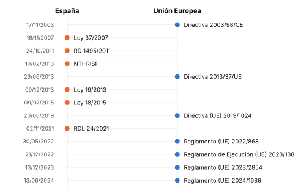

# Tema 1. Reutilización de la información del sector público (RISP) {#sec-tema1}

::: {.callout-note appearance="default"}
## Objetivos
- Comprender el marco jurídico que regula la reutilización de la información pública.
- Identificar los derechos y obligaciones asociados a la reutilización.
:::

::: {.callout-note appearance="simple" icon="false"}
## Glosario del tema
[Reutilización](92-glosario.qmd#gl-reutilizacion) · [RISP](92-glosario.qmd#gl-risp) · [Derecho de acceso](92-glosario.qmd#gl-derecho-acceso) · [Publicidad activa](92-glosario.qmd#gl-publicidad-activa) · [Silencio negativo](92-glosario.qmd#gl-silencio) · [Licencia tipo](92-glosario.qmd#gl-licencia-tipo) · [Alto valor](92-glosario.qmd#gl-alto-valor) · [Datos dinámicos](92-glosario.qmd#gl-datos-dinamicos) · [Transposición](92-glosario.qmd#gl-transposicion) · [Infomediario](92-glosario.qmd#gl-infomediario)
:::

::: {.callout-tip appearance="simple" icon="false"}
## Descargas
[Script R del capítulo](plantillas/tema1_risp.R){.btn .btn-outline-primary .btn-sm download="tema1_risp.R"}
[Plantilla de informe (.qmd)](plantillas/informe_practica.qmd){.btn .btn-outline-primary .btn-sm download="informe_practica.qmd"}
[Tema de estilo (.scss)](plantillas/informe.scss){.btn .btn-outline-primary .btn-sm download="informe.scss"}
[CSV de práctica](datos/prestamos_bibliotecas_practica.csv){.btn .btn-outline-primary .btn-sm download="prestamos_bibliotecas_practica.csv"}

El script reúne todo el código del capítulo para trabajar en RStudio o Positron. La plantilla `.qmd` y su tema `.scss` sirven para redactar las prácticas opcionales: guárdalos en la misma carpeta.
:::


## Lectura obligatoria

::: {.lectura}
Clabo, N.; Ramos-Vielba, I. (2015). [Reutilización de datos abiertos en la administración pública en España y uso de licencias-tipo](https://doi.org/10.3989/redc.2015.3.1206). *Revista Española de Documentación Científica*, 38(3), e097. [Versión en acceso abierto (Digital.CSIC)](https://digital.csic.es/handle/10261/132306).

El artículo es anterior a la Directiva (UE) 2019/1024. Léelo junto con la normativa vigente: lo que ha cambiado desde entonces (datos de alto valor, datos de investigación, tarifas, licencias) es justo lo que trabaja este capítulo.
:::

### Lecturas complementarias {.unnumbered}

- Janssen, K. (2011). [The influence of the PSI directive on open government data: An overview of recent developments](https://doi.org/10.1016/j.giq.2011.01.004). *Government Information Quarterly*, 28(4), 446-456. Cómo la primera directiva de reutilización se relaciona con el movimiento de datos abiertos.

## 1. Conceptos básicos de reutilización de la información

La Ley 37/2007 entiende por **reutilización** el uso, por personas físicas o jurídicas, de documentos en poder del sector público con fines comerciales o no comerciales **distintos del propósito inicial** de servicio público para el que se produjeron. El intercambio de documentos entre administraciones en el ejercicio de sus funciones no es reutilización.

| Concepto | Significado |
|---|---|
| **Documento** | Cualquier contenido, sea cual sea su soporte (papel, electrónico, sonoro, audiovisual), o una parte de él. Incluye los datos |
| **Reutilizador** | Persona o entidad que reutiliza; puede ser una empresa, una ONG, un periodista, un investigador o un ciudadano |
| **Agente infomediario** | Reutilizador que crea productos o servicios de valor añadido a partir de la información (Tema 5) |
| **Datos abiertos** | Documentos en formato abierto que pueden usarse, reutilizarse y compartirse libremente para cualquier fin |
| **Datos dinámicos** | Datos que se actualizan con frecuencia o en tiempo real (tráfico, sensores) |
| **Conjuntos de datos de alto valor** | Datos cuya reutilización tiene grandes beneficios para la sociedad y la economía; tienen un régimen reforzado |

Conviene distinguir dos derechos que a menudo se confunden:

- **Derecho de acceso** (Ley 19/2013): cualquier persona puede solicitar y conocer información pública.
- **Reutilización** (Ley 37/2007): usar esa información para otro fin. La regla general es que la información del sector público es reutilizable salvo excepciones.

El acceso es previo a la reutilización, pero no la garantiza: puedo tener derecho a ver un documento y no poder reutilizarlo, por ejemplo si contiene propiedad intelectual de terceros.

## 2. Evolución de las políticas de reutilización

| Etapa | Rasgos |
|---|---|
| **Información del sector público (PSI), 2003-2012** | La Directiva 2003/98/CE armoniza las condiciones de reutilización, pero no obliga a autorizarla. España la transpone con la Ley 37/2007 y la desarrolla para la Administración del Estado con el Real Decreto 1495/2011. Nace el Proyecto Aporta (2009) y el portal datos.gob.es (2011) |
| **Obligación de reutilizar, 2013-2018** | La Directiva 2013/37/UE convierte la reutilización en obligación y extiende la norma a bibliotecas (también universitarias), museos y archivos. España aprueba la Ley 19/2013 de transparencia, la NTI-RISP (2013) y la Ley 18/2015 |
| **Datos abiertos, 2019-2021** | La Directiva (UE) 2019/1024 pasa de «información del sector público» a «datos abiertos»: datos dinámicos y API, datos de investigación, datos de alto valor, empresas públicas. España la transpone con el Real Decreto-ley 24/2021 |
| **Economía del dato, desde 2020** | La Estrategia Europea de Datos (2020) amplía el foco a datos protegidos y privados: Reglamento de Gobernanza de Datos (2022), datos de alto valor (2023), Ley de Datos (2023), espacios comunes de datos y Ley de IA (2024) |

La tendencia es clara: de **permitir** reutilizar a **obligar** a publicar, de documentos a **datos** y API, y del sector público a todo el **ecosistema de datos**.

{#fig-cronologia fig-alt="Cronología vertical con dos columnas, España a la izquierda y Unión Europea a la derecha, ordenada por fecha de 2003 a 2024. UE: Directiva 2003/98/CE, Directiva 2013/37/UE, Directiva 2019/1024, Reglamentos 2022/868, de Ejecución 2023/138, 2023/2854 y 2024/1689. España: Ley 37/2007, RD 1495/2011, NTI-RISP, Ley 19/2013, Ley 18/2015 y RDL 24/2021."}

## 3. Marco normativo europeo

| Norma | Fecha | Qué aporta |
|---|---|---|
| Directiva 2003/98/CE | 17/11/2003 | Primera directiva de reutilización (PSI) |
| Directiva 2013/37/UE | 26/06/2013 | Obligación de autorizar la reutilización; bibliotecas, museos y archivos |
| Directiva (UE) 2019/1024 | 20/06/2019 | Datos abiertos: alto valor, API, datos de investigación (refunde las anteriores) |
| Reglamento (UE) 2022/868 | 30/05/2022 | Gobernanza de Datos: reutilización de datos protegidos, intermediarios de datos, altruismo de datos |
| Reglamento de Ejecución (UE) 2023/138 | 21/12/2022 | Lista de conjuntos de datos de alto valor (aplicable desde el 9/6/2024) |
| Reglamento (UE) 2023/2854 | 13/12/2023 | Ley de Datos: datos generados por productos conectados |
| Reglamento (UE) 2024/1689 | 13/06/2024 | Ley de Inteligencia Artificial |

: El Reglamento de Ejecución 2023/138 se adoptó en diciembre de 2022 y se publicó en el DOUE en enero de 2023. {tbl-colwidths="[32,14,54]"}

Las **directivas** obligan a los Estados a transponerlas a su derecho interno; los **reglamentos** se aplican directamente.

### Datos de alto valor

El Reglamento de Ejecución (UE) 2023/138 concreta seis categorías temáticas: **geoespaciales**, **observación de la Tierra y medio ambiente**, **meteorológicos**, **estadísticos**, **sociedades y propiedad de sociedades** y **movilidad**. Estos conjuntos deben ofrecerse gratis, en formato legible por máquina, mediante API y, cuando proceda, en descarga masiva, con una licencia CC BY 4.0, CC0 o equivalente.

## 4. Marco normativo español

| Norma | Fecha | Qué aporta |
|---|---|---|
| Ley 37/2007 | 16/11/2007 | Norma básica de reutilización (texto consolidado vigente) |
| Real Decreto 1495/2011 | 24/10/2011 | Desarrolla la Ley 37/2007 para el sector público estatal |
| NTI de reutilización de recursos de información (NTI-RISP) | 19/02/2013 | Pautas técnicas comunes: identificación, metadatos, formatos, condiciones de uso (BOE de 4/3/2013) |
| Ley 19/2013 | 09/12/2013 | Transparencia, acceso a la información pública y buen gobierno |
| Ley 18/2015 | 09/07/2015 | Modifica la Ley 37/2007 para transponer la Directiva 2013/37/UE |
| Real Decreto-ley 24/2021 | 02/11/2021 | Modifica la Ley 37/2007 para transponer la Directiva (UE) 2019/1024 |

Las comunidades autónomas y muchos ayuntamientos tienen además sus propias leyes y ordenanzas de transparencia y datos abiertos, y sus portales se federan en datos.gob.es.

## 5. Transparencia y acceso a la información pública

La Ley 19/2013 tiene tres partes: **publicidad activa** (información que las administraciones deben publicar sin que nadie la pida: organización, contratos, subvenciones, presupuestos…), **derecho de acceso** a la información pública y **buen gobierno**. Su órgano de garantía estatal es el [Consejo de Transparencia y Buen Gobierno](https://www.consejodetransparencia.es) (CTBG).

Plazos del derecho de acceso:

- **Resolver** (art. 20.1): un mes desde que la solicitud llega al órgano competente, ampliable **otro mes** si el volumen o la complejidad lo justifican.
- **Silencio** (art. 20.4): si no hay resolución expresa en plazo, la solicitud se entiende **desestimada**.
- **Reclamar** ante el CTBG (art. 24): un mes desde la notificación o desde que se producen los efectos del silencio. El Consejo tiene tres meses para resolver; su silencio también es desestimatorio.

## 6. Derechos y obligaciones de reutilizadores y administraciones

La Ley 37/2007 (texto consolidado) distribuye derechos y obligaciones así:

**Modalidades de reutilización.** Hay cuatro modalidades: documentos publicados sin condiciones; documentos publicados con licencias tipo; documentos reutilizados previa solicitud (art. 10); y acuerdos exclusivos (art. 6). Las condiciones que se impongan deben ser objetivas, proporcionadas, no discriminatorias y justificadas por un objetivo de interés público.

**Obligaciones de las administraciones:**

- **Formatos.** Los documentos se ofrecen en el formato existente, preferiblemente abierto y legible por máquina, con sus metadatos; no hay obligación de crear o adaptar documentos. Los datos dinámicos deben estar disponibles justo después de su recogida mediante API, y los conjuntos de datos de alto valor, en formato legible por máquina y mediante API.
- **Catálogos.** Deben ofrecer catálogos en línea y herramientas de búsqueda de los documentos reutilizables (art. 4.5).
- **No exclusividad.** Los derechos exclusivos están en general prohibidos; solo se admiten si son necesarios para un servicio de interés público, revisándolos al menos cada tres años. Para la digitalización de recursos culturales, la exclusividad tiene un límite general de 10 años.
- **Tarifas.** La reutilización es gratuita, aunque pueden cobrarse tarifas por el suministro limitadas a los costes marginales; ese límite no se aplica a bibliotecas, museos y archivos. Las tarifas deben publicarse en línea.
- **Resolver las solicitudes.** La resolución debe dictarse en veinte días desde la entrada en el registro del órgano competente; si la solicitud es voluminosa o compleja, el plazo puede ampliarse otros veinte días, comunicándolo con su motivación en un plazo de diez días. Si no se resuelve en plazo, el solicitante puede entender desestimada la solicitud.

**Obligaciones de los reutilizadores.** Las condiciones generales que pueden imponerse son no alterar el contenido ni los metadatos, no desnaturalizar su sentido, citar la fuente, indicar la fecha de última actualización, concretar los fines si hay datos personales y no revertir la anonimización.

**Régimen sancionador** (art. 11, aplicable a la Administración General del Estado):

| Tipo | Ejemplos | Multa |
|---|---|---|
| Muy grave | Desnaturalizar el sentido de la información; alteración muy grave | 50.001 - 100.000 € |
| Grave | Reutilizar sin licencia cuando es obligatoria o para otra finalidad; alteración grave; incumplimiento grave de la licencia | 10.001 - 50.000 € |
| Leve | No indicar la fecha de actualización; no citar la fuente; alteración o incumplimiento leve | 1.000 - 10.000 € |

Las infracciones muy graves y graves pueden conllevar además la prohibición de reutilizar documentos sometidos a licencia durante uno a cinco años y la revocación de la licencia.

**Datos de investigación.** Los organismos de investigación financiados con fondos públicos deben adoptar medidas para que los datos de investigación sean reutilizables, interoperables y abiertos, con los límites de la propiedad intelectual, la protección de datos y la confidencialidad; si ya se han publicado en un repositorio institucional o temático, pueden reutilizarse con fines comerciales o no comerciales, y su reutilización es gratuita.

### Lo que afecta a las bibliotecas

Las bibliotecas (también las universitarias), los museos y los archivos están incluidos en la ley, pero con un régimen propio: conservan sus derechos de propiedad intelectual, aunque deben ejercerlos facilitando la reutilización; pueden cobrar por encima del coste marginal, con un límite de costes más un margen razonable; y la información sujeta a derechos de terceros queda fuera.

## 7. Licencias de reutilización

Cuando se reutiliza con condiciones, estas se recogen en una **licencia**. La ley anima a usar licencias abiertas con las mínimas restricciones posibles, y toda licencia debe indicar, entre otras cosas, la finalidad, si se admite el uso comercial, la duración, las obligaciones, la responsabilidad y las tarifas (art. 9).

En la práctica se usan **licencias tipo**: textos estándar, iguales para todos los reutilizadores, publicados en el aviso legal del portal. Clabo y Ramos-Vielba analizan cómo las administraciones españolas fueron pasando de condiciones propias a licencias Creative Commons. Hoy lo más frecuente es **CC BY 4.0**, que exige citar la fuente, y es una de las licencias admitidas para los datos de alto valor junto con CC0.

| Opción | Cuándo usarla |
|---|---|
| Sin condiciones / CC0 | Datos sin riesgo de desnaturalización; máxima reutilización |
| CC BY 4.0 (licencia tipo) | Opción por defecto: solo exige atribución |
| Licencia específica previa solicitud | Casos excepcionales: datos sensibles, condiciones particulares |

## Práctica en R

### Paso 1. La normativa como datos

```{webr}
#| autorun: true
normas <- data.frame(
  norma = c("Directiva 2003/98/CE", "Ley 37/2007", "Directiva 2013/37/UE", "Ley 19/2013",
            "Ley 18/2015", "Directiva (UE) 2019/1024", "RDL 24/2021",
            "RD 1495/2011", "NTI-RISP (Resolución 19/02/2013)",
            "Reglamento (UE) 2022/868", "Reglamento de Ejecución (UE) 2023/138",
            "Reglamento (UE) 2023/2854", "Reglamento (UE) 2024/1689"),
  fecha = as.Date(c("2003-11-17", "2007-11-16", "2013-06-26", "2013-12-09",
                    "2015-07-09", "2019-06-20", "2021-11-02",
                    "2011-10-24", "2013-02-19",
                    "2022-05-30", "2022-12-21", "2023-12-13", "2024-06-13")),
  ambito = c("UE", "ES", "UE", "ES", "ES", "UE", "ES", "ES", "ES", "UE", "UE", "UE", "UE")
)
normas
```

`as.Date()` convierte un texto con formato `AAAA-MM-DD` en una fecha con la que se puede calcular.

### Paso 2. Ordenar y medir intervalos (apartado 2)

```{webr}
#| autorun: true
normas <- normas[order(normas$fecha), ]
normas[, c("fecha", "ambito", "norma")]
# Años transcurridos entre la Directiva 2003/98/CE y su transposición
as.numeric(normas$fecha[2] - normas$fecha[1]) / 365.25
```

### Ejercicio 1.1 {.unnumbered}

¿Cuántas de las normas de la tabla son de ámbito europeo (`"UE"`)?

```{webr}
#| exercise: t1_ue
#| setup: true
normas <- data.frame(
  norma = c("Directiva 2003/98/CE", "Ley 37/2007", "Directiva 2013/37/UE", "Ley 19/2013",
            "Ley 18/2015", "Directiva (UE) 2019/1024", "RDL 24/2021",
            "RD 1495/2011", "NTI-RISP (Resolución 19/02/2013)",
            "Reglamento (UE) 2022/868", "Reglamento de Ejecución (UE) 2023/138",
            "Reglamento (UE) 2023/2854", "Reglamento (UE) 2024/1689"),
  fecha = as.Date(c("2003-11-17", "2007-11-16", "2013-06-26", "2013-12-09",
                    "2015-07-09", "2019-06-20", "2021-11-02",
                    "2011-10-24", "2013-02-19",
                    "2022-05-30", "2022-12-21", "2023-12-13", "2024-06-13")),
  ambito = c("UE", "ES", "UE", "ES", "ES", "UE", "ES", "ES", "ES", "UE", "UE", "UE", "UE")
)
```

```{webr}
#| exercise: t1_ue
sum(normas$ambito == ______)
```

::: {.solution exercise="t1_ue"}
```r
sum(normas$ambito == "UE")
```
:::

```{webr}
#| exercise: t1_ue
#| check: true
if (identical(as.integer(.result), 7L)) {
  list(correct = TRUE, message = "Correcto: siete normas europeas y seis españolas.")
} else {
  list(correct = FALSE, message = "Recuerda escribir el texto entre comillas: \"UE\".")
}
```

### Ejercicio 1.2 {.unnumbered}

Calcula cuántos **días** pasaron entre la Directiva (UE) 2019/1024 y el Real Decreto-ley 24/2021 que la transpuso. (El plazo de transposición terminaba el 17 de julio de 2021: compara.)

```{webr}
#| exercise: t1_transp
#| setup: true
directiva <- as.Date("2019-06-20")
```

```{webr}
#| exercise: t1_transp
rdl <- as.Date("______")
as.numeric(rdl - directiva)
```

::: {.hint exercise="t1_transp"}
La fecha del RDL 24/2021 está en la tabla de normas, en formato `AAAA-MM-DD`.
:::

::: {.solution exercise="t1_transp"}
```r
rdl <- as.Date("2021-11-02")
as.numeric(rdl - directiva)
```
Fueron 866 días: España transpuso la directiva unos tres meses y medio después de que venciera el plazo.
:::

```{webr}
#| exercise: t1_transp
#| check: true
if (isTRUE(all.equal(as.numeric(.result), 866))) {
  list(correct = TRUE, message = "Correcto: 866 días, con retraso respecto al plazo del 17/07/2021.")
} else {
  list(correct = FALSE, message = "Comprueba la fecha del RDL 24/2021: 2 de noviembre de 2021.")
}
```

### Paso 3. Plazos del derecho de acceso (apartado 5)

Los plazos de la Ley 19/2013 se expresan en meses, que se cuentan de fecha a fecha. En R, `seq()` con `by = "1 month"` avanza un mes natural:

```{webr}
#| autorun: true
recepcion <- as.Date("2026-02-16")
fin_plazo <- seq(recepcion, by = "1 month", length.out = 2)[2]
fin_plazo
weekdays(fin_plazo)   # día de la semana (en inglés en webR)
```

::: {.callout-note}
Es una simplificación: si el último día es inhábil, el plazo pasa al primer día hábil siguiente (art. 30.5 de la Ley 39/2015). El calendario de días inhábiles no se modela aquí.
:::

### Ejercicio 1.3 {.unnumbered}

Una biblioteca pública recibe el **10 de marzo de 2026** una solicitud de acceso al número de préstamos por sede. Por su complejidad, el órgano **amplía el plazo**. ¿Cuál es la fecha límite para resolver?

```{webr}
#| exercise: t1_plazo
recepcion <- as.Date("2026-03-10")
meses <- ______
seq(recepcion, by = "1 month", length.out = meses + 1)[meses + 1]
```

::: {.hint exercise="t1_plazo"}
Un mes de plazo ordinario más un mes de ampliación.
:::

::: {.solution exercise="t1_plazo"}
```r
recepcion <- as.Date("2026-03-10")
meses <- 2
seq(recepcion, by = "1 month", length.out = meses + 1)[meses + 1]
```
El 10 de mayo de 2026. Como es domingo, en la práctica el plazo terminaría el lunes 11.
:::

```{webr}
#| exercise: t1_plazo
#| check: true
if (identical(.result, as.Date("2026-05-10"))) {
  list(correct = TRUE, message = "Correcto: 10/05/2026 (domingo, así que el plazo se iría al lunes 11).")
} else if (identical(.result, as.Date("2026-04-10"))) {
  list(correct = FALSE, message = "Esa es la fecha sin ampliación. Suma el mes adicional.")
} else {
  list(correct = FALSE, message = "Revisa cuántos meses suman el plazo ordinario y la ampliación.")
}
```

### Ejercicio 1.4 {.unnumbered}

De esta lista, selecciona **solo** las categorías de datos de alto valor del Reglamento de Ejecución (UE) 2023/138. Escribe sus posiciones en el vector.

```{webr}
#| exercise: t1_hvd
#| setup: true
candidatas <- c("Geoespaciales", "Préstamos bibliotecarios", "Observación de la Tierra y medio ambiente",
                "Meteorológicos", "Sanitarios", "Estadísticos", "Educativos",
                "Sociedades y propiedad de sociedades", "Movilidad", "Culturales")
```

```{webr}
#| exercise: t1_hvd
candidatas
mis_hvd <- candidatas[c(______)]
mis_hvd
```

::: {.hint exercise="t1_hvd"}
Son seis categorías. Escribe los números separados por comas, por ejemplo `c(1, 3, 4)`.
:::

::: {.solution exercise="t1_hvd"}
```r
mis_hvd <- candidatas[c(1, 3, 4, 6, 8, 9)]
```
:::

```{webr}
#| exercise: t1_hvd
#| check: true
esperado <- c("Geoespaciales", "Observación de la Tierra y medio ambiente", "Meteorológicos",
              "Estadísticos", "Sociedades y propiedad de sociedades", "Movilidad")
if (setequal(.result, esperado)) {
  list(correct = TRUE, message = "Correcto: las seis categorías temáticas del anexo del Reglamento.")
} else {
  sobran <- setdiff(.result, esperado); faltan <- setdiff(esperado, .result)
  list(correct = FALSE, message = paste0(
    if (length(sobran)) paste0("Sobran: ", paste(sobran, collapse = ", "), ". ") else "",
    if (length(faltan)) paste0("Faltan ", length(faltan), " categorías.") else ""))
}
```

### Paso 4. Plazos de una solicitud de reutilización (apartado 6)

Los plazos de la Ley 37/2007 se expresan en **días**, que según la Ley 39/2015 son **hábiles** salvo que se diga lo contrario: no cuentan los sábados, los domingos ni los festivos. Esta función suma días hábiles saltando los fines de semana (no conoce el calendario de festivos):

```{webr}
#| autorun: true
sumar_habiles <- function(inicio, n) {
  dia <- inicio
  while (n > 0) {
    dia <- dia + 1
    # weekdays() devuelve el día en inglés en webR
    if (!weekdays(dia) %in% c("Saturday", "Sunday")) n <- n - 1
  }
  dia
}
sumar_habiles(as.Date("2026-01-09"), 3)   # viernes + 3 días hábiles = miércoles
```

### Ejercicio 1.5 {.unnumbered}

Un investigador presenta el lunes **2 de marzo de 2026** una solicitud de reutilización de las estadísticas de préstamo de una biblioteca pública estatal. El plazo no se amplía. ¿Hasta qué fecha tiene la administración para resolver? (Supón que no hay festivos en esas semanas.)

```{webr}
#| exercise: t1_habiles
#| setup: true
sumar_habiles <- function(inicio, n) {
  dia <- inicio
  while (n > 0) {
    dia <- dia + 1
    if (!weekdays(dia) %in% c("Saturday", "Sunday")) n <- n - 1
  }
  dia
}
```

```{webr}
#| exercise: t1_habiles
sumar_habiles(as.Date("2026-03-02"), ______)
```

::: {.hint exercise="t1_habiles"}
El plazo ordinario de resolución del art. 10 de la Ley 37/2007 es de veinte días.
:::

::: {.solution exercise="t1_habiles"}
```r
sumar_habiles(as.Date("2026-03-02"), 20)
```
El 30 de marzo de 2026. Si se ampliara, serían otros veinte días hábiles, y entonces sí habría que descontar los festivos de Semana Santa.
:::

```{webr}
#| exercise: t1_habiles
#| check: true
if (identical(.result, as.Date("2026-03-30"))) {
  list(correct = TRUE, message = "Correcto: 30/03/2026. Compara: el derecho de acceso de la Ley 19/2013 se cuenta en meses, no en días.")
} else if (identical(.result, as.Date("2026-04-27"))) {
  list(correct = FALSE, message = "Has sumado también la ampliación. El enunciado dice que el plazo no se amplía.")
} else {
  list(correct = FALSE, message = "Usa el plazo ordinario de la Ley 37/2007: 20 días hábiles.")
}
```

### Ejercicio 1.6 {.unnumbered}

Un portal de noticias reutiliza el catálogo de una biblioteca estatal con licencia tipo, pero **no cita la fuente**. Según el art. 11 de la Ley 37/2007, ¿qué tipo de infracción es y cuál es la multa máxima? Completa con la tabla del apartado 6.

```{webr}
#| exercise: t1_sancion
infraccion <- c(tipo = "______", multa_maxima = "______")
infraccion
```

::: {.hint exercise="t1_sancion"}
El tipo se escribe en minúsculas (`"leve"`, `"grave"` o `"muy grave"`) y la multa como número, sin puntos ni símbolo de euro.
:::

::: {.solution exercise="t1_sancion"}
```r
infraccion <- c(tipo = "leve", multa_maxima = "10000")
```
:::

```{webr}
#| exercise: t1_sancion
#| check: true
r <- .result
tipo <- tolower(trimws(r[["tipo"]]))
multa <- suppressWarnings(as.numeric(gsub("[^0-9]", "", r[["multa_maxima"]])))
if (identical(tipo, "leve") && isTRUE(multa == 10000)) {
  list(correct = TRUE, message = "Correcto: infracción leve, multa de 1.000 a 10.000 €.")
} else if (!identical(tipo, "leve")) {
  list(correct = FALSE, message = "No citar la fuente figura entre las infracciones leves.")
} else {
  list(correct = FALSE, message = "Revisa la multa máxima de las infracciones leves.")
}
```

## Reto evaluable {#reto-t1}

::: {.callout-important appearance="simple" icon="false"}
## Reto del Tema 1 · Una solicitud de reutilización
Busca una información del sector público que te interese profesionalmente y que **no esté publicada** como datos abiertos (por ejemplo, las estadísticas de préstamo por sucursal de la red de bibliotecas de tu municipio). Prepara, sin enviarla, la solicitud de reutilización:

1. Redacta la solicitud con los elementos que exige el art. 10 de la Ley 37/2007: identificación, información pedida, finalidad y formato preferido.
2. Identifica el órgano competente y justifica que la información es reutilizable (y no está excluida por el art. 3).
3. Calcula con `sumar_habiles()` la fecha límite de resolución, **descontando los festivos nacionales, autonómicos y locales reales** de tu municipio, y la fecha si el plazo se ampliara.
4. Indica qué condiciones de reutilización esperarías (licencia, tarifas) y por qué.

**Entrega:** un informe hecho con la [plantilla de informe](plantillas/informe_practica.qmd), renderizado a HTML o PDF, con el código visible y el conjunto de datos citado. Se evalúa con la rúbrica que incluye la plantilla. Este reto **no tiene solución en el libro**: cada estudiante trabaja con datos distintos y la corrección la hace el profesorado.
:::

Espacio de trabajo (no se corrige automáticamente):

```{webr}
source("datos/datareuseR.R")
presentacion <- as.Date("2026-02-02")   # cámbiala por la fecha en que presentarías la solicitud
festivos <- as.Date(c())                # añade los festivos del periodo, p. ej. "2026-04-02"
ordinario <- sumar_habiles(presentacion, 20, festivos)
ampliado  <- sumar_habiles(ordinario, 20, festivos)
c(ordinario = ordinario, ampliado = ampliado)
```

## Autoevaluación

Responde a todas las preguntas y pulsa **Mostrar respuestas**: verás en verde las acertadas, en rojo las falladas y tu recuento. Puedes corregir y volver a comprobar. No cuenta para la nota.

::: {.webex-check .webex-box}
1. Tener derecho de acceso a un documento garantiza poder reutilizarlo. 
2. Plazo ordinario para resolver una solicitud de reutilización según la Ley 37/2007 (en días): 
3. Si la administración no resuelve en plazo una solicitud de acceso (Ley 19/2013), la solicitud se entiende 
4. La Directiva (UE) 2019/1024 se transpuso en España mediante el 
5. ¿Cuál de estas **no** es una categoría de datos de alto valor del Reglamento de Ejecución (UE) 2023/138?



6. No citar la fuente al reutilizar con licencia tipo es una infracción 
7. Completa el código para sumar un mes a una fecha: `seq(recepcion, by = "1`  `", length.out = 2)[2]`
:::

::: {.webex-solution boton="Ver explicaciones"}
- El acceso permite conocer el documento; la reutilización puede estar limitada, por ejemplo, por derechos de terceros.
- Art. 10 de la Ley 37/2007: veinte días, ampliables otros veinte.
- Art. 20.4 de la Ley 19/2013: silencio negativo.
- El RDL 24/2021 modificó la Ley 37/2007; la Ley 18/2015 transpuso la Directiva 2013/37/UE.
- Las seis categorías son geoespaciales, observación de la Tierra y medio ambiente, meteorológicos, estadísticos, sociedades y movilidad.
- Art. 11.3 de la Ley 37/2007: multa de 1.000 a 10.000 €.
- `by = "1 month"` avanza un mes natural.
:::

## Para practicar fuera del libro

::: {.callout-tip appearance="simple"}
En tu ordenador tienes las funciones de este tema en el paquete [`datareuseR`](90-chuleta-r.qmd#sec-datareuser): `sumar_habiles()`, que además descuenta festivos.
:::

Redacta una solicitud de acceso a un dato bibliotecario que no esté publicado y busca en el [Consejo de Transparencia y Buen Gobierno](https://www.consejodetransparencia.es) una resolución sobre un caso parecido. Calcula con el código de este capítulo hasta cuándo tendrías para reclamar si la solicitud se desestima por silencio.

## Recursos complementarios

| Recurso | Para qué sirve |
|---|---|
| [Ley 37/2007 (texto consolidado, BOE)](https://www.boe.es/buscar/act.php?id=BOE-A-2007-19814) | Norma básica española de reutilización |
| [Directiva (UE) 2019/1024](https://eur-lex.europa.eu/eli/dir/2019/1024/oj?locale=es) | Directiva europea de datos abiertos |
| [Reglamento de Ejecución (UE) 2023/138](https://eur-lex.europa.eu/eli/reg_impl/2023/138/oj?locale=es) | Conjuntos de datos de alto valor |
| [Ley 19/2013 (BOE)](https://www.boe.es/buscar/act.php?id=BOE-A-2013-12887) | Publicidad activa y derecho de acceso |
| [Consejo de Transparencia y Buen Gobierno](https://www.consejodetransparencia.es) | Resoluciones y criterios interpretativos |
| [Portal de la Transparencia](https://transparencia.gob.es) | Derecho de acceso ante la AGE |
| [datos.gob.es: convalidación del RDL 24/2021](https://datos.gob.es/es/blog/convalidacion-del-real-decreto-ley-sobre-reutilizacion-de-la-informacion-del-sector-publico-y) | Novedades de la transposición |
| [Reglamento (UE) 2022/868](https://eur-lex.europa.eu/eli/reg/2022/868/oj?locale=es) y [Reglamento (UE) 2023/2854](https://eur-lex.europa.eu/eli/reg/2023/2854/oj?locale=es) | Gobernanza de Datos y Ley de Datos |
