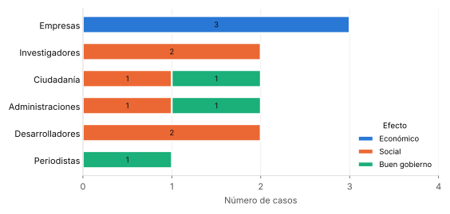

# Tema 2. Proyectos relevantes de reutilización de datos abiertos {#sec-tema2}

::: {.callout-note appearance="default"}
## Objetivos
- Analizar iniciativas nacionales e internacionales de reutilización de datos.
- Valorar el impacto de los datos abiertos en diferentes ámbitos.
:::

::: {.callout-note appearance="simple" icon="false"}
## Glosario del tema
[Portal de datos](92-glosario.qmd#gl-portal) · [Federación](92-glosario.qmd#gl-federacion) · [Open Data Maturity](92-glosario.qmd#gl-odm) · [Caso de uso](92-glosario.qmd#gl-caso-uso) · [B2G](92-glosario.qmd#gl-b2g) · [Altruismo de datos](92-glosario.qmd#gl-altruismo) · [Ciencia abierta](92-glosario.qmd#gl-ciencia-abierta) · [Repositorio](92-glosario.qmd#gl-repositorio) · [Data paper](92-glosario.qmd#gl-data-paper) · [API](92-glosario.qmd#gl-api) · [Tipo MIME](92-glosario.qmd#gl-mime)
:::

::: {.callout-tip appearance="simple" icon="false"}
## Descargas
[Script R del capítulo](plantillas/tema2_proyectos.R){.btn .btn-outline-primary .btn-sm download="tema2_proyectos.R"}
[Plantilla de informe (.qmd)](plantillas/informe_practica.qmd){.btn .btn-outline-primary .btn-sm download="informe_practica.qmd"}
[Tema de estilo (.scss)](plantillas/informe.scss){.btn .btn-outline-primary .btn-sm download="informe.scss"}
[CSV de práctica](datos/prestamos_bibliotecas_practica.csv){.btn .btn-outline-primary .btn-sm download="prestamos_bibliotecas_practica.csv"}

El script reúne todo el código del capítulo para trabajar en RStudio o Positron. La plantilla `.qmd` y su tema `.scss` sirven para redactar las prácticas opcionales: guárdalos en la misma carpeta.
:::


## Lectura obligatoria

::: {.lectura}
Safarov, I.; Meijer, A.; Grimmelikhuijsen, S. (2017). [Utilization of open government data: A systematic literature review of types, conditions, effects and users](https://doi.org/10.3233/IP-160012). *Information Polity*, 22(1), 1-24. [Versión en acceso abierto](https://dspace.library.uu.nl/handle/1874/380235).
:::

### Lecturas complementarias {.unnumbered}

- @ruijer2017 — Marco teórico sobre el uso democrático de los datos abiertos.
- @zuiderwijk2015 — Factores que explican la adopción de tecnologías de datos abiertos.

## Un marco para analizar los proyectos

Safarov et al. revisan de forma sistemática 101 estudios sobre el uso de datos abiertos de gobierno y los ordenan en cuatro dimensiones. Sirven como guion para analizar cualquier proyecto de este tema sin quedarse en la descripción:

| Dimensión | Pregunta que responde | Ejemplos |
|---|---|---|
| **Tipo de utilización** | ¿Qué se hace con los datos? | Crear un servicio o aplicación, analizar, visualizar, investigar, fiscalizar |
| **Condiciones** | ¿Qué facilita o frena el uso? | Calidad y actualidad, licencia, formatos, competencias de los usuarios, apoyo institucional |
| **Efectos** | ¿Qué cambia gracias a la reutilización? | Valor económico, valor social, transparencia y buen gobierno |
| **Usuarios** | ¿Quién reutiliza? | Ciudadanía, empresas, periodistas, investigadores, administraciones, desarrolladores |

## 1. Open Data en España

- **Iniciativa Aporta** (desde 2009): programa estatal para impulsar la apertura y la reutilización, hoy gestionado desde el Ministerio con competencias en transformación digital. Es el origen del portal nacional.
- **[datos.gob.es](https://datos.gob.es)** (desde 2011): catálogo nacional que **federa** los catálogos de la Administración General del Estado, las comunidades autónomas, las entidades locales y las universidades. Publica además guías, informes, un directorio de [aplicaciones](https://datos.gob.es/es/aplicaciones) y de [empresas](https://datos.gob.es/es/empresas) reutilizadoras y [métricas de impacto](https://datos.gob.es/es/metricas-e-impacto).
- **Portales autonómicos y locales**: [Aragón Open Data](https://opendata.aragon.es), [Open Data Euskadi](https://opendata.euskadi.eus), [datos.madrid.es](https://datos.madrid.es), entre muchos otros, con conjuntos sobre bibliotecas.
- **Desafíos Aporta** (ediciones de 2017 a 2021): concurso nacional de ideas y prototipos basados en datos abiertos. No se ha vuelto a convocar desde 2021.
- **Posición internacional**: en el informe anual Open Data Maturity, España figura de forma sostenida en el grupo de cabeza; datos.gob.es resumió la edición de 2025 como una confirmación de su papel de referencia europea.

## 2. Open Data en la Unión Europea

- **[data.europa.eu](https://data.europa.eu)** (desde 2021): portal europeo que reúne los datos de las instituciones de la UE y recolecta los catálogos nacionales. Incluye formación ([data.europa.eu academy](https://data.europa.eu/en/academy)) y un [observatorio de casos de uso](https://data.europa.eu/en/stories-use-case-observatory).
- **[Open Data Maturity](https://data.europa.eu/en/open-data-maturity/2025)** (desde 2015): informe anual que compara la madurez de 36 países europeos en cuatro dimensiones: **políticas**, **impacto**, **portal** y **calidad**.
- **Estrategia Europea de Datos (2020)** y **espacios comunes europeos de datos**: sanidad, movilidad, energía, patrimonio cultural, investigación (EOSC)… En el ámbito cultural, [Europeana](https://www.europeana.eu) es el antecedente y la base del espacio de datos del patrimonio.

## 3. Portales internacionales de datos abiertos

| Portal o iniciativa | Ámbito | Interés |
|---|---|---|
| [data.gov](https://data.gov) (2009) | Estados Unidos | Primer gran portal nacional |
| [data.gov.uk](https://www.data.gov.uk) (2010) | Reino Unido | Pionero en licencias y en el Open Data Institute |
| [Open Data Charter](https://opendatacharter.org) (2015) | Internacional | Seis principios para gobiernos (abiertos por defecto, oportunos, accesibles, comparables, para mejorar la gobernanza, para el desarrollo inclusivo) |
| [Global Data Barometer](https://globaldatabarometer.org) | Internacional | Indicadores de gobernanza, disponibilidad y uso de datos |
| Banco Mundial, OCDE, Naciones Unidas | Internacional | Portales estadísticos de referencia para comparar países |

## 4. Casos de éxito

Un «caso de éxito» debe poder explicarse con las cuatro dimensiones de Safarov et al.: quién usa qué datos, en qué condiciones y con qué efecto. Las fuentes para encontrarlos son el directorio de aplicaciones de datos.gob.es, el observatorio de casos de uso de data.europa.eu y las historias de datos (*datastories*) del portal europeo. Recuerda los «mitos» del Tema 0: que un portal publique datos no garantiza que se usen, y un caso aislado no prueba un impacto general.

## 5. Iniciativas públicas y privadas

La reutilización no es solo cosa de administraciones:

| Tipo | Ejemplos de iniciativa |
|---|---|
| **Públicas** | Portales de datos, concursos y retos, laboratorios de datos municipales, programas de formación |
| **Privadas que publican datos** | Comunidades como OpenStreetMap; empresas que publican conjuntos con licencia abierta |
| **Colaboración público-privada** | Intercambio de datos de empresas con administraciones (*business-to-government*, B2G) para fines de interés general, por ejemplo movilidad o emergencias |
| **Altruismo de datos** | Ciudadanos y empresas que ceden datos para fines de interés general a través de organizaciones reconocidas (Reglamento de Gobernanza de Datos) |
| **Tercer sector y periodismo** | Fundaciones de transparencia, periodismo de datos, comunidades de desarrolladores |

## 6. Datos abiertos para la investigación y la innovación

En investigación, los datos abiertos forman parte de la **ciencia abierta**: publicar los datos que sustentan los resultados permite comprobarlos, reproducirlos y reutilizarlos para nuevas preguntas.

- **Principio**: «tan abiertos como sea posible, tan cerrados como sea necesario», y siempre FAIR (Tema 0).
- **Marco normativo**: la Directiva (UE) 2019/1024 y la Ley 37/2007 hacen reutilizables los datos de investigación financiados con fondos públicos que ya están en un repositorio (Tema 1). En España, la Ley 17/2022, que modifica la Ley de la Ciencia, refuerza la difusión en acceso abierto, y el Consejo de Ministros aprobó el 3 de mayo de 2023 la primera Estrategia Nacional de Ciencia Abierta (ENCA), para el periodo 2023-2027.
- **Infraestructuras**: repositorios generalistas como [Zenodo](https://zenodo.org), repositorios institucionales (en la UC3M, e-Archivo), el registro de repositorios [re3data](https://www.re3data.org), el grafo de [OpenAIRE](https://explore.openaire.eu) y la Nube Europea de la Ciencia Abierta (EOSC).
- **Publicación**: los *data papers* y los planes de gestión de datos son ya habituales en revistas y convocatorias.
- **Innovación**: los datos de investigación abiertos alimentan nuevas líneas de investigación, empresas de base tecnológica y, cada vez más, el entrenamiento de modelos de IA (Tema 5).

Las bibliotecas universitarias son un actor clave: gestionan repositorios, asesoran en planes de gestión de datos y asignan identificadores persistentes.

## Práctica en R

### Paso 1. Clasificar casos de reutilización (apartado 4)

La tabla siguiente recoge **doce casos ilustrativos** (inventados para el ejercicio, aunque inspirados en tipos de proyecto frecuentes) ya clasificados con las dimensiones de Safarov et al.

```{webr}
#| autorun: true
casos <- data.frame(
  caso = c("App de horarios de bibliotecas", "Mapa de wifi público", "Visor de presupuestos municipales",
           "Recomendador de lecturas", "Estudio de brecha digital", "Alertas de calidad del aire",
           "Buscador de ayudas públicas", "Reportaje sobre contratos", "Panel de préstamos regionales",
           "Planificador de rutas accesibles", "Análisis de citas a datasets", "Catálogo enriquecido con Wikidata"),
  usuario = c("Desarrolladores", "Empresas", "Ciudadanía", "Empresas", "Investigadores", "Desarrolladores",
              "Empresas", "Periodistas", "Administraciones", "Ciudadanía", "Investigadores", "Administraciones"),
  utilizacion = c("Servicio", "Servicio", "Visualización", "Servicio", "Análisis", "Servicio",
                  "Servicio", "Fiscalización", "Visualización", "Servicio", "Análisis", "Servicio"),
  efecto = c("Social", "Económico", "Buen gobierno", "Económico", "Social", "Social",
             "Económico", "Buen gobierno", "Buen gobierno", "Social", "Social", "Social"),
  ambito = c("Local", "Local", "Local", "Nacional", "Nacional", "Local",
             "Nacional", "Nacional", "Autonómico", "Local", "Europeo", "Autonómico")
)
casos[, c("caso", "usuario", "efecto")]
```

{#fig-casos fig-alt="Barras horizontales apiladas. Empresas: 3 casos de efecto económico. Administraciones: 1 social y 1 de buen gobierno. Ciudadanía: 1 social y 1 de buen gobierno. Investigadores: 2 sociales. Desarrolladores: 2 sociales. Periodistas: 1 de buen gobierno."}

La figura se ha hecho con estos mismos datos; en el paso siguiente aprenderás a obtener los recuentos con R.

### Paso 2. Contar con `table()`

`table()` cuenta cuántas veces aparece cada valor; `prop.table()` lo convierte en proporciones.

```{webr}
#| autorun: true
table(casos$efecto)
round(100 * prop.table(table(casos$efecto)), 1)
```

Con dos variables, `table()` construye una tabla de contingencia:

```{webr}
#| autorun: true
table(casos$usuario, casos$efecto)
```

Y `barplot()` la dibuja:

```{webr}
#| autorun: true
#| fig-height: 4
barplot(sort(table(casos$usuario), decreasing = TRUE),
        las = 2, col = "#000e78", ylab = "Casos", cex.names = 0.8,
        main = "Casos por tipo de usuario")
```

### Ejercicio 2.1 {.unnumbered}

¿Qué **porcentaje** de los casos tiene un efecto de tipo **económico**? Redondea a un decimal.

```{webr}
#| exercise: t2_pct
#| setup: true
casos <- data.frame(
  usuario = c("Desarrolladores", "Empresas", "Ciudadanía", "Empresas", "Investigadores", "Desarrolladores",
              "Empresas", "Periodistas", "Administraciones", "Ciudadanía", "Investigadores", "Administraciones"),
  efecto = c("Social", "Económico", "Buen gobierno", "Económico", "Social", "Social",
             "Económico", "Buen gobierno", "Buen gobierno", "Social", "Social", "Social")
)
```

```{webr}
#| exercise: t2_pct
porcentajes <- round(100 * prop.table(table(casos$efecto)), 1)
porcentajes[______]
```

::: {.hint exercise="t2_pct"}
Puedes seleccionar un elemento de una tabla por su nombre, entre comillas.
:::

::: {.solution exercise="t2_pct"}
```r
porcentajes <- round(100 * prop.table(table(casos$efecto)), 1)
porcentajes[["Económico"]]
```
Tres de doce casos: un 25 %.
:::

```{webr}
#| exercise: t2_pct
#| check: true
if (isTRUE(all.equal(as.numeric(.result), 25))) {
  list(correct = TRUE, message = "Correcto: 25 % (3 de 12).")
} else {
  list(correct = FALSE, message = "Selecciona el elemento \"Económico\" del objeto porcentajes.")
}
```

### Ejercicio 2.2 {.unnumbered}

¿Cuántos casos tienen como usuarios a **empresas** y como efecto el **valor económico**? Usa `subset()` y `nrow()`.

```{webr}
#| exercise: t2_cruce
#| setup: true
casos <- data.frame(
  usuario = c("Desarrolladores", "Empresas", "Ciudadanía", "Empresas", "Investigadores", "Desarrolladores",
              "Empresas", "Periodistas", "Administraciones", "Ciudadanía", "Investigadores", "Administraciones"),
  efecto = c("Social", "Económico", "Buen gobierno", "Económico", "Social", "Social",
             "Económico", "Buen gobierno", "Buen gobierno", "Social", "Social", "Social")
)
```

```{webr}
#| exercise: t2_cruce
nrow(subset(casos, usuario == "Empresas" ______ efecto == "Económico"))
```

::: {.hint exercise="t2_cruce"}
Las dos condiciones deben cumplirse a la vez: el operador «y» es `&`.
:::

::: {.solution exercise="t2_cruce"}
```r
nrow(subset(casos, usuario == "Empresas" & efecto == "Económico"))
```
:::

```{webr}
#| exercise: t2_cruce
#| check: true
if (identical(as.integer(.result), 3L)) {
  list(correct = TRUE, message = "Correcto: en esta muestra, todos los casos con valor económico vienen de empresas.")
} else if (identical(as.integer(.result), 6L)) {
  list(correct = FALSE, message = "Has usado «o» (|). La pregunta pide que se cumplan las dos condiciones.")
} else {
  list(correct = FALSE, message = "Usa & para combinar las dos condiciones.")
}
```

### Ejercicio 2.3 (sin corrección automática, apartado 2) {.unnumbered}

Abre la [ficha de España del Open Data Maturity 2025](https://data.europa.eu/sites/default/files/2025-12/2025_odm_factsheet_spain.pdf), anota las puntuaciones de España y de la media europea en las cuatro dimensiones y calcula la diferencia. ¿En qué dimensión está España más lejos de la media? Este resultado lo necesitarás en el cuestionario del Tema 2 de Aula Global.

```{webr}
dimensiones <- c("Políticas", "Impacto", "Portal", "Calidad")
espana <- c(NA, NA, NA, NA)   # escribe aquí las puntuaciones de España (en %)
media  <- c(NA, NA, NA, NA)   # y aquí las de la media de los 36 países
diferencia <- espana - media
data.frame(dimensiones, espana, media, diferencia)
```

### Paso 3. Autoevaluación FAIR de un registro de datos (apartado 6)

Una lista de comprobación muy simplificada para un conjunto de datos de investigación depositado en un repositorio:

```{webr}
#| autorun: true
evaluar_fair <- function(registro) {
  c(F = registro$identificador_persistente && registro$metadatos_descriptivos,
    A = registro$acceso_por_protocolo_abierto,
    I = registro$formato_abierto && registro$vocabulario_comun,
    R = registro$licencia_declarada && registro$procedencia_documentada)
}

registro_zenodo <- list(
  identificador_persistente = TRUE,   # DOI
  metadatos_descriptivos = TRUE,
  acceso_por_protocolo_abierto = TRUE, # HTTPS
  formato_abierto = TRUE,              # CSV
  vocabulario_comun = FALSE,           # columnas sin definir con un vocabulario
  licencia_declarada = TRUE,           # CC BY 4.0
  procedencia_documentada = TRUE       # README con método de obtención
)
evaluar_fair(registro_zenodo)
```

### Ejercicio 2.4 {.unnumbered}

Un grupo de investigación publica sus datos en su web en un fichero CSV, **sin DOI**, sin licencia y sin descripción de cómo se obtuvieron (sí tiene metadatos descriptivos y usa un vocabulario común). Completa el registro y ejecuta la evaluación. ¿Cuántos de los cuatro principios cumple?

```{webr}
#| exercise: t2_fair
#| setup: true
evaluar_fair <- function(registro) {
  c(F = registro$identificador_persistente && registro$metadatos_descriptivos,
    A = registro$acceso_por_protocolo_abierto,
    I = registro$formato_abierto && registro$vocabulario_comun,
    R = registro$licencia_declarada && registro$procedencia_documentada)
}
```

```{webr}
#| exercise: t2_fair
registro_web <- list(
  identificador_persistente = ______,
  metadatos_descriptivos = TRUE,
  acceso_por_protocolo_abierto = TRUE,
  formato_abierto = TRUE,
  vocabulario_comun = TRUE,
  licencia_declarada = ______,
  procedencia_documentada = ______
)
sum(evaluar_fair(registro_web))
```

::: {.hint exercise="t2_fair"}
Los tres huecos describen lo que **no** tiene el conjunto de datos.
:::

::: {.solution exercise="t2_fair"}
```r
registro_web <- list(
  identificador_persistente = FALSE,
  metadatos_descriptivos = TRUE,
  acceso_por_protocolo_abierto = TRUE,
  formato_abierto = TRUE,
  vocabulario_comun = TRUE,
  licencia_declarada = FALSE,
  procedencia_documentada = FALSE
)
sum(evaluar_fair(registro_web))
```
Cumple dos principios (A e I). Falla F, por no tener identificador persistente, y R, por no tener licencia ni procedencia. Depositarlo en un repositorio con DOI y licencia CC BY 4.0 lo arreglaría casi todo.
:::

```{webr}
#| exercise: t2_fair
#| check: true
if (isTRUE(all.equal(as.numeric(.result), 2))) {
  list(correct = TRUE, message = "Correcto: cumple A e I; falla F (sin DOI) y R (sin licencia ni procedencia).")
} else {
  list(correct = FALSE, message = "Los tres huecos deben ser FALSE: el conjunto no tiene DOI, licencia ni procedencia.")
}
```

### Ejercicio 2.5 {.unnumbered}

¿Qué **ámbito territorial** es el más frecuente entre los doce casos? `which.max()` devuelve la posición del valor más alto de una tabla y `names()`, su etiqueta.

```{webr}
#| exercise: t2_ambito
#| setup: true
casos <- data.frame(
  usuario = c("Desarrolladores", "Empresas", "Ciudadanía", "Empresas", "Investigadores", "Desarrolladores",
              "Empresas", "Periodistas", "Administraciones", "Ciudadanía", "Investigadores", "Administraciones"),
  ambito = c("Local", "Local", "Local", "Nacional", "Nacional", "Local",
             "Nacional", "Nacional", "Autonómico", "Local", "Europeo", "Autonómico")
)
```

```{webr}
#| exercise: t2_ambito
names(which.max(table(casos$______)))
```

::: {.hint exercise="t2_ambito"}
La columna del ámbito territorial se llama `ambito`, sin tilde.
:::

::: {.solution exercise="t2_ambito"}
```r
names(which.max(table(casos$ambito)))
```
El ámbito local: cinco de los doce casos. Los servicios más cercanos a la ciudadanía (horarios, wifi, rutas) se apoyan sobre todo en datos municipales.
:::

```{webr}
#| exercise: t2_ambito
#| check: true
if (identical(trimws(as.character(.result)), "Local")) {
  list(correct = TRUE, message = "Correcto: el ámbito local (5 de 12 casos).")
} else {
  list(correct = FALSE, message = "Aplica table() a la columna ambito y quédate con el nombre del máximo.")
}
```

### Paso 4. Consultar el catálogo nacional en directo (apartado 1)

datos.gob.es tiene una **API**: una dirección web que, en lugar de una página para personas, devuelve datos para programas. Esta consulta pide los 50 primeros conjuntos de datos con «bibliotecas» en el título:

`https://datos.gob.es/apidata/catalog/dataset/title/bibliotecas.json?_pageSize=50`

La respuesta llega en JSON. R la lee con `url()` y `readLines()`, y `jsonlite::fromJSON()` la convierte en listas. La consulta es **en directo**: el resultado puede cambiar de un día a otro. Si el portal no responde, el código usa una copia guardada el 24 de noviembre de 2026.

```{webr}
#| autorun: true
url_api <- "https://datos.gob.es/apidata/catalog/dataset/title/bibliotecas.json?_pageSize=50"
respuesta <- tryCatch({
  con <- url(url_api, encoding = "UTF-8")
  texto <- paste(readLines(con, warn = FALSE), collapse = "\n")
  close(con)
  jsonlite::fromJSON(texto, simplifyVector = FALSE)
}, error = function(e) NULL)
if (is.null(respuesta)) {
  message("Sin conexión con datos.gob.es: uso la copia del 24/11/2026.")
  respuesta <- jsonlite::fromJSON("datos/datosgob_bibliotecas.json", simplifyVector = FALSE)
}
items <- respuesta$result$items
length(items)
str(items[[1]][c("title", "publisher")], max.level = 2)
```

Cada elemento describe un conjunto con el vocabulario **DCAT** que verás en el Tema 4: título (en varios idiomas), publicador y distribuciones, cada una con su formato. Para no repetir este trabajo en cada consulta, el paquete [`datareuseR`](90-chuleta-r.qmd#sec-datareuser) reúne unas funciones auxiliares. Aquí las cargamos con `source()`:

```{webr}
#| autorun: true
source("datos/datareuseR.R")
tabla <- tabla_datosgob(items)
head(tabla[, c("titulo", "formatos")], 8)
sort(table(unlist(lapply(items, formatos_de))), decreasing = TRUE)
```

Los formatos no vienen escritos igual: unos publicadores usan el vocabulario de tipos de fichero de la UE (`.../file-type/CSV`) y otros, tipos MIME (`text/csv`). `formatos_de()` los unifica con `normalizar_formato()`. Es un problema de **interoperabilidad semántica** que retomarás en el Tema 4.

### Ejercicio 2.6 {.unnumbered}

¿Cuántos de los conjuntos devueltos ofrecen **al menos una distribución en CSV**? Completa la etiqueta de formato.

```{webr}
#| exercise: t2_api
#| setup: true
source("datos/datareuseR.R")
items <- consultar_datosgob("bibliotecas", n = 50)
```

```{webr}
#| exercise: t2_api
tiene_csv <- sapply(items, function(it) "______" %in% formatos_de(it))
sum(tiene_csv)
```

::: {.hint exercise="t2_api"}
`formatos_de()` devuelve etiquetas en mayúsculas, como `"JSON"` o `"XLS"`.
:::

::: {.solution exercise="t2_api"}
```r
tiene_csv <- sapply(items, function(it) "CSV" %in% formatos_de(it))
sum(tiene_csv)
```
Con la copia del 24 de noviembre de 2026, 46 de 50. La cifra puede variar si la consulta es en directo. Que casi todos ofrezcan CSV no quiere decir que todos tengan la misma calidad: muchos son estadísticas en formato PC-Axis convertidas.
:::

```{webr}
#| exercise: t2_api
#| check: true
esperado <- with(.envir_result, sum(sapply(items, function(it) "CSV" %in% formatos_de(it))))
origen <- if (identical(attr(get("items", envir = .envir_result), "origen"), "api")) "consulta en directo" else "copia guardada"
if (isTRUE(all.equal(as.numeric(.result), esperado))) {
  list(correct = TRUE, message = paste0("Correcto: ", esperado, " de ", length(get("items", envir = .envir_result)), " conjuntos (", origen, ")."))
} else {
  list(correct = FALSE, message = "Escribe la etiqueta \"CSV\", en mayúsculas.")
}
```

## Caso práctico resuelto

::: {.callout-note appearance="simple" icon="false"}
## Analizar un proyecto de reutilización como un caso de negocio
Proyecto de ejemplo: un servicio que combina datos abiertos de calidad del aire y de tráfico para recomendar rutas en bicicleta. Análisis:

| Elemento | Respuesta |
|---|---|
| **Datos de origen** | Calidad del aire (ayuntamiento, por horas), intensidad de tráfico, carril bici (geoespacial) |
| **Valor añadido** | Integración, cálculo de rutas, alertas personalizadas |
| **Usuarios** | Ciclistas urbanos; también ayuntamientos interesados en la información agregada |
| **Modelo de ingresos** | App gratuita con informes de pago para administraciones |
| **Riesgos** | Cambios en el formato de los datos de origen, interrupciones del servicio, calidad desigual entre ciudades |

La dependencia de datos externos se mitiga con contratos de servicio, si existen, supervisión de las fuentes y validación automática al cargar.
:::

## Ejercicios graduados

**Básico.** Identifica los datos de origen y el valor añadido de un servicio que muestra en tiempo real la llegada de autobuses.

::: {.webex-solution boton="Ver solución"}
Datos: posiciones de los vehículos y horarios publicados por el operador (por ejemplo, en GTFS y GTFS-Realtime). Valor añadido: cálculo de tiempos de llegada, interfaz cómoda, avisos y combinación con otras redes.
:::

**Avanzado.** Elige un proyecto real de reutilización del catálogo de datos.gob.es y analízalo con la tabla del caso.

::: {.webex-solution boton="Ver solución"}
Documenta las fuentes reales que usa, cómo genera valor, quiénes son sus usuarios, cómo se financia y qué riesgos tiene por depender de datos públicos.
:::


## Actividades

::: {.clasificar #ia-t2-portales titulo="¿De qué ámbito es cada portal?" categorias="España|Unión Europea|Internacional o de otro país"}
- datos.gob.es → España
- data.europa.eu → Unión Europea
- data.gov → Internacional o de otro país
- datos.madrid.es → España
- Zenodo → Internacional o de otro país
:::

::: {.clasificar #ia-t2-usuarios titulo="¿Quién reutiliza y para qué?" categorias="Empresa|Ciudadanía|Investigación|Periodismo"}
- Una aplicación de transporte que muestra los horarios en tiempo real → Empresa
- Un vecino que consulta la calidad del aire de su barrio → Ciudadanía
- Un estudio sobre la relación entre bibliotecas y nivel educativo → Investigación
- Un reportaje que cruza contratos públicos y empresas adjudicatarias → Periodismo
:::

::: {.callout-warning appearance="simple" icon="false"}
## Errores frecuentes
- **Pensar que un portal es una fuente única**: muchos conjuntos se repiten en el portal local, el autonómico y el nacional; elige el original.
- **No mirar la fecha de actualización** antes de basar un proyecto en un conjunto de datos.
- **Confundir «publicado» con «reutilizable»**: comprueba la licencia y el formato.
:::

## Reto evaluable {#reto-t2}

::: {.callout-important appearance="simple" icon="false"}
## Reto del Tema 2 · Radiografía de un tema en el catálogo nacional
Elige una palabra relacionada con tu interés profesional que **no sea «bibliotecas»** (por ejemplo, *archivos*, *museos*, *patrimonio* o *lectura*) y consulta en directo la API de datos.gob.es:

1. ¿Cuántos conjuntos devuelve y qué publicadores concentran la oferta? Resúmelo en una tabla.
2. ¿Qué formatos predominan? Haz un gráfico y comenta qué dice del nivel de apertura (Tema 0).
3. Localiza en la sección de [aplicaciones y empresas de datos.gob.es](https://datos.gob.es/es/aplicaciones) tres reutilizaciones reales relacionadas con tu tema y clasifícalas con las dimensiones de Safarov et al. (usuario, utilización, efecto).
4. Concluye: ¿qué conjunto de datos falta para que surja una reutilización de valor en tu tema?

**Entrega:** un informe hecho con la [plantilla de informe](plantillas/informe_practica.qmd), renderizado a HTML o PDF, con el código visible y el conjunto de datos citado. Se evalúa con la rúbrica que incluye la plantilla. Este reto **no tiene solución en el libro**: cada estudiante trabaja con datos distintos y la corrección la hace el profesorado.
:::

Espacio de trabajo (no se corrige automáticamente; necesita conexión):

```{webr}
source("datos/datareuseR.R")
palabra <- "archivos"   # cámbiala por tu tema
items <- consultar_datosgob(palabra, n = 50, copia = FALSE)
tabla <- tabla_datosgob(items)
length(items)
head(sort(table(tabla$publicador), decreasing = TRUE))
formatos <- sort(table(unlist(lapply(items, formatos_de))), decreasing = TRUE)
barplot(formatos, las = 2, col = "#2a78d6", border = NA, ylab = "Conjuntos")
```

## Autoevaluación

Responde a todas las preguntas y pulsa **Mostrar respuestas**: verás en verde las acertadas, en rojo las falladas y tu recuento. Puedes corregir y volver a comprobar. No cuenta para la nota.

::: {.webex-check .webex-box}
1. datos.gob.es solo publica datos de la Administración General del Estado. 
2. El Open Data Maturity compara  países europeos.
3. En el marco de Safarov et al., «la licencia y la calidad de los datos» corresponden a la dimensión de 
4. ¿Qué es re3data?



5. Los Desafíos Aporta se siguen convocando cada año. 
6. Completa el código para calcular proporciones a partir de una tabla de frecuencias:  `(table(casos$efecto))`
:::

::: {.webex-solution boton="Ver explicaciones"}
- Es el catálogo nacional y federa portales estatales, autonómicos, locales y universitarios.
- El informe de 2025 compara 36 países en cuatro dimensiones.
- Las condiciones son lo que facilita o frena el uso: calidad, licencia, formatos, competencias.
- re3data registra repositorios de datos de investigación de todo el mundo.
- La última edición fue la de 2021.
- `prop.table()` divide cada frecuencia entre el total.
:::

## Para practicar fuera del libro

::: {.callout-tip appearance="simple"}
En tu ordenador tienes las funciones de este tema en el paquete [`datareuseR`](90-chuleta-r.qmd#sec-datareuser): `consultar_datosgob()`, `tabla_datosgob()` y `evaluar_fair()`.
:::

Elige un caso español y uno internacional de las fuentes anteriores y descríbelos con las cuatro dimensiones. Añádelos como filas nuevas a `casos` con `rbind()` y repite las tablas.

## Recursos complementarios

| Recurso | Para qué sirve |
|---|---|
| [datos.gob.es – Aplicaciones](https://datos.gob.es/es/aplicaciones) y [Empresas](https://datos.gob.es/es/empresas) | Casos de reutilización en España |
| [datos.gob.es – Desafíos Aporta](https://datos.gob.es/es/desafios-aporta) | Ediciones 2017-2021 y ganadores |
| [Open Data Maturity 2025](https://data.europa.eu/en/open-data-maturity/2025) | Informe comparado ([resumen en datos.gob.es](https://datos.gob.es/en/noticias/spain-continues-be-european-benchmark-openness-and-reuse-public-data)) |
| [data.europa.eu – casos de uso](https://data.europa.eu/en/publications/datastories/explore-our-open-data-use-cases) | Casos europeos con seguimiento de impacto |
| [data.gov](https://data.gov) y [data.gov.uk](https://www.data.gov.uk) | Portales internacionales de referencia |
| [Global Data Barometer](https://globaldatabarometer.org) | Indicadores de gobernanza y uso de datos |
| [datos.madrid.es](https://datos.madrid.es), [Aragón Open Data](https://opendata.aragon.es), [Open Data Euskadi](https://opendata.euskadi.eus) | Portales con datos de bibliotecas |
