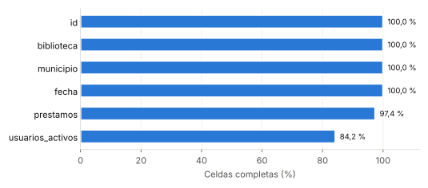
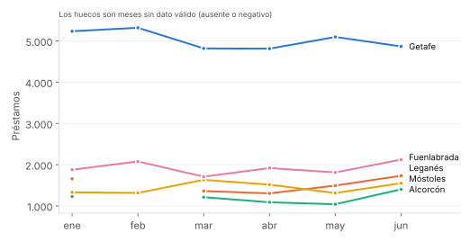

# Tema 3. Gestión documental y *open data* {#sec-tema3}

::: {.callout-note appearance="default"}
## Objetivos
- Comprender el papel de la gestión documental en la publicación de datos abiertos.
- Aplicar criterios de calidad y documentación de conjuntos de datos.
:::

::: {.callout-note appearance="simple" icon="false"}
## Glosario del tema
[Gestión documental](92-glosario.qmd#gl-gestion-documental) · [Ciclo de vida](92-glosario.qmd#gl-ciclo-vida) · [Metadatos](92-glosario.qmd#gl-metadatos) · [DCAT](92-glosario.qmd#gl-dcat) · [Distribución](92-glosario.qmd#gl-distribucion) · [Completitud](92-glosario.qmd#gl-completitud) · [Conformidad](92-glosario.qmd#gl-conformidad) · [Exactitud](92-glosario.qmd#gl-exactitud) · [Valor ausente](92-glosario.qmd#gl-ausente) · [Checksum](92-glosario.qmd#gl-checksum) · [OAIS](92-glosario.qmd#gl-oais) · [Identificador persistente](92-glosario.qmd#gl-pid)
:::

::: {.callout-tip appearance="simple" icon="false"}
## Descargas
[Script R del capítulo](plantillas/tema3_calidad.R){.btn .btn-outline-primary .btn-sm download="tema3_calidad.R"}
[Plantilla de informe (.qmd)](plantillas/informe_practica.qmd){.btn .btn-outline-primary .btn-sm download="informe_practica.qmd"}
[Tema de estilo (.scss)](plantillas/informe.scss){.btn .btn-outline-primary .btn-sm download="informe.scss"}
[CSV de práctica](datos/prestamos_bibliotecas_practica.csv){.btn .btn-outline-primary .btn-sm download="prestamos_bibliotecas_practica.csv"}

El script reúne todo el código del capítulo para trabajar en RStudio o Positron. La plantilla `.qmd` y su tema `.scss` sirven para redactar las prácticas opcionales: guárdalos en la misma carpeta.
:::


## Lectura obligatoria

::: {.lectura}
Vetrò, A.; Canova, L.; Torchiano, M.; Orozco Minotas, C.; Iemma, R.; Morando, F. (2016). [Open data quality measurement framework: Definition and application to Open Government Data](https://doi.org/10.1016/j.giq.2016.02.001). *Government Information Quarterly*, 33(2), 325-337. [Postprint en acceso abierto](https://iris.polito.it/handle/11583/2631238).

Norma de referencia: [ISO/IEC 25012:2008](https://www.iso.org/standard/35736.html), modelo de calidad de datos (norma de pago; basta con la descripción).
:::

### Lecturas complementarias {.unnumbered}

- Batini, C.; Cappiello, C.; Francalanci, C.; Maurino, A. (2009). [Methodologies for data quality assessment and improvement](https://doi.org/10.1145/1541880.1541883). *ACM Computing Surveys*, 41(3). Revisión clásica de metodologías de evaluación de la calidad de datos.
- Umbrich, J.; Neumaier, S.; Polleres, A. (2015). [Quality assessment and evolution of open data portals](https://doi.org/10.1109/FiCloud.2015.82). En *2015 3rd International Conference on Future Internet of Things and Cloud*, 404-411. Métricas de calidad aplicadas a portales de datos abiertos.

## 1. Gestión documental aplicada a los datos abiertos

Un conjunto de datos publicado es, a todos los efectos, un **documento** de la administración: tiene un productor, un contexto de creación, un valor (administrativo, informativo, histórico) y un plazo de conservación. Por eso la publicación de datos abiertos no empieza en el portal, sino en el **sistema de gestión documental** de la organización.

| Aportación de la gestión documental | Aplicación a los datos abiertos |
|---|---|
| **Identificación y clasificación** (cuadro de clasificación) | Inventario de la información que produce cada unidad: qué datos existen y dónde |
| **Valoración** | Decidir qué conjuntos tienen valor para la reutilización y cuáles deben protegerse |
| **Descripción** | Metadatos que garantizan autenticidad, contexto y comprensión |
| **Calendario de conservación** | Cuánto tiempo se mantiene cada versión publicada y cuándo se transfiere o elimina |
| **Control de acceso** | Separar lo publicable de lo que contiene datos personales o información protegida |

Normas de referencia:

- **ISO 15489-1:2016**, conceptos y principios de la gestión de documentos: autenticidad, fiabilidad, integridad y disponibilidad.
- **ISO 30301**, sistemas de gestión para los documentos.
- **Esquema Nacional de Interoperabilidad** y sus normas técnicas de **documento electrónico**, **expediente electrónico** y **política de gestión de documentos electrónicos**, que fijan cómo se crean, describen y conservan los documentos en la administración española (Tema 4).

En la práctica, muchas administraciones elaboran un **plan de apertura**: inventario de la información, priorización de los conjuntos con más demanda o valor, calendario de publicación y responsables de mantenerlos.

## 2. Ciclo de vida de la información

La gestión documental clásica describe el **ciclo vital del documento** por las fases de archivo que recorre: oficina o gestión, central, intermedio e histórico, según disminuye su uso administrativo y aumenta su valor informativo o histórico.

Para los datos se usan modelos más específicos. El [modelo de ciclo de vida del DCC](https://www.dcc.ac.uk/faq/dcc-curation-lifecycle-model) ordena las acciones secuenciales de curación: **crear o recibir → valorar y seleccionar → ingresar → acciones de preservación → almacenar → acceso, uso y reutilización → transformar**. Alrededor hay acciones continuas (descripción, planificación de la preservación, seguimiento de la comunidad) y ocasionales (eliminar, revalorar, migrar).

En el laboratorio de este capítulo, la limpieza es una acción de preservación sobre datos ya ingresados; publicar el resultado con sus metadatos facilita el acceso y la reutilización.

## 3. Metadatos

Un conjunto de datos sin metadatos no se encuentra ni se entiende. Hay metadatos **descriptivos** (qué es), **administrativos** (quién lo publica, con qué licencia), **estructurales** (qué columnas tiene y qué significan) y **de preservación** (versiones, sumas de control, formatos).

El vocabulario del W3C [DCAT](https://www.w3.org/TR/vocab-dcat-3/) describe catálogos, conjuntos de datos (`dcat:Dataset`) y distribuciones (`dcat:Distribution`, cada fichero descargable), y reutiliza términos de **Dublin Core** (`dct:`). En Europa se usa el perfil DCAT-AP y en España [DCAT-AP-ES](https://datosgobes.github.io/DCAT-AP-ES), basado en DCAT-AP 2.1.1 y en la extensión de datos de alto valor. Según datos.gob.es, será el modelo de metadatos de la nueva versión de la NTI-RISP; comprueba si la norma modificada ya se ha publicado en el BOE.

| Propiedad | Significado |
|---|---|
| `dct:title` | Título del conjunto |
| `dct:description` | Descripción |
| `dct:publisher` | Organismo que publica |
| `dct:license` | Licencia (URI) |
| `dct:accrualPeriodicity` | Periodicidad de actualización |
| `dct:temporal` | Cobertura temporal |
| `dct:spatial` | Cobertura geográfica |
| `dcat:downloadURL` | URL de descarga directa del fichero |
| `dcat:mediaType` | Tipo MIME del fichero (por ejemplo, `text/csv`) |

Los metadatos **estructurales** de un CSV (nombre, tipo y significado de cada columna) se describen con un diccionario de datos o con especificaciones como [CSV on the Web](https://www.w3.org/TR/tabular-data-primer/) o [Frictionless Data](https://frictionlessdata.io).

## 4. Calidad de los datos

Vetrò et al. proponen medir la calidad de cada conjunto de datos, no solo la del portal, con siete características y 17 métricas:

| Característica | Qué mide |
|---|---|
| Trazabilidad | Si constan la creación y las modificaciones del conjunto |
| Actualidad | Si los datos se publican a tiempo respecto al periodo que describen |
| Expiración | Si el conjunto sigue vigente o ya ha sido sustituido |
| **Completitud** | Proporción de celdas y filas sin valores ausentes |
| Conformidad | Si los valores siguen el formato esperado (fechas, códigos, unidades) |
| Exactitud | Si los valores son correctos y plausibles |
| Comprensibilidad | Si hay metadatos y descripciones que permitan entenderlos |

En el laboratorio calcularás dos métricas de completitud y corregirás problemas de conformidad y exactitud en el CSV de práctica.

{#fig-completitud fig-alt="Barras horizontales del porcentaje de celdas completas por columna, eje de 0 a 100. id, biblioteca, municipio y fecha: 100 %. prestamos: 97,4 %. usuarios_activos: 84,2 %."}

## 5. Publicación de conjuntos de datos

Las [Buenas prácticas para datos en la Web](https://www.w3.org/TR/dwbp/) del W3C y la experiencia de los portales permiten resumir la publicación en una secuencia:

1. **Seleccionar** el conjunto a partir del inventario y del plan de apertura.
2. **Revisar** la protección de datos: anonimizar o agregar si hay datos personales.
3. **Depurar** y comprobar la calidad (laboratorio de este capítulo).
4. **Preparar las distribuciones** en formatos abiertos (CSV, JSON, RDF) y, si procede, una API.
5. **Describir** con metadatos DCAT-AP-ES y un diccionario de datos.
6. **Asignar una licencia** (normalmente CC BY 4.0).
7. **Publicar** en el portal de la organización, a menudo construido con software como [CKAN](https://ckan.org), y **federarlo** con datos.gob.es.
8. **Difundir** y **recoger la opinión** de los reutilizadores para mejorar.

## 6. Preservación y actualización

Publicar no es el final: un conjunto de datos debe seguir siendo **íntegro**, **accesible** y **actual**.

- **Modelo OAIS** (ISO 14721): modelo de referencia para archivos digitales que deben preservar información a largo plazo; distingue los paquetes de información que se reciben, se archivan y se difunden.
- **Integridad (fijeza)**: sumas de control (*checksums*) como MD5 o SHA-256 permiten comprobar que un fichero no ha cambiado ni se ha corrompido.
- **Identificadores persistentes**: un DOI o una URI estable evitan que los enlaces se rompan cuando el portal cambia.
- **Versionado**: cada actualización debe quedar registrada (qué cambió y cuándo); las versiones anteriores se conservan según el calendario de conservación.
- **Actualización periódica**: la periodicidad declarada en `dct:accrualPeriodicity` es un compromiso. Un conjunto que deja de actualizarse pierde **actualidad** y acaba **expirado**, dos características de calidad de Vetrò et al.
- **Formatos de preservación**: los formatos abiertos y documentados (CSV, XML) son también los más fáciles de conservar.

## Práctica en R: laboratorio de calidad (apartados 3 a 6)

El fichero tiene errores introducidos a propósito. El objetivo es detectarlos, medirlos y corregirlos. Cada paso indica la operación equivalente en [OpenRefine](https://openrefine.org), la herramienta que usarás en el cuestionario de Aula Global.

### Paso 1. Leer todo como texto

Leemos todas las columnas como texto (`colClasses = "character"`) para que R no transforme nada antes de que lo veamos.

```{webr}
#| autorun: true
bruto <- read.csv("datos/prestamos_bibliotecas_practica.csv", colClasses = "character")
dim(bruto)
head(bruto, 8)
```

### Paso 2. Valores ausentes y completitud

Los ausentes aparecen de dos formas: celdas vacías y el texto `"n/d"`. Una matriz lógica marca cuáles lo son:

```{webr}
#| autorun: true
ausente <- bruto == "" | bruto == "n/d"
colSums(ausente)          # ausentes por columna
sum(ausente)              # total de celdas ausentes
```

Las dos métricas de completitud de Vetrò et al. son:

- **Porcentaje de celdas completas** = celdas no vacías / celdas totales × 100.
- **Porcentaje de filas completas** = filas sin ningún ausente / filas totales × 100.

### Ejercicio 3.1 {.unnumbered}

Calcula el porcentaje de celdas completas del fichero original, redondeado a dos decimales.

```{webr}
#| exercise: t3_celdas
#| setup: true
bruto <- read.csv("datos/prestamos_bibliotecas_practica.csv", colClasses = "character")
ausente <- bruto == "" | bruto == "n/d"
```

```{webr}
#| exercise: t3_celdas
celdas_totales <- nrow(bruto) * ncol(bruto)
celdas_completas <- celdas_totales - ______
round(100 * celdas_completas / celdas_totales, 2)
```

::: {.hint exercise="t3_celdas"}
Resta el número total de celdas ausentes: `sum(ausente)`.
:::

::: {.solution exercise="t3_celdas"}
```r
celdas_totales <- nrow(bruto) * ncol(bruto)
celdas_completas <- celdas_totales - sum(ausente)
round(100 * celdas_completas / celdas_totales, 2)
```
:::

```{webr}
#| exercise: t3_celdas
#| check: true
b <- read.csv("datos/prestamos_bibliotecas_practica.csv", colClasses = "character")
a <- b == "" | b == "n/d"
esperado <- round(100 * (length(a) - sum(a)) / length(a), 2)
if (isTRUE(all.equal(as.numeric(.result), esperado))) {
  list(correct = TRUE, message = paste0("Correcto: ", format(esperado, decimal.mark = ","), " % de celdas completas."))
} else {
  list(correct = FALSE, message = "Comprueba que restas todas las celdas ausentes (vacías y \"n/d\").")
}
```

### Ejercicio 3.2 {.unnumbered}

Calcula ahora el porcentaje de **filas** completas (dos decimales). Una fila es completa si no tiene ningún ausente.

```{webr}
#| exercise: t3_filas
#| setup: true
bruto <- read.csv("datos/prestamos_bibliotecas_practica.csv", colClasses = "character")
ausente <- bruto == "" | bruto == "n/d"
```

```{webr}
#| exercise: t3_filas
fila_con_ausente <- rowSums(ausente) > 0
filas_completas <- sum(______)
round(100 * filas_completas / nrow(bruto), 2)
```

::: {.hint exercise="t3_filas"}
`fila_con_ausente` vale `TRUE` en las filas incompletas. Necesitas lo contrario: el operador de negación es `!`.
:::

::: {.solution exercise="t3_filas"}
```r
fila_con_ausente <- rowSums(ausente) > 0
filas_completas <- sum(!fila_con_ausente)
round(100 * filas_completas / nrow(bruto), 2)
```
:::

```{webr}
#| exercise: t3_filas
#| check: true
b <- read.csv("datos/prestamos_bibliotecas_practica.csv", colClasses = "character")
a <- b == "" | b == "n/d"
esperado <- round(100 * sum(rowSums(a) == 0) / nrow(b), 2)
if (isTRUE(all.equal(as.numeric(.result), esperado))) {
  list(correct = TRUE, message = paste0("Correcto: ", format(esperado, decimal.mark = ","), " % de filas completas. Fíjate en que es bastante menor que el de celdas."))
} else {
  list(correct = FALSE, message = "Cuenta las filas sin ningún ausente: sum(!fila_con_ausente).")
}
```

### Paso 3. Filas duplicadas

*En OpenRefine: ordenar, «Blank down» y eliminar las filas en blanco, o facetar por duplicados.*

`duplicated()` marca las filas idénticas a otra anterior.

```{webr}
#| autorun: true
duplicated(bruto)
```

### Ejercicio 3.3 {.unnumbered}

¿Cuántas filas duplicadas hay? Después, crea `sin_dup` sin ellas y comprueba cuántas filas quedan.

```{webr}
#| exercise: t3_dup
#| setup: true
bruto <- read.csv("datos/prestamos_bibliotecas_practica.csv", colClasses = "character")
```

```{webr}
#| exercise: t3_dup
n_dup <- sum(duplicated(bruto))
sin_dup <- bruto[______, ]
c(duplicadas = n_dup, filas_restantes = nrow(sin_dup))
```

::: {.hint exercise="t3_dup"}
Quieres las filas que **no** están duplicadas: `!duplicated(bruto)`.
:::

::: {.solution exercise="t3_dup"}
```r
n_dup <- sum(duplicated(bruto))
sin_dup <- bruto[!duplicated(bruto), ]
c(duplicadas = n_dup, filas_restantes = nrow(sin_dup))
```
:::

```{webr}
#| exercise: t3_dup
#| check: true
b <- read.csv("datos/prestamos_bibliotecas_practica.csv", colClasses = "character")
esp <- c(duplicadas = sum(duplicated(b)), filas_restantes = sum(!duplicated(b)))
if (isTRUE(all.equal(as.numeric(.result), as.numeric(esp)))) {
  list(correct = TRUE, message = paste0("Correcto: ", esp[1], " duplicadas; quedan ", esp[2], " filas."))
} else {
  list(correct = FALSE, message = "Para quedarte con las filas únicas, indexa con !duplicated(bruto).")
}
```

### Paso 4. Normalizar los municipios

*En OpenRefine: «Edit cells → Common transforms → Trim whitespace» y «Cluster and edit» con el método* key collision / fingerprint.

```{webr}
#| autorun: true
sin_dup <- bruto[!duplicated(bruto), ]
table(sin_dup$municipio)
```

El mismo municipio aparece escrito de varias formas. Construimos una **clave** como hace el método *fingerprint* de OpenRefine: quitar espacios sobrantes, pasar a minúsculas y eliminar tildes.

```{webr}
#| autorun: true
clave <- function(x) {
  x <- trimws(x)
  x <- tolower(x)
  chartr("áéíóúüñ", "aeiouun", x)
}
table(clave(sin_dup$municipio))
```

Después asignamos a cada clave su forma correcta con un vector con nombres (una tabla de equivalencias):

```{webr}
#| autorun: true
forma_correcta <- c(getafe = "Getafe", leganes = "Leganés", alcorcon = "Alcorcón",
                    mostoles = "Móstoles", fuenlabrada = "Fuenlabrada")
sin_dup$municipio <- unname(forma_correcta[clave(sin_dup$municipio)])
table(sin_dup$municipio)
```

### Ejercicio 3.4 {.unnumbered}

¿Cuántas formas distintas de escribir el municipio había en el fichero original y cuántos municipios hay realmente? Devuelve un vector con los dos números.

```{webr}
#| exercise: t3_muni
#| setup: true
bruto <- read.csv("datos/prestamos_bibliotecas_practica.csv", colClasses = "character")
clave <- function(x) chartr("áéíóúüñ", "aeiouun", tolower(trimws(x)))
```

```{webr}
#| exercise: t3_muni
c(variantes  = length(unique(bruto$municipio)),
  municipios = length(unique(______)))
```

::: {.hint exercise="t3_muni"}
Aplica la función `clave()` a la columna antes de contar los valores únicos.
:::

::: {.solution exercise="t3_muni"}
```r
c(variantes  = length(unique(bruto$municipio)),
  municipios = length(unique(clave(bruto$municipio))))
```
:::

```{webr}
#| exercise: t3_muni
#| check: true
b <- read.csv("datos/prestamos_bibliotecas_practica.csv", colClasses = "character")
k <- chartr("áéíóúüñ", "aeiouun", tolower(trimws(b$municipio)))
esp <- c(length(unique(b$municipio)), length(unique(k)))
if (isTRUE(all.equal(as.numeric(.result), as.numeric(esp)))) {
  list(correct = TRUE, message = paste0("Correcto: ", esp[1], " variantes para ", esp[2], " municipios."))
} else {
  list(correct = FALSE, message = "El segundo valor debe contar las claves normalizadas: unique(clave(bruto$municipio)).")
}
```

### Paso 5. Unificar las fechas

*En OpenRefine: «Edit cells → Transform» con una expresión GREL que detecte el formato, o «To date» con varios formatos.*

```{webr}
#| autorun: true
table(grepl("/", sin_dup$fecha))   # TRUE = formato dd/mm/aaaa
```

Convertimos cada formato con su patrón y combinamos el resultado:

```{webr}
#| autorun: true
es_dmy <- grepl("/", sin_dup$fecha)
fecha <- as.Date(sin_dup$fecha, format = "%Y-%m-%d")
fecha[es_dmy] <- as.Date(sin_dup$fecha[es_dmy], format = "%d/%m/%Y")
sin_dup$fecha <- fecha
sum(is.na(sin_dup$fecha))   # ninguna fecha sin convertir
range(sin_dup$fecha)
```

### Paso 6. Valores numéricos

*En OpenRefine: «To number», facetas numéricas para localizar valores no numéricos y negativos.*

```{webr}
#| autorun: true
num <- function(x) as.numeric(ifelse(x %in% c("", "n/d"), NA, x))
sin_dup$prestamos <- num(sin_dup$prestamos)
sin_dup$usuarios_activos <- num(sin_dup$usuarios_activos)
summary(sin_dup$prestamos)
subset(sin_dup, prestamos < 0)
```

Un número de préstamos negativo es imposible: es un error de **exactitud**. Sin acceso a la fuente no podemos saber el valor correcto (¿un signo menos erróneo?), así que lo marcamos como ausente y lo documentamos.

```{webr}
#| autorun: true
sin_dup$prestamos[which(sin_dup$prestamos < 0)] <- NA
limpio <- sin_dup
str(limpio)
```

### Ejercicio 3.5 {.unnumbered}

Con el fichero limpio, calcula el **total de préstamos de Getafe** entre enero y junio. Ten en cuenta que puede haber `NA`.

```{webr}
#| exercise: t3_getafe
#| setup: true
b <- read.csv("datos/prestamos_bibliotecas_practica.csv", colClasses = "character")
limpio <- b[!duplicated(b), ]
clave <- function(x) chartr("áéíóúüñ", "aeiouun", tolower(trimws(x)))
forma_correcta <- c(getafe = "Getafe", leganes = "Leganés", alcorcon = "Alcorcón",
                    mostoles = "Móstoles", fuenlabrada = "Fuenlabrada")
limpio$municipio <- unname(forma_correcta[clave(limpio$municipio)])
num <- function(x) as.numeric(ifelse(x %in% c("", "n/d"), NA, x))
limpio$prestamos <- num(limpio$prestamos)
limpio$prestamos[!is.na(limpio$prestamos) & limpio$prestamos < 0] <- NA
```

```{webr}
#| exercise: t3_getafe
getafe <- subset(limpio, municipio == ______)
sum(getafe$prestamos, na.rm = ______)
```

::: {.hint exercise="t3_getafe"}
El primer hueco es el nombre del municipio entre comillas; el segundo, el valor lógico que indica a `sum()` que ignore los `NA`.
:::

::: {.solution exercise="t3_getafe"}
```r
getafe <- subset(limpio, municipio == "Getafe")
sum(getafe$prestamos, na.rm = TRUE)
```
:::

```{webr}
#| exercise: t3_getafe
#| check: true
b <- read.csv("datos/prestamos_bibliotecas_practica.csv", colClasses = "character")
b <- b[!duplicated(b), ]
k <- chartr("áéíóúüñ", "aeiouun", tolower(trimws(b$municipio)))
p <- suppressWarnings(as.numeric(ifelse(b$prestamos %in% c("", "n/d"), NA, b$prestamos)))
p[!is.na(p) & p < 0] <- NA
esperado <- sum(p[k == "getafe"], na.rm = TRUE)
orig <- read.csv("datos/prestamos_bibliotecas_practica.csv", colClasses = "character")
sin_limpiar <- sum(suppressWarnings(as.numeric(orig$prestamos[orig$municipio == "Getafe"])), na.rm = TRUE)
if (isTRUE(all.equal(as.numeric(.result), esperado))) {
  list(correct = TRUE, message = paste0("Correcto: ", formatC(esperado, big.mark = ".", format = "d"), " préstamos. Sin normalizar los municipios ni quitar duplicados habrías obtenido ", formatC(sin_limpiar, big.mark = ".", format = "d"), "."))
} else if (is.na(.result)) {
  list(correct = FALSE, message = "El resultado es NA: indica a sum() que ignore los ausentes con na.rm = TRUE.")
} else {
  list(correct = FALSE, message = "Escribe el municipio tal como quedó tras la normalización: \"Getafe\".")
}
```

### Ejercicio 3.6 {.unnumbered}

¿Cuántos **préstamos por usuario activo** tuvo cada municipio? Calcula la ratio con `aggregate()` (que suma por grupos) y ordénala de mayor a menor. Este ejercicio no tiene una única respuesta: interpreta el resultado.

```{webr}
#| exercise: t3_ratio
#| setup: true
b <- read.csv("datos/prestamos_bibliotecas_practica.csv", colClasses = "character")
limpio <- b[!duplicated(b), ]
clave <- function(x) chartr("áéíóúüñ", "aeiouun", tolower(trimws(x)))
forma_correcta <- c(getafe = "Getafe", leganes = "Leganés", alcorcon = "Alcorcón",
                    mostoles = "Móstoles", fuenlabrada = "Fuenlabrada")
limpio$municipio <- unname(forma_correcta[clave(limpio$municipio)])
num <- function(x) as.numeric(ifelse(x %in% c("", "n/d"), NA, x))
limpio$prestamos <- num(limpio$prestamos)
limpio$usuarios_activos <- num(limpio$usuarios_activos)
limpio$prestamos[!is.na(limpio$prestamos) & limpio$prestamos < 0] <- NA
```

```{webr}
#| exercise: t3_ratio
# Solo filas con ambos valores, para que numerador y denominador sean comparables
completas <- subset(limpio, !is.na(prestamos) & !is.na(usuarios_activos))
por_muni <- aggregate(cbind(prestamos, usuarios_activos) ~ municipio, data = completas, FUN = sum)
por_muni$ratio <- round(por_muni$prestamos / por_muni$usuarios_activos, 2)
por_muni[order(por_muni$ratio, decreasing = TRUE), ]
```

::: {.callout-note}
¿Por qué se usan solo las filas con ambos valores? Si sumaras todos los préstamos pero solo los usuarios conocidos, la ratio de los municipios con más ausentes saldría inflada. Es un ejemplo de cómo la completitud afecta a los indicadores que se derivan de los datos.
:::

### Resultado de la limpieza

Con los datos ya depurados se puede, por fin, comparar municipios. Los huecos de las líneas son los meses en que el dato era ausente o negativo: la limpieza no los inventa, los deja a la vista.

{#fig-prestamos fig-alt="Gráfico de líneas de enero a junio. Getafe se mantiene entre unos 4.800 y 5.300 préstamos. Fuenlabrada ronda los 1.700-2.100; Leganés, Móstoles y Alcorcón entre unos 1.000 y 1.750. Leganés y Alcorcón no tienen dato en febrero."}

### Explora los datos limpios

Marca y desmarca municipios: la gráfica se recalcula en tu navegador con R.

```{ojs}
//| echo: false
viewof municipios_sel = Inputs.checkbox(
  ["Getafe", "Leganés", "Alcorcón", "Móstoles", "Fuenlabrada"],
  { value: ["Leganés", "Alcorcón", "Móstoles", "Fuenlabrada"], label: "Municipios:" }
)
viewof por_biblioteca = Inputs.toggle({ label: "Media por biblioteca", value: false })
```

```{webr}
#| input:
#|   - municipios_sel
#|   - por_biblioteca
#| autorun: true
#| max-lines: 6
#| fig-height: 4.2
b <- read.csv("datos/prestamos_bibliotecas_practica.csv", colClasses = "character")
b <- b[!duplicated(b), ]
k <- chartr("áéíóúüñ", "aeiouun", tolower(trimws(b$municipio)))
b$municipio <- unname(c(getafe = "Getafe", leganes = "Leganés", alcorcon = "Alcorcón",
                        mostoles = "Móstoles", fuenlabrada = "Fuenlabrada")[k])
b$mes <- as.integer(ifelse(grepl("/", b$fecha), substr(b$fecha, 4, 5), substr(b$fecha, 6, 7)))
b$prestamos <- suppressWarnings(as.numeric(b$prestamos))
b$prestamos[which(b$prestamos < 0)] <- NA
colores <- c(Getafe = "#2a78d6", "Leganés" = "#eb6834", "Alcorcón" = "#1baf7a",
             "Móstoles" = "#eda100", Fuenlabrada = "#e87ba4")
sel <- unlist(municipios_sel)
if (length(sel) == 0) {
  plot.new(); text(0.5, 0.5, "Marca al menos un municipio")
} else {
  fun <- if (isTRUE(por_biblioteca)) function(x) mean(x) else function(x) sum(x)
  tabla <- aggregate(prestamos ~ municipio + mes, data = b[b$municipio %in% sel, ], FUN = fun)
  rango <- range(tabla$prestamos)
  plot(NA, xlim = c(1, 6.8), ylim = rango, xaxt = "n", bty = "l",
       xlab = "", ylab = if (isTRUE(por_biblioteca)) "Préstamos por biblioteca" else "Préstamos")
  axis(1, at = 1:6, labels = c("ene", "feb", "mar", "abr", "may", "jun"))
  for (m in sel) {
    d <- merge(data.frame(mes = 1:6), tabla[tabla$municipio == m, ], all.x = TRUE)
    lines(d$mes, d$prestamos, col = colores[m], lwd = 2)
    points(d$mes, d$prestamos, col = colores[m], pch = 19)
    text(6.1, tail(na.omit(d$prestamos), 1), m, pos = 4, cex = 0.8)
  }
}
```

Activa la **media por biblioteca**: Getafe deja de destacar, porque tiene dos bibliotecas en la muestra. Elegir bien el indicador es parte de la calidad de un servicio de datos.

### Paso 7. Publicar el resultado con metadatos (apartados 3 y 5)

Guardamos el fichero limpio y lo describimos con propiedades DCAT. `jsonlite` convierte una lista de R en JSON.

```{webr}
#| autorun: true
write.csv(limpio, "prestamos_limpio.csv", row.names = FALSE)

metadatos <- list(
  "@type" = "dcat:Dataset",
  "dct:title" = "Préstamos mensuales de bibliotecas municipales (enero-junio 2025)",
  "dct:description" = "Datos sintéticos para docencia. Versión depurada: municipios normalizados, fechas ISO 8601, duplicados eliminados.",
  "dct:license" = "https://creativecommons.org/licenses/by/4.0/",
  "dct:accrualPeriodicity" = "http://publications.europa.eu/resource/authority/frequency/MONTHLY",
  "dct:temporal" = list(startDate = "2025-01-01", endDate = "2025-06-30"),
  "dct:spatial" = "Comunidad de Madrid",
  "dcat:distribution" = list(
    "@type" = "dcat:Distribution",
    "dcat:downloadURL" = "https://ejemplo.org/datos/prestamos_limpio.csv",
    "dcat:mediaType" = "text/csv",
    "dct:format" = "CSV"
  )
)
cat(jsonlite::toJSON(metadatos, auto_unbox = TRUE, pretty = TRUE))
```

### Ejercicio 3.7 {.unnumbered}

Completa la distribución en **JSON** del mismo conjunto: su tipo MIME es `application/json`. Y su licencia es CC0 1.0, cuya URI es `https://creativecommons.org/publicdomain/zero/1.0/`.

```{webr}
#| exercise: t3_dcat
distribucion <- list(
  "@type" = "dcat:Distribution",
  "dcat:downloadURL" = "https://ejemplo.org/datos/prestamos_limpio.json",
  "dcat:mediaType" = "______",
  "dct:license" = "______"
)
distribucion
```

::: {.solution exercise="t3_dcat"}
```r
distribucion <- list(
  "@type" = "dcat:Distribution",
  "dcat:downloadURL" = "https://ejemplo.org/datos/prestamos_limpio.json",
  "dcat:mediaType" = "application/json",
  "dct:license" = "https://creativecommons.org/publicdomain/zero/1.0/"
)
```
:::

```{webr}
#| exercise: t3_dcat
#| check: true
r <- .result
if (!is.list(r)) {
  list(correct = FALSE, message = "La última línea debe devolver la lista distribucion.")
} else if (!identical(r[["dcat:mediaType"]], "application/json")) {
  list(correct = FALSE, message = "Revisa dcat:mediaType: el tipo MIME de JSON es application/json.")
} else if (!identical(sub("/$", "", r[["dct:license"]]), "https://creativecommons.org/publicdomain/zero/1.0")) {
  list(correct = FALSE, message = "Revisa la URI de la licencia CC0 1.0.")
} else {
  list(correct = TRUE, message = "Correcto: la misma licencia puede variar entre distribuciones, pero lo habitual es que coincida con la del conjunto.")
}
```

### Paso 8. Comprobar la integridad de los ficheros (apartado 6)

`tools::md5sum()` calcula la suma de control MD5 de un fichero. Si dos ficheros tienen la misma suma, su contenido es idéntico; si cambia un solo carácter, la suma cambia por completo.

```{webr}
#| autorun: true
write.csv(limpio, "prestamos_limpio.csv", row.names = FALSE)
sumas <- tools::md5sum(c("datos/prestamos_bibliotecas_practica.csv", "prestamos_limpio.csv"))
sumas
```

Un registro de versiones mínimo combina la fecha, la descripción del cambio y la suma de control:

```{webr}
#| autorun: true
versiones <- data.frame(
  version = c("1.0", "1.1"),
  fecha = as.Date(c("2025-07-01", Sys.Date())),
  cambio = c("Publicación inicial (fichero original)",
             "Depuración: duplicados, municipios, fechas y valores negativos"),
  md5 = unname(sumas)
)
versiones
```

### Ejercicio 3.8 {.unnumbered}

Un reutilizador descarga el fichero original y quiere comprobar que no se ha alterado. Compara la suma de control del fichero con la que publica el portal (`suma_publicada`). El resultado debe ser `TRUE` o `FALSE`.

```{webr}
#| exercise: t3_md5
#| setup: true
suma_publicada <- unname(tools::md5sum("datos/prestamos_bibliotecas_practica.csv"))
```

```{webr}
#| exercise: t3_md5
suma_descarga <- unname(tools::md5sum("______"))
suma_descarga ______ suma_publicada
```

::: {.hint exercise="t3_md5"}
El primer hueco es la ruta del CSV original (`datos/...`). El segundo, el operador que compara si dos valores son iguales.
:::

::: {.solution exercise="t3_md5"}
```r
suma_descarga <- unname(tools::md5sum("datos/prestamos_bibliotecas_practica.csv"))
suma_descarga == suma_publicada
```
`TRUE`: el fichero está íntegro. Si comparas con `prestamos_limpio.csv` obtendrás `FALSE`, porque el contenido es distinto.
:::

```{webr}
#| exercise: t3_md5
#| check: true
if (isTRUE(.result) && grepl("prestamos_bibliotecas_practica.csv", .user_code, fixed = TRUE)) {
  list(correct = TRUE, message = "Correcto: las sumas coinciden, así que el fichero no ha cambiado.")
} else if (isFALSE(.result)) {
  list(correct = FALSE, message = "Las sumas no coinciden: ¿estás leyendo el fichero original de la carpeta datos/?")
} else {
  list(correct = FALSE, message = "Compara las dos sumas con ==.")
}
```

## Autoevaluación

Responde a todas las preguntas y pulsa **Mostrar respuestas**: verás en verde las acertadas, en rojo las falladas y tu recuento. Puedes corregir y volver a comprobar. No cuenta para la nota.

::: {.webex-check .webex-box}
1. Un número de préstamos negativo es un problema de 
2. Que las fechas aparezcan en dos formatos distintos afecta a la 
3. En DCAT, cada fichero descargable de un conjunto de datos es una 
4. El tipo MIME de un fichero CSV es 
5. Si la suma de control MD5 de un fichero descargado coincide con la publicada, el fichero no ha cambiado. 
6. ¿Qué norma ISO describe el modelo de referencia OAIS para archivos digitales?



7. Completa el código para quedarte solo con las filas no duplicadas: `bruto[`  `, ]`
:::

::: {.webex-solution boton="Ver explicaciones"}
- Un valor imposible es un error de exactitud.
- La conformidad mide si los valores siguen el formato esperado.
- `dcat:Distribution` describe cada forma de obtener el conjunto: un CSV, un JSON, una API.
- `text/csv` es el tipo MIME registrado para CSV.
- La suma cambia si cambia un solo carácter del fichero.
- ISO 14721 es OAIS; ISO 15489 es gestión de documentos; ISO/IEC 25012 es calidad de datos; ISO 30301 es sistemas de gestión para los documentos.
- `duplicated()` marca las repeticiones y `!` las excluye.
:::

## Resumen de problemas encontrados

| Problema | Característica de Vetrò et al. | Corrección |
|---|---|---|
| Ausentes como vacío y como `"n/d"` | Completitud y conformidad | Codificar todos como `NA` |
| Variantes del mismo municipio | Conformidad | Clave normalizada y tabla de equivalencias |
| Fechas en dos formatos | Conformidad | Convertir a ISO 8601 (`AAAA-MM-DD`) |
| Préstamos negativos | Exactitud | Marcar como ausente y documentarlo |
| Filas duplicadas | Exactitud | Eliminar duplicados |

## Recursos complementarios

| Recurso | Para qué sirve |
|---|---|
| [Guía de implementación de DCAT-AP-ES](https://datosgobes.github.io/DCAT-AP-ES) y [validación](https://datosgobes.github.io/DCAT-AP-ES/validacion) | Modelo de metadatos para catálogos españoles |
| [datos.gob.es – DCAT-AP-ES, un paso adelante](https://datos.gob.es/es/blog/dcat-ap-es-un-paso-adelante-en-la-interoperabilidad-de-datos-abiertos) | Novedades respecto a la NTI-RISP de 2013 |
| [ISO/IEC 25012:2008](https://www.iso.org/standard/35736.html) | Modelo de calidad de datos |
| [OpenRefine](https://openrefine.org) | Limpieza y transformación de datos |
| [Frictionless Data](https://frictionlessdata.io) | Describir y validar ficheros tabulares |
| [CKAN](https://ckan.org) | Software de catálogo de muchos portales |
| [DCC Curation Lifecycle Model](https://www.dcc.ac.uk/faq/dcc-curation-lifecycle-model) | Ciclo de vida de los datos |
| [W3C – Data on the Web Best Practices](https://www.w3.org/TR/dwbp/) | Buenas prácticas de publicación |
