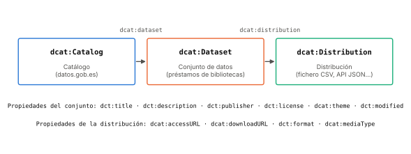

# Tema 4. Normalización e interoperabilidad {#sec-tema4}

::: {.callout-note appearance="default"}
## Objetivos
- Conocer los principales estándares utilizados en la publicación de datos abiertos.
- Comprender los fundamentos de la interoperabilidad técnica y semántica.
:::

::: {.callout-note appearance="simple" icon="false"}
## Glosario del tema
[Estándar abierto](92-glosario.qmd#gl-estandar-abierto) · [Interoperabilidad](92-glosario.qmd#gl-interoperabilidad) · [ENI](92-glosario.qmd#gl-eni) · [URI](92-glosario.qmd#gl-uri) · [RDF](92-glosario.qmd#gl-rdf) · [Tripleta](92-glosario.qmd#gl-tripleta) · [Turtle](92-glosario.qmd#gl-turtle) · [JSON-LD](92-glosario.qmd#gl-jsonld) · [Linked Open Data](92-glosario.qmd#gl-lod) · [SPARQL](92-glosario.qmd#gl-sparql) · [Vocabulario](92-glosario.qmd#gl-vocabulario) · [Ontología](92-glosario.qmd#gl-ontologia) · [SKOS](92-glosario.qmd#gl-skos)
:::

::: {.callout-tip appearance="simple" icon="false"}
## Descargas
[Script R del capítulo](plantillas/tema4_interoperabilidad.R){.btn .btn-outline-primary .btn-sm download="tema4_interoperabilidad.R"}
[Plantilla de informe (.qmd)](plantillas/informe_practica.qmd){.btn .btn-outline-primary .btn-sm download="informe_practica.qmd"}
[Tema de estilo (.scss)](plantillas/informe.scss){.btn .btn-outline-primary .btn-sm download="informe.scss"}
[CSV de práctica](datos/prestamos_bibliotecas_practica.csv){.btn .btn-outline-primary .btn-sm download="prestamos_bibliotecas_practica.csv"}

El script reúne todo el código del capítulo para trabajar en RStudio o Positron. La plantilla `.qmd` y su tema `.scss` sirven para redactar las prácticas opcionales: guárdalos en la misma carpeta.
:::


## Lectura obligatoria

::: {.lectura}
Bizer, C.; Heath, T.; Berners-Lee, T. (2009). [Linked Data – The Story So Far](https://doi.org/10.4018/jswis.2009081901). *International Journal on Semantic Web and Information Systems*, 5(3), 1-22. Acceso por suscripción a través de la Biblioteca UC3M.
:::

### Lecturas complementarias {.unnumbered}

- Hallo, M.; Luján-Mora, S.; Maté, A.; Trujillo, J. (2016). [Current state of Linked Data in digital libraries](https://doi.org/10.1177/0165551515594729). *Journal of Information Science*, 42(2), 117-127. Estado de los datos enlazados en bibliotecas digitales.

## 1. Estándares abiertos

Un **estándar** (o norma) es una especificación acordada que permite que productos y sistemas distintos funcionen juntos. Es **abierto** cuando su especificación es pública y gratuita, se ha desarrollado en un proceso abierto a todas las partes interesadas y puede implementarse sin pagar derechos ni pedir permiso. No hay que confundirlo con el software libre: un estándar abierto puede implementarse en software privativo.

| Organismo | Estándares relevantes para datos abiertos |
|---|---|
| **W3C** (World Wide Web Consortium) | HTML, XML, RDF, SPARQL, OWL, SKOS, DCAT, JSON-LD, CSV on the Web |
| **IETF** (Internet Engineering Task Force) | HTTP, URI, CSV (RFC 4180), JSON (RFC 8259) |
| **ISO** | Dublin Core (ISO 15836), OAIS (ISO 14721), PDF (ISO 32000), códigos de país y lengua |
| **OGC** (Open Geospatial Consortium) | Servicios de mapas (WMS, WFS), GeoPackage |
| **Ámbito bibliotecario** (Library of Congress, IFLA, OCLC) | MARC 21, BIBFRAME, IFLA LRM, Z39.50, OAI-PMH |

Los estándares de facto (los que se imponen por uso, como un formato de un fabricante dominante) pueden ser útiles, pero no garantizan acceso ni continuidad.

## 2. Interoperabilidad técnica, semántica y organizativa

La **interoperabilidad** es la capacidad de los sistemas y las organizaciones de intercambiar información y usarla. El [Marco Europeo de Interoperabilidad](https://interoperable-europe.ec.europa.eu) (EIF, revisado en 2017) distingue cuatro niveles; publicar en un formato abierto resuelve solo uno de ellos:

| Nivel | Pregunta | Ejemplo en bibliotecas |
|---|---|---|
| **Jurídico** | ¿Las normas y licencias permiten combinar los datos? | Licencias compatibles entre dos portales |
| **Organizativo** | ¿Los procesos y responsabilidades están alineados? | Acuerdo entre la red de bibliotecas y el portal autonómico para actualizar cada mes |
| **Semántico** | ¿Los datos significan lo mismo para todos? | Usar `schema:Library` y la misma definición de «préstamo» |
| **Técnico** | ¿Los sistemas pueden intercambiar datos? | API, formatos, protocolos |

El Reglamento (UE) 2024/903, de 13 de marzo de 2024, conocido como **Reglamento sobre la Europa Interoperable**, se aplica en su mayor parte desde el 12 de julio de 2024. Convierte la interoperabilidad de los servicios públicos transfronterizos en una obligación con estructuras de gobernanza propias.

## 3. Esquema Nacional de Interoperabilidad

En España, el **Esquema Nacional de Interoperabilidad (ENI)**, previsto en el artículo 156 de la Ley 40/2015 y regulado por el Real Decreto 4/2010, fija los criterios que deben seguir las administraciones para que sus sistemas interoperen. Se desarrolla en **Normas Técnicas de Interoperabilidad (NTI)**, entre ellas:

| NTI | Qué regula |
|---|---|
| Documento electrónico | Componentes, formato y metadatos mínimos del documento |
| Expediente electrónico | Estructura e índice del expediente |
| Digitalización y copiado auténtico | Requisitos de imágenes y copias |
| Política de gestión de documentos electrónicos | Procesos de gestión documental (Tema 3) |
| Catálogo de estándares | Formatos y estándares admitidos en la administración |
| **Reutilización de recursos de información (NTI-RISP)** | Identificación con URI, metadatos, formatos y condiciones de uso para publicar datos (Temas 1 y 3) |

El texto del ENI y de sus normas está en el [Portal de Administración Electrónica](https://administracionelectronica.gob.es/ctt/eni). El ENI tiene su paralelo en el **Esquema Nacional de Seguridad**, que regula la seguridad de los mismos sistemas.

## 4. Formatos de intercambio: CSV, XML, JSON y RDF

El mismo registro, en los cuatro formatos:

::: {.panel-tabset}
### CSV
```
biblioteca,municipio,prestamos
Biblioteca Municipal Centro,Getafe,2637
```
### XML
```xml
<biblioteca>
  <nombre>Biblioteca Municipal Centro</nombre>
  <municipio>Getafe</municipio>
  <prestamos>2637</prestamos>
</biblioteca>
```
### JSON
```json
{"biblioteca": "Biblioteca Municipal Centro", "municipio": "Getafe", "prestamos": 2637}
```
### RDF (Turtle)
```turtle
<https://ejemplo.org/biblioteca/centro> a schema:Library ;
    schema:name "Biblioteca Municipal Centro" ;
    schema:containedInPlace wd:Q8802 .
```
:::

| Formato | Característica principal | Puntos fuertes | Limitaciones |
|---|---|---|---|
| CSV | Tabla en texto plano | Sencillo; lo abre cualquier programa | Sin tipos ni significado; problemas de separadores y codificación |
| XML | Elementos jerárquicos con etiquetas | Validación con esquemas (XSD); estándar en metadatos bibliográficos (MARCXML, Dublin Core, METS) | Verboso |
| JSON | Objetos de clave y valor anidados | Formato habitual de las API; ligero | Sin esquema obligatorio ni semántica |
| RDF (Turtle, RDF/XML, JSON-LD) | Tripletas sujeto–predicado–objeto con URI | Significado explícito; enlazable | Curva de aprendizaje mayor |

JSON-LD es JSON con un `@context` que asigna a cada clave una URI de un vocabulario: es RDF con aspecto de JSON.

## 5. Linked Open Data

Bizer, Heath y Berners-Lee recogen los cuatro principios de *Linked Data*:

1. Usar URI para nombrar las cosas.
2. Usar URI HTTP, para que cualquiera pueda consultarlas.
3. Al consultar una URI, ofrecer información útil con estándares (RDF, SPARQL).
4. Incluir enlaces a otras URI, para descubrir más cosas.

**Linked Open Data** (LOD) son datos enlazados publicados con licencia abierta: las cinco estrellas del Tema 0. La [nube LOD](https://lod-cloud.net) muestra los conjuntos que se enlazan entre sí, con Wikidata y DBpedia en el centro. En bibliotecas, [datos.bne.es](https://datos.bne.es), VIAF o id.loc.gov publican autoridades y registros como datos enlazados. Los datos RDF se consultan con **SPARQL**, el lenguaje de consulta del W3C.

## 6. Vocabularios y ontologías

Para que los datos signifiquen lo mismo para todos (interoperabilidad semántica) no se inventan propiedades: se **reutilizan vocabularios** existentes.

- Un **vocabulario** define un conjunto de clases y propiedades con URI (por ejemplo, `schema:Library` o `dct:title`).
- Una **ontología** es un vocabulario con una semántica formal más rica: jerarquías de clases, restricciones y reglas que permiten inferir información nueva. Se expresa en **RDFS** u **OWL**.
- Un **sistema de organización del conocimiento** (tesauro, clasificación, lista de encabezamientos) se publica en la Web con **SKOS**, que modela conceptos y sus relaciones (`skos:broader`, `skos:narrower`, `skos:related`, `skos:prefLabel`).

| Vocabulario u ontología | Uso |
|---|---|
| Dublin Core (`dct:`) | Metadatos descriptivos básicos |
| DCAT | Catálogos y conjuntos de datos |
| schema.org | Descripción general de entidades en la Web (lo usan los buscadores) |
| FOAF | Personas y relaciones |
| SKOS | Tesauros y clasificaciones (EuroVoc, LCSH, tesauros de la BNE) |
| BIBFRAME, IFLA LRM / RDA | Descripción bibliográfica en datos enlazados |
| Vocabularios básicos de SEMIC | Personas, organizaciones, direcciones y servicios públicos en la UE |

Para encontrar el vocabulario adecuado se usa [Linked Open Vocabularies (LOV)](https://lov.linkeddata.es/dataset/lov).

## Práctica en R

### Paso 1. Generar XML (apartado 4)

Partimos del CSV limpio y escribimos cada fila como un elemento `<registro>` con `sprintf()`:

```{webr}
#| autorun: true
cargar_limpio <- function() {
  b <- read.csv("datos/prestamos_bibliotecas_practica.csv", colClasses = "character")
  b <- b[!duplicated(b), ]
  clave <- chartr("áéíóúüñ", "aeiouun", tolower(trimws(b$municipio)))
  b$municipio <- unname(c(getafe = "Getafe", leganes = "Leganés", alcorcon = "Alcorcón",
                          mostoles = "Móstoles", fuenlabrada = "Fuenlabrada")[clave])
  es_dmy <- grepl("/", b$fecha)
  f <- as.Date(b$fecha, "%Y-%m-%d"); f[es_dmy] <- as.Date(b$fecha[es_dmy], "%d/%m/%Y")
  b$fecha <- format(f)
  for (v in c("prestamos", "usuarios_activos"))
    b[[v]] <- as.numeric(ifelse(b[[v]] %in% c("", "n/d"), NA, b[[v]]))
  b$prestamos[which(b$prestamos < 0)] <- NA
  b
}
limpio <- cargar_limpio()

a_xml <- function(d) {
  filas <- sprintf(
    '  <registro>\n    <biblioteca>%s</biblioteca>\n    <municipio>%s</municipio>\n    <fecha>%s</fecha>\n    <prestamos>%s</prestamos>\n  </registro>',
    d$biblioteca, d$municipio, d$fecha, ifelse(is.na(d$prestamos), "", d$prestamos))
  paste0('<?xml version="1.0" encoding="UTF-8"?>\n<prestamos_bibliotecas>\n',
         paste(filas, collapse = "\n"), '\n</prestamos_bibliotecas>')
}
xml <- a_xml(limpio)
cat(substr(xml, 1, 520))
```

Un documento XML está **bien formado** si tiene un único elemento raíz y cada etiqueta que se abre se cierra. Contar etiquetas de apertura y cierre es una comprobación rápida:

```{webr}
#| autorun: true
contar <- function(texto, patron) lengths(regmatches(texto, gregexpr(patron, texto, fixed = TRUE)))
c(abren = contar(xml, "<registro>"), cierran = contar(xml, "</registro>"))
```

### Ejercicio 4.1 {.unnumbered}

¿Cuántos elementos `<prestamos>` **vacíos** (sin valor, porque el dato era ausente o erróneo) hay en el XML? Busca la cadena exacta de un elemento vacío.

```{webr}
#| exercise: t4_xml
#| setup: true
b <- read.csv("datos/prestamos_bibliotecas_practica.csv", colClasses = "character")
b <- b[!duplicated(b), ]
p <- suppressWarnings(as.numeric(ifelse(b$prestamos %in% c("", "n/d"), NA, b$prestamos)))
p[which(p < 0)] <- NA
xml <- paste0("<prestamos_bibliotecas>",
              paste0("<registro><prestamos>", ifelse(is.na(p), "", p), "</prestamos></registro>", collapse = ""),
              "</prestamos_bibliotecas>")
contar <- function(texto, patron) lengths(regmatches(texto, gregexpr(patron, texto, fixed = TRUE)))
```

```{webr}
#| exercise: t4_xml
contar(xml, "______")
```

::: {.hint exercise="t4_xml"}
Un elemento vacío es la etiqueta de apertura seguida inmediatamente de la de cierre: `<prestamos></prestamos>`.
:::

::: {.solution exercise="t4_xml"}
```r
contar(xml, "<prestamos></prestamos>")
```
Dos: el «n/d» y el valor negativo que marcamos como ausente en el Tema 3. En XML también podría omitirse el elemento o marcarse con el atributo `xsi:nil="true"`.
:::

```{webr}
#| exercise: t4_xml
#| check: true
b <- read.csv("datos/prestamos_bibliotecas_practica.csv", colClasses = "character")
b <- b[!duplicated(b), ]
p <- suppressWarnings(as.numeric(ifelse(b$prestamos %in% c("", "n/d"), NA, b$prestamos)))
p[which(p < 0)] <- NA
esp <- sum(is.na(p))
if (isTRUE(all.equal(as.numeric(.result), esp))) {
  list(correct = TRUE, message = paste0("Correcto: ", esp, " elementos vacíos, que corresponden a los préstamos ausentes o erróneos."))
} else {
  list(correct = FALSE, message = "Busca la cadena completa <prestamos></prestamos>, sin espacios.")
}
```

### Paso 2. De CSV a JSON (apartado 4)

`jsonlite::toJSON()` convierte cada fila en un objeto JSON:

```{webr}
#| autorun: true
cat(jsonlite::toJSON(head(limpio, 2), pretty = TRUE))
```

El JSON es más fácil de consumir desde una API, pero `"municipio": "Getafe"` sigue siendo solo una cadena de texto: ¿qué Getafe? (en Filipinas hay otro). Ahí entran las URI.

### Paso 3. JSON-LD con schema.org (apartados 4 y 6)

Asignamos a cada municipio su URI de Wikidata y describimos las bibliotecas como `schema:Library`.

```{webr}
#| autorun: true
wikidata <- c(Getafe = "Q8802", "Leganés" = "Q77433", "Alcorcón" = "Q10372",
              "Móstoles" = "Q187826", Fuenlabrada = "Q54902")

bibliotecas <- unique(limpio[, c("biblioteca", "municipio")])
bibliotecas$id <- paste0("https://ejemplo.org/biblioteca/",
                         gsub(" ", "-", tolower(sub("Biblioteca Municipal ", "", bibliotecas$biblioteca))))
bibliotecas
```

```{webr}
#| autorun: true
a_jsonld <- function(fila) {
  list(
    "@context" = "https://schema.org/",
    "@type" = "Library",
    "@id" = fila$id,
    "name" = fila$biblioteca,
    "containedInPlace" = list(
      "@id" = paste0("http://www.wikidata.org/entity/", wikidata[[fila$municipio]]),
      "name" = fila$municipio
    )
  )
}
cat(jsonlite::toJSON(a_jsonld(bibliotecas[1, ]), auto_unbox = TRUE, pretty = TRUE))
```

El `@context` dice que `name` significa `https://schema.org/name` y `Library` significa `https://schema.org/Library`. Copia el resultado en el [JSON-LD Playground](https://json-ld.org/playground/) y mira la pestaña *N-Quads*: son las tripletas RDF.

### Paso 4. Turtle (apartado 5)

La misma información en Turtle. `sprintf()` rellena una plantilla de texto con valores:

```{webr}
#| autorun: true
plantilla <- '@prefix schema: <https://schema.org/> .
@prefix wd: <http://www.wikidata.org/entity/> .

<%s> a schema:Library ;
    schema:name "%s"@es ;
    schema:containedInPlace wd:%s .'

b <- bibliotecas[1, ]
cat(sprintf(plantilla, b$id, b$biblioteca, wikidata[[b$municipio]]))
```

### Ejercicio 4.2 {.unnumbered}

Completa el Turtle de la Biblioteca Municipal Norte, de Leganés: falta la clase de schema.org y la entidad de Wikidata del municipio (está en el vector `wikidata`).

```{webr}
#| exercise: t4_turtle
#| setup: true
wikidata <- c(Getafe = "Q8802", "Leganés" = "Q77433", "Alcorcón" = "Q10372",
              "Móstoles" = "Q187826", Fuenlabrada = "Q54902")
```

```{webr}
#| exercise: t4_turtle
ttl <- '@prefix schema: <https://schema.org/> .
@prefix wd: <http://www.wikidata.org/entity/> .

<https://ejemplo.org/biblioteca/norte> a schema:______ ;
    schema:name "Biblioteca Municipal Norte"@es ;
    schema:containedInPlace wd:______ .'
cat(ttl)
ttl
```

::: {.hint exercise="t4_turtle"}
La clase es la misma que en el ejemplo. Para la entidad, escribe `wikidata[["Leganés"]]` en otra línea para consultarla.
:::

::: {.solution exercise="t4_turtle"}
```r
ttl <- '@prefix schema: <https://schema.org/> .
@prefix wd: <http://www.wikidata.org/entity/> .

<https://ejemplo.org/biblioteca/norte> a schema:Library ;
    schema:name "Biblioteca Municipal Norte"@es ;
    schema:containedInPlace wd:Q77433 .'
```
:::

```{webr}
#| exercise: t4_turtle
#| check: true
t <- if (is.character(.result)) .result else ""
if (!grepl("a schema:Library ;", t, fixed = TRUE)) {
  list(correct = FALSE, message = "La clase debe ser schema:Library.")
} else if (!grepl("wd:Q77433 .", t, fixed = TRUE)) {
  list(correct = FALSE, message = "La entidad de Leganés en Wikidata es otra: consúltala con wikidata[[\"Leganés\"]].")
} else {
  list(correct = TRUE, message = "Correcto: ahora la biblioteca está enlazada (cuarto principio) con una entidad que otros también usan.")
}
```

### Paso 5. Consultas sobre un grafo (apartado 5)

Un grafo RDF es, en el fondo, una tabla de tres columnas: sujeto, predicado y objeto. Este pequeño grafo describe las bibliotecas y sus actividades culturales:

```{webr}
#| autorun: true
grafo <- read.table(header = TRUE, stringsAsFactors = FALSE, text = '
s                p                          o
ex:centro        rdf:type                   schema:Library
ex:centro        schema:containedInPlace    wd:Q8802
ex:sur           rdf:type                   schema:Library
ex:sur           schema:containedInPlace    wd:Q8802
ex:norte         rdf:type                   schema:Library
ex:norte         schema:containedInPlace    wd:Q77433
ex:parque        rdf:type                   schema:Library
ex:parque        schema:containedInPlace    wd:Q10372
ex:act1          rdf:type                   schema:Event
ex:act1          schema:location            ex:centro
ex:act1          schema:about               "Club de lectura"
ex:act2          rdf:type                   schema:Event
ex:act2          schema:location            ex:centro
ex:act2          schema:about               "Taller de datos abiertos"
ex:act3          rdf:type                   schema:Event
ex:act3          schema:location            ex:sur
ex:act3          schema:about               "Cuentacuentos"
ex:act4          rdf:type                   schema:Event
ex:act4          schema:location            ex:norte
ex:act4          schema:about               "Club de lectura"
ex:act5          rdf:type                   schema:Event
ex:act5          schema:location            ex:centro
ex:act5          schema:about               "Alfabetización digital"
ex:act6          rdf:type                   schema:Event
ex:act6          schema:location            ex:parque
ex:act6          schema:about               "Taller de datos abiertos"
')
grafo
```

{#fig-grafo fig-alt="Diagrama en tres columnas. Actividades a la derecha: club de lectura, taller de datos abiertos, cuentacuentos y alfabetización digital. Bibliotecas en el centro: centro, sur, norte y parque. Municipios a la izquierda: Getafe, Leganés y Alcorcón. Flechas de cada actividad a su biblioteca y de cada biblioteca a su municipio."}

Una consulta SPARQL busca tripletas que encajen con un **patrón**. Por ejemplo, «¿qué bibliotecas están en Getafe?»:

```sparql
PREFIX schema: <https://schema.org/>
PREFIX wd: <http://www.wikidata.org/entity/>
SELECT ?biblioteca WHERE {
  ?biblioteca a schema:Library ;
              schema:containedInPlace wd:Q8802 .
}
```

En R, el mismo patrón es un filtro sobre la tabla de tripletas:

```{webr}
#| autorun: true
subset(grafo, p == "schema:containedInPlace" & o == "wd:Q8802")$s
```

Cuando el patrón tiene dos tripletas encadenadas por una variable, la operación equivalente es una **unión** (`merge()`). «¿Qué actividades hay en bibliotecas de Getafe?»:

```sparql
SELECT ?actividad ?tema WHERE {
  ?actividad schema:location ?biblioteca ;
             schema:about ?tema .
  ?biblioteca schema:containedInPlace wd:Q8802 .
}
```

```{webr}
#| autorun: true
lugar <- subset(grafo, p == "schema:location")[, c("s", "o")]
names(lugar) <- c("actividad", "biblioteca")
tema <- subset(grafo, p == "schema:about")[, c("s", "o")]
names(tema) <- c("actividad", "tema")
en_getafe <- data.frame(biblioteca = subset(grafo, p == "schema:containedInPlace" & o == "wd:Q8802")$s)

resultado <- merge(merge(lugar, tema), en_getafe)
resultado
```

### Ejercicio 4.3 {.unnumbered}

¿Cuántas filas devuelve esta consulta? Resuélvela en R.

```sparql
SELECT ?actividad WHERE {
  ?actividad schema:location ex:centro .
}
```

```{webr}
#| exercise: t4_centro
#| setup: true
grafo <- read.table(header = TRUE, stringsAsFactors = FALSE, text = '
s p o
ex:centro rdf:type schema:Library
ex:centro schema:containedInPlace wd:Q8802
ex:sur rdf:type schema:Library
ex:sur schema:containedInPlace wd:Q8802
ex:norte rdf:type schema:Library
ex:norte schema:containedInPlace wd:Q77433
ex:parque rdf:type schema:Library
ex:parque schema:containedInPlace wd:Q10372
ex:act1 rdf:type schema:Event
ex:act1 schema:location ex:centro
ex:act1 schema:about "Club de lectura"
ex:act2 rdf:type schema:Event
ex:act2 schema:location ex:centro
ex:act2 schema:about "Taller de datos abiertos"
ex:act3 rdf:type schema:Event
ex:act3 schema:location ex:sur
ex:act3 schema:about "Cuentacuentos"
ex:act4 rdf:type schema:Event
ex:act4 schema:location ex:norte
ex:act4 schema:about "Club de lectura"
ex:act5 rdf:type schema:Event
ex:act5 schema:location ex:centro
ex:act5 schema:about "Alfabetización digital"
ex:act6 rdf:type schema:Event
ex:act6 schema:location ex:parque
ex:act6 schema:about "Taller de datos abiertos"
')
```

```{webr}
#| exercise: t4_centro
nrow(subset(grafo, p == "______" & o == "______"))
```

::: {.solution exercise="t4_centro"}
```r
nrow(subset(grafo, p == "schema:location" & o == "ex:centro"))
```
:::

```{webr}
#| exercise: t4_centro
#| check: true
if (identical(as.integer(.result), 3L)) {
  list(correct = TRUE, message = "Correcto: tres actividades (act1, act2 y act5).")
} else {
  list(correct = FALSE, message = "El predicado es schema:location y el objeto, ex:centro.")
}
```

### Ejercicio 4.4 {.unnumbered}

¿En cuántas bibliotecas **distintas** se celebra un «Taller de datos abiertos»? Equivale a `SELECT (COUNT(DISTINCT ?biblioteca) AS ?n)`.

```{webr}
#| exercise: t4_taller
#| setup: true
grafo <- read.table(header = TRUE, stringsAsFactors = FALSE, text = '
s p o
ex:centro schema:containedInPlace wd:Q8802
ex:sur schema:containedInPlace wd:Q8802
ex:norte schema:containedInPlace wd:Q77433
ex:parque schema:containedInPlace wd:Q10372
ex:act1 schema:location ex:centro
ex:act1 schema:about "Club de lectura"
ex:act2 schema:location ex:centro
ex:act2 schema:about "Taller de datos abiertos"
ex:act3 schema:location ex:sur
ex:act3 schema:about "Cuentacuentos"
ex:act4 schema:location ex:norte
ex:act4 schema:about "Club de lectura"
ex:act5 schema:location ex:centro
ex:act5 schema:about "Alfabetización digital"
ex:act6 schema:location ex:parque
ex:act6 schema:about "Taller de datos abiertos"
')
lugar <- subset(grafo, p == "schema:location")[, c("s", "o")]
names(lugar) <- c("actividad", "biblioteca")
tema <- subset(grafo, p == "schema:about")[, c("s", "o")]
names(tema) <- c("actividad", "tema")
```

```{webr}
#| exercise: t4_taller
actividades <- merge(lugar, tema)
talleres <- subset(actividades, tema == "______")
length(unique(talleres$______))
```

::: {.hint exercise="t4_taller"}
Primero filtra por el tema exacto; después cuenta los valores únicos de la columna `biblioteca`.
:::

::: {.solution exercise="t4_taller"}
```r
actividades <- merge(lugar, tema)
talleres <- subset(actividades, tema == "Taller de datos abiertos")
length(unique(talleres$biblioteca))
```
:::

```{webr}
#| exercise: t4_taller
#| check: true
if (identical(as.integer(.result), 2L)) {
  list(correct = TRUE, message = "Correcto: dos bibliotecas (ex:centro y ex:parque).")
} else {
  list(correct = FALSE, message = "Comprueba que el tema está escrito exactamente igual, con mayúscula inicial.")
}
```

### Paso 6. Un vocabulario controlado en SKOS (apartado 6)

Un pequeño esquema de conceptos para clasificar las actividades de las bibliotecas. `skos:broader` apunta al concepto más general:

```{webr}
#| autorun: true
skos <- read.table(header = TRUE, stringsAsFactors = FALSE, text = '
concepto                 propiedad        valor
ex:actividades           skos:prefLabel   "Actividades culturales"
ex:fomento_lectura       skos:prefLabel   "Fomento de la lectura"
ex:fomento_lectura       skos:broader     ex:actividades
ex:club_lectura          skos:prefLabel   "Club de lectura"
ex:club_lectura          skos:broader     ex:fomento_lectura
ex:cuentacuentos         skos:prefLabel   "Cuentacuentos"
ex:cuentacuentos         skos:broader     ex:fomento_lectura
ex:formacion             skos:prefLabel   "Formación"
ex:formacion             skos:broader     ex:actividades
ex:alfabetizacion        skos:prefLabel   "Alfabetización digital"
ex:alfabetizacion        skos:broader     ex:formacion
ex:taller_datos          skos:prefLabel   "Taller de datos abiertos"
ex:taller_datos          skos:broader     ex:formacion
ex:taller_datos          skos:related     ex:alfabetizacion
')
subset(skos, propiedad == "skos:broader")
```

En SPARQL, los conceptos específicos de «Formación» serían:

```sparql
SELECT ?concepto WHERE { ?concepto skos:broader ex:formacion . }
```

### Ejercicio 4.5 {.unnumbered}

Obtén las **etiquetas** (`skos:prefLabel`) de los conceptos cuyo concepto general es `ex:fomento_lectura`. Necesitas dos pasos: localizar los conceptos y buscar sus etiquetas.

```{webr}
#| exercise: t4_skos
#| setup: true
skos <- read.table(header = TRUE, stringsAsFactors = FALSE, text = '
concepto propiedad valor
ex:actividades skos:prefLabel "Actividades culturales"
ex:fomento_lectura skos:prefLabel "Fomento de la lectura"
ex:fomento_lectura skos:broader ex:actividades
ex:club_lectura skos:prefLabel "Club de lectura"
ex:club_lectura skos:broader ex:fomento_lectura
ex:cuentacuentos skos:prefLabel "Cuentacuentos"
ex:cuentacuentos skos:broader ex:fomento_lectura
ex:formacion skos:prefLabel "Formación"
ex:formacion skos:broader ex:actividades
ex:alfabetizacion skos:prefLabel "Alfabetización digital"
ex:alfabetizacion skos:broader ex:formacion
ex:taller_datos skos:prefLabel "Taller de datos abiertos"
ex:taller_datos skos:broader ex:formacion
ex:taller_datos skos:related ex:alfabetizacion
')
```

```{webr}
#| exercise: t4_skos
especificos <- subset(skos, propiedad == "skos:broader" & valor == "______")$concepto
subset(skos, propiedad == "skos:prefLabel" & concepto %in% ______)$valor
```

::: {.hint exercise="t4_skos"}
El primer hueco es la URI abreviada del concepto general; el segundo, el vector que acabas de crear.
:::

::: {.solution exercise="t4_skos"}
```r
especificos <- subset(skos, propiedad == "skos:broader" & valor == "ex:fomento_lectura")$concepto
subset(skos, propiedad == "skos:prefLabel" & concepto %in% especificos)$valor
```
:::

```{webr}
#| exercise: t4_skos
#| check: true
if (setequal(.result, c("Club de lectura", "Cuentacuentos"))) {
  list(correct = TRUE, message = "Correcto: «Club de lectura» y «Cuentacuentos». Así funciona la navegación jerárquica de un tesauro publicado en SKOS.")
} else {
  list(correct = FALSE, message = "Filtra primero por skos:broader con valor ex:fomento_lectura y usa ese resultado con %in%.")
}
```

{#fig-v14-dcat fig-alt="Tres recuadros unidos por flechas: dcat:Catalog (catálogo, datos.gob.es) se relaciona por dcat:dataset con dcat:Dataset (conjunto de datos de préstamos de bibliotecas), que se relaciona por dcat:distribution con dcat:Distribution (fichero CSV, API JSON). Debajo, propiedades del conjunto: dct:title, dct:description, dct:publisher, dct:license, dcat:theme, dct:modified; y de la distribución: dcat:accessURL, dcat:downloadURL, dct:format, dcat:mediaType."}

## Laboratorio: del CSV al JSON y al RDF {#lab-t4-formatos}

::: {.laboratorio}
::: {.laboratorio-etiqueta}
Laboratorio · se ejecuta en tu navegador
:::

Los mismos datos en tres formatos. Edita el CSV y mira cómo cambian el **JSON** (para las API) y el **RDF en Turtle** (para los datos enlazados, con un URI para cada biblioteca y el municipio enlazado con Wikidata).

```{ojs}
//| echo: false
area = window.Lab.area
viewof csv_f = area("CSV (separado por comas)", {rows: 4, value: `id,biblioteca,municipio,wikidata_municipio,prestamos
eugenio-trias,Biblioteca Eugenio Trías,Madrid,Q2807,12450
ricardo-vega,Biblioteca Ricardo de la Vega,Getafe,Q8802,3210`})
```

```{ojs}
//| echo: false
{
  const l = csv_f.trim().split(/\r?\n/).map(x => x.split(","));
  const cab = l[0].map(x => x.trim()), filas = l.slice(1).filter(f => f.length === cab.length);
  const objs = filas.map(f => Object.fromEntries(cab.map((c, i) => [c, /^\d+$/.test(f[i].trim()) ? +f[i] : f[i].trim()])));
  const json = JSON.stringify(objs, null, 2);
  const esc = s => String(s).replace(/\\/g, "\\\\").replace(/"/g, '\\"');
  const ttl = ["@prefix ex: <https://example.org/biblioteca/> .", "@prefix schema: <https://schema.org/> .", "@prefix wd: <http://www.wikidata.org/entity/> .", ""]
    .concat(objs.map(o => `ex:${o.id ?? "sin-id"} a schema:Library ;\n    schema:name "${esc(o.biblioteca ?? "")}"@es ;\n    schema:location ${o.wikidata_municipio ? "wd:" + o.wikidata_municipio : `"${esc(o.municipio ?? "")}"`} ;\n    ex:prestamos ${Number.isFinite(o.prestamos) ? o.prestamos : `"${esc(o.prestamos ?? "")}"`} .`)).join("\n\n");
  const pre = (t, s) => `<div style="flex:1;min-width:16rem"><p class="small fw-semibold mb-1">${t}</p><pre style="font-size:.8rem;max-height:20rem;overflow:auto" tabindex="0"><code>${s.replace(/&/g, "&amp;").replace(/</g, "&lt;")}</code></pre></div>`;
  const d = html`<div role="status" style="display:flex;gap:1rem;flex-wrap:wrap"></div>`;
  d.innerHTML = pre("JSON", json) + pre("RDF (Turtle)", ttl);
  return d;
}
```

En el RDF, `wd:Q2807` no es un texto: es el identificador de Madrid en Wikidata. Esa es la diferencia entre la tercera estrella (un CSV) y la quinta (datos enlazados). Los URI `example.org` son de ejemplo.
:::

## Caso práctico resuelto

::: {.callout-note appearance="simple" icon="false"}
## Describir un catálogo con DCAT-AP
Para que un portal intercambie metadatos con datos.gob.es y con el portal europeo, cada conjunto se describe con el vocabulario **DCAT-AP** (en España, el perfil DCAT-AP-ES):

| Concepto | Clase DCAT | Ejemplo |
|---|---|---|
| Catálogo | `dcat:Catalog` | Portal de datos del ayuntamiento |
| Conjunto de datos | `dcat:Dataset` | Préstamos en bibliotecas, 2024 |
| Distribución | `dcat:Distribution` | El CSV y el JSON de ese conjunto |
| Servicio | `dcat:DataService` | La API que da acceso a los datos |

Propiedades habituales del conjunto: `dct:title`, `dct:description`, `dct:publisher`, `dcat:keyword`, `dcat:theme`, `dct:temporal`, `dct:spatial`, `dct:accrualPeriodicity`. De la distribución: `dcat:accessURL` o `dcat:downloadURL`, `dct:format`, `dct:license`.

Al usar vocabularios controlados (por ejemplo, los temas del sector público), los buscadores de los portales agregadores clasifican bien los datos.
:::

## Ejercicios graduados

**Básico.** ¿Es una distribución o un conjunto de datos el archivo CSV con los préstamos de 2024?

::: {.webex-solution boton="Ver solución"}
Una distribución: es una forma concreta (formato, URL) de acceder al conjunto de datos «Préstamos en bibliotecas, 2024», que puede tener otras distribuciones (JSON, API).
:::

**Avanzado.** Escribe en Turtle la descripción DCAT de un conjunto con dos distribuciones.

::: {.webex-solution boton="Ver solución"}
Debe declarar un `dcat:Dataset` con título, descripción, publicador, licencia y periodicidad, y dos `dcat:Distribution` enlazadas con `dcat:distribution`, cada una con formato y URL de descarga.
:::


## Actividades

::: {.clasificar #ia-t4-formato titulo="¿Qué formato es?" categorias="CSV|JSON|XML|RDF (Turtle)"}
- `municipio;prestamos` seguido de `Madrid;12450` → CSV
- `{"municipio": "Madrid", "prestamos": 12450}` → JSON
- `<biblioteca><municipio>Madrid</municipio></biblioteca>` → XML
- `ex:eugenio-trias schema:location wd:Q2807 .` → RDF (Turtle)
:::

::: {.clasificar #ia-t4-dcat titulo="¿A qué propiedad DCAT-AP corresponde?" categorias="dct:title|dct:publisher|dct:license|dct:modified|dcat:downloadURL"}
- «Préstamos en las bibliotecas públicas municipales» → dct:title
- «Ayuntamiento de Madrid» → dct:publisher
- «https://creativecommons.org/licenses/by/4.0/» → dct:license
- «2024-02-15» como fecha de la última actualización → dct:modified
- Enlace directo al fichero CSV → dcat:downloadURL
:::

::: {.clasificar #ia-t4-interop titulo="¿Qué nivel de interoperabilidad?" categorias="Técnica|Semántica|Organizativa"}
- Usar HTTPS y codificación UTF-8 → Técnica
- Usar los códigos de municipio del INE en todos los conjuntos → Semántica
- Un convenio entre ayuntamientos para publicar con la misma periodicidad → Organizativa
- Describir los datos con el vocabulario DCAT-AP → Semántica
:::

## Reto evaluable {#reto-t4}

::: {.callout-important appearance="simple" icon="false"}
## Reto del Tema 4 · Publicar como datos enlazados
Parte del conjunto que depuraste en el reto del Tema 3 (o de otro conjunto abierto que describa entidades: bibliotecas, archivos, museos, centros culturales…):

1. Convierte **al menos diez registros** a JSON-LD con el tipo de schema.org más adecuado y justifica la elección de cada propiedad.
2. Enlaza al menos una propiedad con un identificador externo (por ejemplo, el municipio con su URI de Wikidata).
3. Comprueba el resultado en el [validador de schema.org](https://validator.schema.org/) y corrige los avisos.
4. Describe el conjunto con DCAT-AP: título, descripción, publicador, licencia, cobertura temporal y una distribución con su formato del vocabulario de tipos de fichero de la UE.
5. Explica qué gana un reutilizador con esta versión frente al CSV original.

**Entrega:** un informe hecho con la [plantilla de informe](plantillas/informe_practica.qmd), renderizado a HTML o PDF, con el código visible y el conjunto de datos citado. Se evalúa con la rúbrica que incluye la plantilla. Este reto **no tiene solución en el libro**: cada estudiante trabaja con datos distintos y la corrección la hace el profesorado.
:::

Espacio de trabajo (no se corrige automáticamente):

```{webr}
a_jsonld <- function(fila) {
  list("@context" = "https://schema.org/",
       "@type" = "Library",                 # cámbialo según tus datos
       "name" = fila$nombre,
       "address" = list("@type" = "PostalAddress", "addressLocality" = fila$municipio),
       "containedInPlace" = list("@id" = "https://www.wikidata.org/entity/Q8802"))  # Q8802 = Getafe
}
ejemplo <- data.frame(nombre = "Biblioteca Municipal Centro", municipio = "Getafe")
cat(jsonlite::toJSON(a_jsonld(ejemplo[1, ]), auto_unbox = TRUE, pretty = TRUE))
```

## Autoevaluación

Responde a todas las preguntas y pulsa **Mostrar respuestas**: verás en verde las acertadas, en rojo las falladas y tu recuento. Puedes corregir y volver a comprobar. No cuenta para la nota.

::: {.webex-check .webex-box}
1. Usar el mismo vocabulario (por ejemplo, `schema:Library`) resuelve la interoperabilidad 
2. El ENI está previsto en el artículo 156 de la Ley 40/2015. 
3. En JSON-LD, la clave que asigna a cada término una URI de un vocabulario es 
4. ¿Cuál de estos es el cuarto principio de Linked Data?



5. La propiedad SKOS que apunta a un concepto más general es `skos:` 
6. Una ontología es un vocabulario con semántica formal que permite inferencias. 
7. Completa la tripleta Turtle: `<https://ejemplo.org/biblioteca/centro>`  `schema:Library .`
:::

::: {.webex-solution boton="Ver explicaciones"}
- La interoperabilidad semántica asegura que los datos signifiquen lo mismo para todos.
- Así es: el ENI se regula en el Real Decreto 4/2010.
- `@context` convierte las claves JSON en URI.
- Los cuatro principios: URI, URI HTTP, información útil con estándares y enlaces a otras URI.
- `skos:broader` apunta al concepto general; `skos:narrower`, al específico.
- RDFS y OWL permiten expresar jerarquías y restricciones de las que se deduce información nueva.
- En Turtle, `a` abrevia `rdf:type`.
:::

## Para practicar fuera del libro

::: {.callout-tip appearance="simple"}
En tu ordenador tienes las funciones de este tema en el paquete [`datareuseR`](90-chuleta-r.qmd#sec-datareuser): `normalizar_formato()` y `tabla_datosgob()`.
:::

- Copia en el [JSON-LD Playground](https://json-ld.org/playground/) el JSON-LD de todas las bibliotecas (`lapply(split(bibliotecas, seq_len(nrow(bibliotecas))), a_jsonld)`) y comprueba que es válido.
- En el [Wikidata Query Service](https://query.wikidata.org) lanza una consulta real de bibliotecas de una provincia. Los resultados cambian cada día porque Wikidata se edita continuamente: por eso los ejercicios de este capítulo usan un grafo fijo.

## Recursos complementarios

| Recurso | Para qué sirve |
|---|---|
| [Esquema Nacional de Interoperabilidad (PAe)](https://administracionelectronica.gob.es/ctt/eni) | ENI y sus normas técnicas |
| [Interoperable Europe (SEMIC)](https://interoperable-europe.ec.europa.eu) | EIF, DCAT-AP y vocabularios básicos |
| [W3C DCAT 3](https://www.w3.org/TR/vocab-dcat-3/) | Vocabulario de catálogos de datos |
| [W3C CSV on the Web](https://www.w3.org/TR/tabular-data-primer/) | Metadatos para publicar CSV interoperables |
| [Linked Open Vocabularies](https://lov.linkeddata.es/dataset/lov) | Buscador de vocabularios RDF |
| [schema.org](https://schema.org) | Vocabulario usado en el capítulo |
| [Wikidata Query Service](https://query.wikidata.org) | Consultas SPARQL sobre Wikidata |
| [The Linked Open Data Cloud](https://lod-cloud.net) | Mapa de conjuntos de datos enlazados |
| [datos.bne.es](https://datos.bne.es) | Datos enlazados de la BNE |
| [JSON-LD Playground](https://json-ld.org/playground/) | Validar y convertir JSON-LD |
