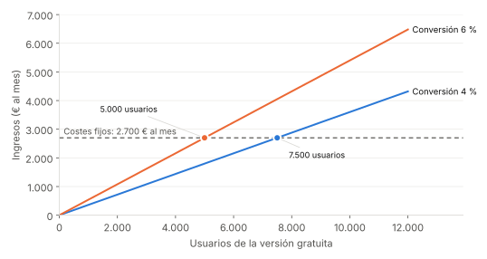
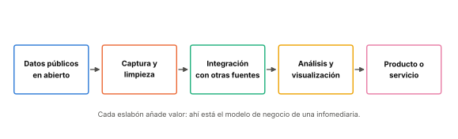

# Tema 5. Empresas infomediarias y oportunidades de negocio {#sec-tema5}

::: {.callout-note appearance="default"}
## Objetivos
- Analizar el ecosistema económico de la reutilización de datos.
- Identificar oportunidades de innovación y emprendimiento basadas en datos abiertos.
:::

::: {.callout-note appearance="simple" icon="false"}
## Glosario del tema
[Sector infomediario](92-glosario.qmd#gl-sector-infomediario) · [Marco 6-V](92-glosario.qmd#gl-6v) · [Freemium](92-glosario.qmd#gl-freemium) · [Punto de equilibrio](92-glosario.qmd#gl-equilibrio) · [Valor añadido](92-glosario.qmd#gl-valor-anadido) · [Compartir igual](92-glosario.qmd#gl-compartir-igual) · [Minería de textos y datos](92-glosario.qmd#gl-tdm) · [Espacio de datos](92-glosario.qmd#gl-espacio-datos) · [Datos sintéticos](92-glosario.qmd#gl-datos-sinteticos)
:::

::: {.callout-tip appearance="simple" icon="false"}
## Descargas
[Script R del capítulo](plantillas/tema5_infomediarias.R){.btn .btn-outline-primary .btn-sm download="tema5_infomediarias.R"}
[Plantilla de informe (.qmd)](plantillas/informe_practica.qmd){.btn .btn-outline-primary .btn-sm download="informe_practica.qmd"}
[Tema de estilo (.scss)](plantillas/informe.scss){.btn .btn-outline-primary .btn-sm download="informe.scss"}
[CSV de práctica](datos/prestamos_bibliotecas_practica.csv){.btn .btn-outline-primary .btn-sm download="prestamos_bibliotecas_practica.csv"}

El script reúne todo el código del capítulo para trabajar en RStudio o Positron. La plantilla `.qmd` y su tema `.scss` sirven para redactar las prácticas opcionales: guárdalos en la misma carpeta.
:::


## Lectura obligatoria

::: {.lectura}
Ahmadi Zeleti, F.; Ojo, A.; Curry, E. (2016). [Exploring the economic value of open government data](https://doi.org/10.1016/j.giq.2016.01.008). *Government Information Quarterly*, 33(3), 535-551. [Versión en acceso abierto (MURAL)](https://mural.maynoothuniversity.ie/12848/1/AO_exploring.pdf).
:::

### Lecturas complementarias {.unnumbered}

- Magalhaes, G.; Roseira, C. (2020). [Open government data and the private sector: An empirical view on business models and value creation](https://doi.org/10.1016/j.giq.2017.08.004). *Government Information Quarterly*, 37(3), 101248. Modelos de negocio de empresas que usan datos abiertos de gobierno.
- Abella, A.; Ortiz-de-Urbina-Criado, M.; De-Pablos-Heredero, C. (2017). [A model for the analysis of data-driven innovation and value generation in smart cities' ecosystems](https://doi.org/10.1016/j.cities.2017.01.011). *Cities*, 64, 47-53. Innovación y generación de valor con datos en ecosistemas urbanos.
- Jetzek, T.; Avital, M.; Bjørn-Andersen, N. (2014). [Data-driven innovation through open government data](https://doi.org/10.4067/S0718-18762014000200008). *Journal of Theoretical and Applied Electronic Commerce Research*, 9(2). Mecanismos por los que los datos abiertos generan valor.

## 1. El sector infomediario

Las empresas **infomediarias** crean productos y servicios de valor añadido a partir de información, en buena parte del sector público, para venderlos a terceros. Se agrupan por el tipo de información que reutilizan: geográfica y cartográfica, económica, financiera y mercantil, jurídica, de mercado y consumo, meteorológica, de movilidad y transporte, sociodemográfica, cultural…

En España, el estudio oficial más reciente de caracterización del sector es el del ONTSI de 2016. Para cifras actuales se usa el informe anual de [ASEDIE](https://www.asedie.es/es/informes-anuales), la asociación del sector, cuya 14.ª edición se presentó en abril de 2026 con datos a 31 de diciembre de 2024. Consulta las cifras en el [resumen de datos.gob.es](https://datos.gob.es/es/noticias/asi-evoluciona-el-ecosistema-infomediario-en-espana-segun-asedie): te harán falta en el cuestionario de Aula Global. Ten en cuenta que los dos estudios no usan la misma metodología, así que sus cifras no son directamente comparables.

El ecosistema no lo forman solo empresas: también participan administraciones que publican, intermediarios de datos, comunidades de desarrolladores, medios de comunicación, centros de investigación y, como mediadoras de la información, las bibliotecas.

## 2. Modelos de negocio basados en datos abiertos

Ahmadi Zeleti et al. proponen el marco **6-V** para describir cómo un negocio crea y captura valor con datos abiertos:

| Componente | Pregunta |
|---|---|
| Propuesta de valor | ¿Qué se ofrece y a quién? |
| Proceso de creación de valor | ¿Qué se hace con los datos para generar ese valor? |
| Valor obtenido (*value in return*) | ¿Qué recibe la organización a cambio? |
| Captura de valor | ¿Cómo se convierte ese valor en ingresos o beneficios? |
| Gestión del valor | ¿Cómo se mantiene y se protege el valor en el tiempo? |
| Red de valor | ¿Con qué socios, proveedores y clientes se crea? |

A partir de ellos agrupan los modelos de negocio en **patrones**, entre ellos *freemium* (servicio básico gratis y funciones avanzadas de pago), *premium* (todo de pago, con valor añadido alto), **ahorro de costes** (los datos abiertos reducen gastos propios), **beneficio indirecto** (los datos se usan para apoyar otro negocio o la reputación) y **«maquinilla y cuchillas»** (algo barato o gratuito que genera ventas recurrentes de otra cosa).

{#fig-equilibrio fig-alt="Dos rectas de ingresos crecientes según el número de usuarios gratuitos, una para conversión del 4 % y otra del 6 %, y una línea horizontal discontinua de costes fijos en 2.700 euros. La recta del 6 % la cruza en 5.000 usuarios y la del 4 % en 7.500."}

## 3. Servicios de valor añadido

Los datos abiertos son materia prima: el valor está en lo que se hace con ellos. Los servicios de valor añadido más habituales son:

| Tipo de servicio | Qué añade | Ejemplo con datos de bibliotecas |
|---|---|---|
| **Agregación** | Reunir fuentes dispersas en un solo lugar | Panel con los préstamos de todos los municipios de una comunidad |
| **Normalización y limpieza** | Datos homogéneos y fiables | Series depuradas como las del Tema 3 |
| **Enriquecimiento** | Cruzar con otras fuentes | Préstamos por cada 1.000 habitantes con datos de población |
| **Análisis y predicción** | Indicadores, tendencias, modelos | Previsión de demanda para planificar compras |
| **Visualización** | Mapas, gráficos, cuadros de mando | Mapa de cobertura bibliotecaria |
| **Acceso programático** | API estables y documentadas | API que sirve los préstamos en JSON |
| **Alertas y personalización** | Información a medida | Aviso de novedades o actividades por barrio |
| **Consultoría** | Interpretación experta | Informe para la renovación de un servicio municipal |

La cadena de valor va de los **datos** (publicados por la administración) a la **información** (datos depurados y combinados) y al **conocimiento** (indicadores y decisiones), una vuelta a la sociedad del conocimiento del Tema 0.

## 4. Emprendimiento e innovación

Emprender con datos abiertos exige lo mismo que cualquier proyecto (un problema real, unos clientes, un modelo sostenible) y algo más: confianza en que los datos seguirán publicándose y se podrán usar legalmente.

- **Herramientas de diseño**: el lienzo de modelo de negocio (*Business Model Canvas*) o su variante *Lean Canvas* ayudan a ordenar la propuesta; el marco 6-V la adapta a los datos.
- **Vías de impulso**: retos y concursos (como los Desafíos Aporta, 2017-2021), *hackatones*, incubadoras y aceleradoras, compra pública de innovación y programas europeos.
- **Innovación abierta**: administraciones y empresas colaboran con comunidades externas para resolver problemas con datos.
- **Riesgos que hay que gestionar**: discontinuidad o cambios en las fuentes, calidad desigual, dependencia de un único publicador y, sobre todo, licencias.

### Licencias al combinar fuentes

Un servicio infomediario suele combinar varias fuentes, y sus obligaciones se acumulan:

| Licencia | Atribución | Compartir igual | Uso comercial |
|---|---|---|---|
| CC0 1.0 | No | No | Sí |
| CC BY 4.0 | Sí | No | Sí |
| CC BY-SA 4.0 | Sí | Sí | Sí |
| ODbL 1.0 | Sí | Sí (base de datos derivada que se distribuya) | Sí |
| CC BY-NC 4.0 | Sí | No | **No** |

Dos matices: la cláusula «compartir igual» de ODbL afecta a la base de datos derivada, no necesariamente a un producto creado a partir de ella (por ejemplo, un mapa impreso); y dos licencias con «compartir igual» distintas pueden ser incompatibles entre sí, por lo que no siempre es posible combinarlas.

## 5. Inteligencia artificial y reutilización de datos

La relación funciona en los dos sentidos.

**Los datos abiertos alimentan la IA.** Son una fuente de datos de entrenamiento y evaluación de modelos. Antes de usarlos hay que revisar:

- La **licencia** de cada fuente y sus obligaciones (atribución, compartir igual, no comercial).
- Las excepciones de **minería de textos y datos** de la Directiva (UE) 2019/790 sobre derechos de autor, y la posibilidad de que los titulares se hayan reservado ese uso.
- La presencia de **datos personales** (RGPD), incluso en conjuntos aparentemente anónimos.
- Las obligaciones del [Reglamento (UE) 2024/1689 de IA](https://eur-lex.europa.eu/eli/reg/2024/1689/oj?locale=es): transparencia frente a los usuarios en ciertos sistemas y, para los modelos de uso general, documentación técnica y un resumen público del contenido usado para el entrenamiento.
- La **calidad** y los **sesgos** de los datos: un recomendador entrenado con préstamos solo de algunas sedes reproducirá sus patrones.

**La IA facilita la reutilización.** Ayuda a generar y mejorar metadatos, detectar errores, clasificar, traducir y consultar datos en lenguaje natural. A cambio, exige verificar los resultados: un modelo puede inventar cifras o referencias.

## 6. Tendencias de futuro

Algunas líneas que ya están en marcha y marcarán los próximos años:

- **Datos de alto valor y API**: obligación de publicar datos clave gratis, por API y en tiempo casi real.
- **Espacios comunes europeos de datos**: entornos de confianza para compartir datos, también privados, por sectores (patrimonio cultural, sanidad, movilidad…). El [Data Spaces Support Centre](https://dssc.eu) los acompaña.
- **Ley de Datos**: acceso de usuarios y terceros a los datos generados por productos conectados, aplicable desde septiembre de 2025.
- **Altruismo de datos e intermediarios de datos**, regulados por el Reglamento de Gobernanza de Datos.
- **IA generativa como interfaz** para encontrar y consultar datos, y como nuevo gran consumidor de datos abiertos.
- **Datos sintéticos** para compartir información sensible protegiendo la privacidad (como el CSV de este libro, a pequeña escala).
- **Medición del impacto**: cada vez se exige más demostrar el valor económico y social de la apertura (dimensión «impacto» del Open Data Maturity).

## Práctica en R

### Paso 1. Un servicio de valor añadido: enriquecer los préstamos (apartado 3)

Cruzamos el CSV limpio con una tabla de población para calcular **préstamos por cada 1.000 habitantes**, un indicador que ninguna de las dos fuentes ofrece por separado.

::: {.callout-warning}
Las cifras de población son **ficticias y redondeadas**, inventadas para el ejercicio. En un servicio real se usarían las del Padrón continuo del INE.
:::

```{webr}
#| autorun: true
b <- read.csv("datos/prestamos_bibliotecas_practica.csv", colClasses = "character")
b <- b[!duplicated(b), ]
clave <- chartr("áéíóúüñ", "aeiouun", tolower(trimws(b$municipio)))
b$municipio <- unname(c(getafe = "Getafe", leganes = "Leganés", alcorcon = "Alcorcón",
                        mostoles = "Móstoles", fuenlabrada = "Fuenlabrada")[clave])
b$prestamos <- as.numeric(ifelse(b$prestamos %in% c("", "n/d"), NA, b$prestamos))
b$prestamos[which(b$prestamos < 0)] <- NA
limpio <- b

poblacion <- data.frame(
  municipio = c("Getafe", "Leganés", "Alcorcón", "Móstoles", "Fuenlabrada"),
  habitantes = c(185000, 190000, 170000, 210000, 190000)   # ficticias
)

por_muni <- aggregate(prestamos ~ municipio, data = limpio, FUN = sum)
enriquecido <- merge(por_muni, poblacion)
enriquecido
```

### Ejercicio 5.1 {.unnumbered}

Añade a `enriquecido` la columna `por_mil` (préstamos por cada 1.000 habitantes, redondeada a un decimal) y devuelve la tabla ordenada de mayor a menor.

```{webr}
#| exercise: t5_valor
#| setup: true
b <- read.csv("datos/prestamos_bibliotecas_practica.csv", colClasses = "character")
b <- b[!duplicated(b), ]
clave <- chartr("áéíóúüñ", "aeiouun", tolower(trimws(b$municipio)))
b$municipio <- unname(c(getafe = "Getafe", leganes = "Leganés", alcorcon = "Alcorcón",
                        mostoles = "Móstoles", fuenlabrada = "Fuenlabrada")[clave])
b$prestamos <- as.numeric(ifelse(b$prestamos %in% c("", "n/d"), NA, b$prestamos))
b$prestamos[which(b$prestamos < 0)] <- NA
poblacion <- data.frame(
  municipio = c("Getafe", "Leganés", "Alcorcón", "Móstoles", "Fuenlabrada"),
  habitantes = c(185000, 190000, 170000, 210000, 190000)
)
enriquecido <- merge(aggregate(prestamos ~ municipio, data = b, FUN = sum), poblacion)
```

```{webr}
#| exercise: t5_valor
enriquecido$por_mil <- round(enriquecido$prestamos / enriquecido$habitantes * ______, 1)
enriquecido[order(enriquecido$por_mil, decreasing = TRUE), ]
```

::: {.hint exercise="t5_valor"}
«Por cada 1.000 habitantes»: multiplica el cociente por 1000.
:::

::: {.solution exercise="t5_valor"}
```r
enriquecido$por_mil <- round(enriquecido$prestamos / enriquecido$habitantes * 1000, 1)
enriquecido[order(enriquecido$por_mil, decreasing = TRUE), ]
```
Getafe queda en cabeza, pero tiene dos bibliotecas en la muestra y los demás municipios una. Un buen servicio de valor añadido debe explicar estas limitaciones a sus clientes.
:::

```{webr}
#| exercise: t5_valor
#| check: true
r <- .result
if (!is.data.frame(r) || !"por_mil" %in% names(r)) {
  list(correct = FALSE, message = "La última línea debe devolver la tabla con la columna por_mil.")
} else {
  esp <- round(r$prestamos / r$habitantes * 1000, 1)
  if (isTRUE(all.equal(r$por_mil, esp)) && !is.unsorted(rev(r$por_mil))) {
    list(correct = TRUE, message = paste0("Correcto: ", r$municipio[1], " encabeza la lista con ", format(r$por_mil[1], decimal.mark = ","), " préstamos por cada 1.000 habitantes."))
  } else if (!isTRUE(all.equal(r$por_mil, esp))) {
    list(correct = FALSE, message = "Revisa el factor: debe ser 1000.")
  } else {
    list(correct = FALSE, message = "Ordena de mayor a menor con decreasing = TRUE.")
  }
}
```

### Paso 2. ¿Es viable un servicio *freemium*? (apartados 2 y 4)

Imagina una empresa que ofrece a las bibliotecas un panel con sus préstamos comparados con los de otros municipios, a partir de datos abiertos. La versión básica es gratuita; la avanzada cuesta una cuota mensual.

```{webr}
#| autorun: true
ingresos_mensuales <- function(usuarios, conversion, precio) {
  usuarios * conversion * precio
}
usuarios   <- 5000    # bibliotecas y profesionales que usan la versión gratuita
conversion <- 0.04    # 4 % pasa a la versión de pago
precio     <- 9       # euros al mes
costes_fijos <- 2700  # euros al mes (servidores, mantenimiento, actualización de datos)

ingresos <- ingresos_mensuales(usuarios, conversion, precio)
c(ingresos = ingresos, costes = costes_fijos, resultado = ingresos - costes_fijos)
```

¿Cómo cambia el resultado con el número de usuarios? Prueba otros valores de conversión y precio:

```{webr}
#| autorun: true
#| fig-height: 4
u <- seq(0, 12000, by = 500)
plot(u, ingresos_mensuales(u, conversion, precio), type = "l", lwd = 2, col = "#000e78",
     xlab = "Usuarios de la versión gratuita", ylab = "Euros al mes",
     main = "Ingresos frente a costes fijos")
abline(h = costes_fijos, lty = 2, col = "firebrick")
legend("topleft", c("Ingresos", "Costes fijos"), lty = c(1, 2), col = c("#000e78", "firebrick"), bty = "n")
```

### Simulador del punto de equilibrio

Mueve los controles y observa cómo cambia el número de usuarios gratuitos necesarios para cubrir los costes.

```{ojs}
//| echo: false
viewof conversion_pct = Inputs.range([1, 12], { value: 4, step: 0.5, label: "Conversión (%)" })
viewof precio_mes = Inputs.range([2, 30], { value: 9, step: 1, label: "Precio (€/mes)" })
viewof costes_mes = Inputs.range([500, 8000], { value: 2700, step: 100, label: "Costes fijos (€/mes)" })
```

```{webr}
#| input:
#|   - conversion_pct
#|   - precio_mes
#|   - costes_mes
#| autorun: true
#| max-lines: 6
#| fig-height: 4
conv <- conversion_pct / 100
equilibrio <- costes_mes / (conv * precio_mes)
u <- seq(0, max(12000, equilibrio * 1.4), length.out = 200)
plot(u, u * conv * precio_mes, type = "l", lwd = 2, col = "#2a78d6", bty = "l",
     xlab = "Usuarios de la versión gratuita", ylab = "Euros al mes",
     ylim = c(0, max(u * conv * precio_mes, costes_mes) * 1.05))
abline(h = costes_mes, lty = 2, col = "#52514e")
points(equilibrio, costes_mes, pch = 19, cex = 1.4, col = "#eb6834")
legend("topleft", bty = "n", legend = c("Ingresos", "Costes fijos"),
       col = c("#2a78d6", "#52514e"), lty = c(1, 2), lwd = c(2, 1))
cat("Punto de equilibrio:", format(round(equilibrio), big.mark = ".", decimal.mark = ","), "usuarios gratuitos\n")
cat("Cada usuario gratuito aporta", format(round(conv * precio_mes, 2), decimal.mark = ","), "€ al mes de media\n")
```

### Ejercicio 5.2 {.unnumbered}

¿Cuántos usuarios de la versión gratuita necesita la empresa para cubrir los costes fijos (punto de equilibrio)? Despeja de `usuarios × conversión × precio = costes fijos`.

```{webr}
#| exercise: t5_equilibrio
#| setup: true
conversion <- 0.04
precio <- 9
costes_fijos <- 2700
```

```{webr}
#| exercise: t5_equilibrio
costes_fijos / (______ * ______)
```

::: {.hint exercise="t5_equilibrio"}
Lo que aporta cada usuario gratuito, de media, es la conversión por el precio.
:::

::: {.solution exercise="t5_equilibrio"}
```r
costes_fijos / (conversion * precio)
```
7.500 usuarios. Cada usuario gratuito aporta de media 0,36 € al mes.
:::

```{webr}
#| exercise: t5_equilibrio
#| check: true
if (isTRUE(all.equal(as.numeric(.result), 7500))) {
  list(correct = TRUE, message = "Correcto: 7.500 usuarios. Con 5.000 la empresa pierde dinero: ¿qué palanca moverías, la conversión o el precio?")
} else {
  list(correct = FALSE, message = "Divide los costes fijos entre lo que aporta cada usuario: conversion * precio.")
}
```

### Ejercicio 5.3 {.unnumbered}

La empresa mejora la versión de pago y consigue una **conversión del 6 %** manteniendo el precio. ¿Cuál es ahora el resultado mensual (ingresos menos costes) con 5.000 usuarios?

```{webr}
#| exercise: t5_conversion
#| setup: true
ingresos_mensuales <- function(usuarios, conversion, precio) usuarios * conversion * precio
costes_fijos <- 2700
```

```{webr}
#| exercise: t5_conversion
ingresos_mensuales(usuarios = 5000, conversion = ______, precio = 9) - costes_fijos
```

::: {.solution exercise="t5_conversion"}
```r
ingresos_mensuales(usuarios = 5000, conversion = 0.06, precio = 9) - costes_fijos
```
:::

```{webr}
#| exercise: t5_conversion
#| check: true
if (isTRUE(all.equal(as.numeric(.result), 0))) {
  list(correct = TRUE, message = "Correcto: 0 €. Con un 6 % de conversión, 5.000 usuarios es justo el punto de equilibrio.")
} else if (isTRUE(all.equal(as.numeric(.result), 267300))) {
  list(correct = FALSE, message = "Has escrito 6 en lugar de 0.06: la conversión es una proporción.")
} else {
  list(correct = FALSE, message = "Escribe la conversión como proporción: 6 % = 0.06.")
}
```

### Paso 3. Obligaciones al combinar licencias (apartado 4)

Codificamos la tabla de licencias como un *data frame* y escribimos una función que, dadas varias fuentes, acumula sus obligaciones.

```{webr}
#| autorun: true
licencias <- data.frame(
  licencia        = c("CC0 1.0", "CC BY 4.0", "CC BY-SA 4.0", "ODbL 1.0", "CC BY-NC 4.0"),
  atribucion      = c(FALSE, TRUE, TRUE, TRUE, TRUE),
  compartir_igual = c(FALSE, FALSE, TRUE, TRUE, FALSE),
  uso_comercial   = c(TRUE, TRUE, TRUE, TRUE, FALSE)
)

obligaciones <- function(fuentes) {
  l <- licencias[licencias$licencia %in% fuentes, ]
  c(atribucion      = any(l$atribucion),
    compartir_igual = any(l$compartir_igual),
    uso_comercial   = all(l$uso_comercial))
}

obligaciones(c("CC0 1.0", "CC BY 4.0"))
```

`any()` es `TRUE` si al menos una fuente lo exige; `all()` es `TRUE` solo si todas lo permiten.

### Ejercicio 5.4 {.unnumbered}

Un servicio combina el padrón municipal (CC BY 4.0) con datos de OpenStreetMap (ODbL 1.0). Calcula sus obligaciones.

```{webr}
#| exercise: t5_licencias
#| setup: true
licencias <- data.frame(
  licencia        = c("CC0 1.0", "CC BY 4.0", "CC BY-SA 4.0", "ODbL 1.0", "CC BY-NC 4.0"),
  atribucion      = c(FALSE, TRUE, TRUE, TRUE, TRUE),
  compartir_igual = c(FALSE, FALSE, TRUE, TRUE, FALSE),
  uso_comercial   = c(TRUE, TRUE, TRUE, TRUE, FALSE)
)
obligaciones <- function(fuentes) {
  l <- licencias[licencias$licencia %in% fuentes, ]
  c(atribucion = any(l$atribucion), compartir_igual = any(l$compartir_igual), uso_comercial = all(l$uso_comercial))
}
```

```{webr}
#| exercise: t5_licencias
obligaciones(c("______", "______"))
```

::: {.hint exercise="t5_licencias"}
Escribe los nombres de las licencias exactamente como aparecen en la tabla `licencias`.
:::

::: {.solution exercise="t5_licencias"}
```r
obligaciones(c("CC BY 4.0", "ODbL 1.0"))
```
Hay que atribuir ambas fuentes y, si se distribuye la base de datos derivada, hacerlo con ODbL. El uso comercial está permitido.
:::

```{webr}
#| exercise: t5_licencias
#| check: true
esp <- c(atribucion = TRUE, compartir_igual = TRUE, uso_comercial = TRUE)
if (identical(.result, esp) && grepl("ODbL 1.0", .user_code, fixed = TRUE) && grepl("CC BY 4.0", .user_code, fixed = TRUE)) {
  list(correct = TRUE, message = "Correcto: atribución y compartir igual (por ODbL), con uso comercial permitido.")
} else {
  list(correct = FALSE, message = "Comprueba que los nombres coinciden exactamente con los de la tabla, por ejemplo \"ODbL 1.0\".")
}
```

### Ejercicio 5.5 {.unnumbered}

Si se añade una tercera fuente con licencia **CC BY-NC 4.0**, ¿puede la empresa vender el servicio? Devuelve solo el valor de `uso_comercial`.

```{webr}
#| exercise: t5_nc
#| setup: true
licencias <- data.frame(
  licencia        = c("CC0 1.0", "CC BY 4.0", "CC BY-SA 4.0", "ODbL 1.0", "CC BY-NC 4.0"),
  atribucion      = c(FALSE, TRUE, TRUE, TRUE, TRUE),
  compartir_igual = c(FALSE, FALSE, TRUE, TRUE, FALSE),
  uso_comercial   = c(TRUE, TRUE, TRUE, TRUE, FALSE)
)
obligaciones <- function(fuentes) {
  l <- licencias[licencias$licencia %in% fuentes, ]
  c(atribucion = any(l$atribucion), compartir_igual = any(l$compartir_igual), uso_comercial = all(l$uso_comercial))
}
```

```{webr}
#| exercise: t5_nc
o <- obligaciones(c("CC BY 4.0", "ODbL 1.0", ______))
o[["______"]]
```

::: {.solution exercise="t5_nc"}
```r
o <- obligaciones(c("CC BY 4.0", "ODbL 1.0", "CC BY-NC 4.0"))
o[["uso_comercial"]]
```
`FALSE`: basta una fuente no comercial para que el servicio no pueda venderse. Por eso CC BY-NC no es una licencia abierta según la Open Definition (Tema 0).
:::

```{webr}
#| exercise: t5_nc
#| check: true
if (identical(.result, FALSE) && grepl("CC BY-NC 4.0", .user_code, fixed = TRUE)) {
  list(correct = TRUE, message = "Correcto: FALSE. Una sola fuente NC impide el uso comercial del conjunto.")
} else {
  list(correct = FALSE, message = "Añade \"CC BY-NC 4.0\" a las fuentes y selecciona el elemento \"uso_comercial\".")
}
```

{#fig-v14-valor fig-alt="Cinco recuadros en fila unidos por flechas: datos públicos en abierto, captura y limpieza, integración con otras fuentes, análisis y visualización, producto o servicio. Debajo: cada eslabón añade valor; ahí está el modelo de negocio de una infomediaria."}

## Caso práctico resuelto

::: {.callout-note appearance="simple" icon="false"}
## Diseñar un servicio infomediario viable
Una empresa infomediaria quiere ofrecer a bibliotecas informes comparativos de uso basados en datos abiertos de varias comunidades autónomas.

1. **Necesidad:** las bibliotecas quieren compararse con otras parecidas, pero los datos están dispersos y en formatos distintos.
2. **Datos:** estadísticas de bibliotecas públicas abiertas, población por municipio (INE), equipamientos.
3. **Proceso:** extracción automática, normalización de nombres y unidades, control de calidad, cálculo de indicadores comparables.
4. **Producto:** panel e informe anual con municipios similares (por población y presupuesto).
5. **Modelo:** suscripción para redes de bibliotecas; versión gratuita con indicadores básicos.
6. **Diferenciación:** el valor no está en los datos (abiertos para todos), sino en la integración, la limpieza y el análisis.
:::

## Ejercicios graduados

**Básico.** ¿Por qué una empresa puede cobrar por un servicio basado en datos abiertos gratuitos?

::: {.webex-solution boton="Ver solución"}
Porque cobra por el valor añadido: integración de fuentes, limpieza, actualización continua, análisis, visualización y soporte, que tienen un coste y ahorran trabajo al cliente.
:::

**Avanzado.** Esboza el modelo de negocio (lienzo de propuesta de valor) de un servicio infomediario para el sector de la información.

::: {.webex-solution boton="Ver solución"}
Debe describir el segmento de clientes, sus problemas, la propuesta de valor, los datos abiertos que se usan, los recursos y actividades clave, los ingresos y los costes, y los riesgos de dependencia de las fuentes.
:::


## Actividades

::: {.clasificar #ia-t5-modelos titulo="¿Qué modelo de negocio es?" categorias="Freemium|Suscripción|Servicios a medida|Publicidad|Venta de informes"}
- Consulta básica gratuita y funciones avanzadas de pago → Freemium
- Una cuota mensual por acceder a una API con datos limpios → Suscripción
- Un ayuntamiento encarga un cuadro de mando de sus bibliotecas → Servicios a medida
- Una aplicación gratuita de horarios que muestra anuncios → Publicidad
- Un estudio sectorial anual elaborado con datos públicos → Venta de informes
:::

::: {.escenario #ia-t5-emprender titulo="Una idea de negocio con datos abiertos"}
Quieres crear una aplicación que recomiende la biblioteca más cercana con salas libres, combinando datos municipales.

### La idea {#t5e-inicio}
¿Qué compruebas primero?

- [Si hay personas dispuestas a usarla y qué necesitan](#t5e-usuarios)
- [Cómo programar la aplicación](#t5e-codigo)

### Empezar por el código {#t5e-codigo .final .regular}
Sin saber si alguien la necesita ni si los datos lo permiten, corres el riesgo de construir algo que nadie usará.

### Las personas usuarias {#t5e-usuarios}
Las entrevistas confirman el interés. Ahora miras los datos.

- [Compruebo la licencia, la frecuencia de actualización y si los datos de ocupación existen](#t5e-datos)
- [Doy por hecho que, si están en el portal, sirven](#t5e-supuesto)

### Supuesto arriesgado {#t5e-supuesto .final .mal}
Descubres después que la ocupación de las salas no se publica y que el conjunto se actualiza una vez al año: la idea no es viable tal como estaba planteada.

### Datos revisados {#t5e-datos}
Los horarios y ubicaciones están en abierto (CC BY 4.0), pero la ocupación en tiempo real no se publica.

- [Pido al ayuntamiento que publique la ocupación y, mientras, lanzo una versión con horarios y ubicaciones](#t5e-bien)
- [Copio la ocupación de su web con un programa sin preguntar](#t5e-scraping)

### Sin permiso {#t5e-scraping .final .mal}
Extraer datos de una web sin revisar sus condiciones puede incumplirlas y hace tu servicio frágil: un cambio en la web lo rompe.

### Producto mínimo viable {#t5e-bien .final .bien}
Empiezas con lo que los datos permiten, citas la fuente como exige la licencia y conviertes la carencia en una petición de datos: así funciona el ecosistema de la reutilización.
:::

## Reto evaluable {#reto-t5}

::: {.callout-important appearance="simple" icon="false"}
## Reto del Tema 5 · Propuesta de un servicio infomediario
Diseña un servicio de valor añadido para bibliotecas, archivos o su público que combine **al menos dos fuentes de datos abiertos con licencias distintas**:

1. Describe el servicio, sus usuarios y el valor que añade frente a consultar directamente las fuentes.
2. Identifica las licencias y calcula con `obligaciones()` qué exige y qué permite el servicio resultante.
3. Elige un modelo de negocio y calcula con `punto_equilibrio()` los usuarios necesarios en tres escenarios (pesimista, base y optimista). Justifica los supuestos.
4. Analiza los riesgos: dependencia del publicador, actualización de los datos, calidad y cambios de licencia.

**Entrega:** un informe hecho con la [plantilla de informe](plantillas/informe_practica.qmd), renderizado a HTML o PDF, con el código visible y el conjunto de datos citado. Se evalúa con la rúbrica que incluye la plantilla. Este reto **no tiene solución en el libro**: cada estudiante trabaja con datos distintos y la corrección la hace el profesorado.
:::

Espacio de trabajo (no se corrige automáticamente):

```{webr}
source("datos/datareuseR.R")
fuentes <- c("CC BY 4.0", "ODbL 1.0")   # las licencias de tus fuentes
obligaciones(fuentes)
escenarios <- data.frame(
  escenario  = c("pesimista", "base", "optimista"),
  conversion = c(0.02, 0.04, 0.06),
  precio     = c(9, 9, 12),
  costes_mes = c(3000, 2700, 2700)
)
escenarios$usuarios_necesarios <- with(escenarios, punto_equilibrio(costes_mes, conversion, precio))
escenarios
```

## Autoevaluación

Responde a todas las preguntas y pulsa **Mostrar respuestas**: verás en verde las acertadas, en rojo las falladas y tu recuento. Puedes corregir y volver a comprobar. No cuenta para la nota.

::: {.webex-check .webex-box}
1. Combinar una fuente CC BY 4.0 con otra CC BY-NC 4.0 permite vender el servicio resultante. 
2. Un servicio con un nivel gratuito y funciones avanzadas de pago sigue el patrón 
3. Con costes fijos de 3.000 € al mes, una conversión del 5 % y un precio de 10 €, el punto de equilibrio es de  usuarios gratuitos.
4. ¿Qué componente del marco 6-V responde a «¿con qué socios, proveedores y clientes se crea el valor?»?



5. Cruzar los préstamos con la población para obtener préstamos por cada 1.000 habitantes es un servicio de 
6. Completa el código: los préstamos por cada 1.000 habitantes se calculan como `prestamos / habitantes *` 
:::

::: {.webex-solution boton="Ver explicaciones"}
- Una sola fuente no comercial impide el uso comercial del conjunto.
- *Freemium* combina un nivel gratuito y otro de pago.
- 3000 / (0,05 × 10) = 6.000 usuarios.
- La red de valor reúne a los socios, proveedores y clientes.
- Enriquecer es cruzar con otras fuentes para obtener información nueva.
- Se multiplica el cociente por 1000.
:::

## Para practicar fuera del libro

::: {.callout-tip appearance="simple"}
En tu ordenador tienes las funciones de este tema en el paquete [`datareuseR`](90-chuleta-r.qmd#sec-datareuser): `punto_equilibrio()` y `obligaciones()`.
:::

En grupo, idead un servicio que combine al menos dos conjuntos de datos abiertos. Describidlo con los seis componentes del marco 6-V, calculad su punto de equilibrio con la función `ingresos_mensuales()` y comprobad las obligaciones de licencia con `obligaciones()`. Presentadlo en 5 minutos.

## Recursos complementarios

| Recurso | Para qué sirve |
|---|---|
| [ASEDIE – Informes anuales](https://www.asedie.es/es/informes-anuales) | Informe anual del sector infomediario |
| [datos.gob.es – Así evoluciona el ecosistema infomediario según ASEDIE](https://datos.gob.es/es/noticias/asi-evoluciona-el-ecosistema-infomediario-en-espana-segun-asedie) | Cifras de la 14.ª edición |
| [Estudio de caracterización del sector infomediario 2016 (ONTSI)](https://datos.gob.es/sites/default/files/doc/file/estudio_de_caracterizacion_del_sector_infomediario_2016_0.pdf) | Último estudio oficial |
| [datos.gob.es – Empresas reutilizadoras](https://datos.gob.es/es/empresas) | Directorio de empresas españolas |
| [Desafíos Aporta](https://datos.gob.es/es/desafios-aporta) | Ideas y productos premiados (2017-2021) |
| [Open Data Institute](https://theodi.org) | Modelos de negocio y ecosistemas de datos |
| [data.europa.eu – Open data business models](https://data.europa.eu/sites/default/files/report/open-data-business-models-value-disciplines.pdf) | Informe europeo sobre modelos de negocio |
| [Data Spaces Support Centre](https://dssc.eu) | Espacios de datos europeos |
| [Reglamento (UE) 2024/1689 de IA](https://eur-lex.europa.eu/eli/reg/2024/1689/oj?locale=es) | Obligaciones de transparencia y datos |
